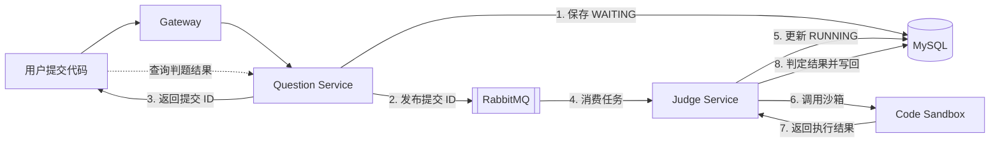
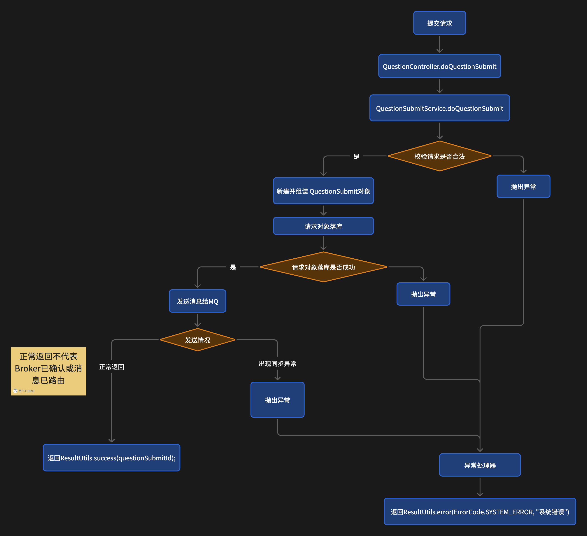
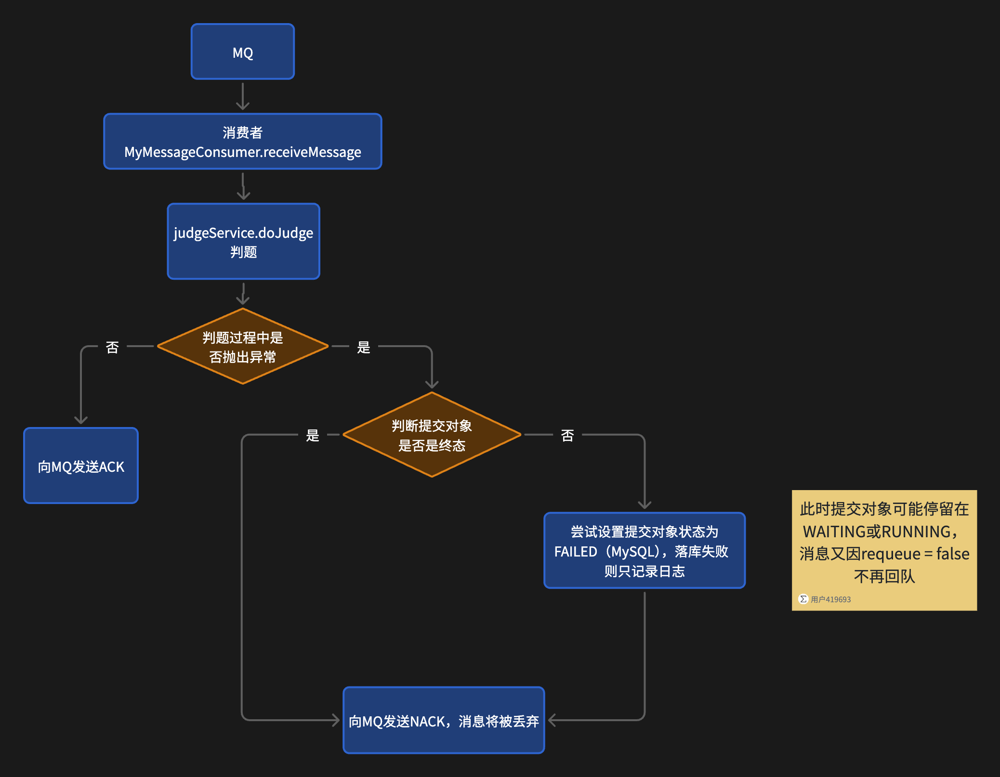
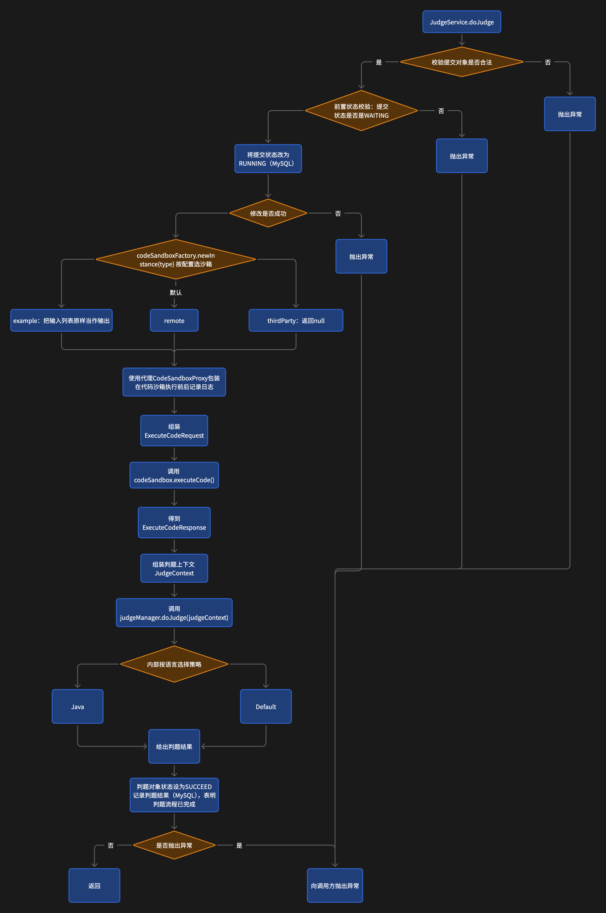

# CodeOJ：基于 Spring Cloud 的在线判题系统

CodeOJ 是我基于 **Spring Cloud + Vue 3** 实现的微服务在线判题系统，覆盖用户与题目管理、代码提交、RabbitMQ 异步判题、代码沙箱执行和判题结果查询。

我梳理了提交、消息消费与判题执行三条核心源码流程，并绘制了对应流程图。

赛事平台二次开发已加入可靠判题、比赛快照/资格、秒杀报名、恢复对账、成绩榜单和最终结算，三个业务开关默认关闭。实施与证据见 [赛事开发记录](docs/contest/README.md)。[J6本机真实联调](docs/contest/j6-native-local.md)使用独立MySQL/Redis/RabbitMQ、会话、网关、Feign和原生Java沙箱，保留失败与修复记录；静态实例发现不等于Nacos验收。

可运行 `./scripts/demo-local-contest.sh` 查看H2与真实Java结算样例；`./scripts/test-native-stack.sh` 在macOS arm64下载固定原生运行时，显式使用可信 native 样例模式及临时独立实例和真实浏览器，结束后清理，不安装全局服务。运行依赖和命令见J6记录。

新增[隔离执行器与持久化回收](docs/contest/isolated-sandbox.md)：默认 `isolated` 模式要求 Linux Docker/cgroup v2、固定镜像及共享本地登记目录；缺失配置时拒绝启动，不降级为宿主执行。完整链路启用可靠判题并提供 execution token/deadline；旧版无执行身份的演示流程仅适用于显式 `native` 可信样例模式。本轮已允许临时 Linux 容器环境用于功能验收，部署和压测继续后置。

## 核心功能

- 用户注册、登录、Spring Session Redis 共享登录态和角色鉴权；
- 题目创建、编辑、查询和提交记录管理；
- RabbitMQ 异步传递判题任务；
- 判题服务调用代码沙箱执行程序，并使用判题策略生成结果；
- 查询提交状态、执行信息和 AC、WA 等判题结果。

## 技术栈

| 方向 | 技术 |
|---|---|
| 后端 | Java 8、Spring Boot 2.6.13、Spring Cloud Alibaba、MyBatis-Plus、OpenFeign |
| 数据与消息 | MySQL 8、Redis、Spring Session、RabbitMQ、Nacos |
| 前端 | Vue 3、TypeScript、Vue Router、Vuex、Arco Design、Monaco Editor |
| 工程 | Maven 多模块、Docker Compose、OpenAPI TypeScript Codegen |

## 系统架构

```text
Vue 3
  |
  | /api/**
  v
Gateway :8101
  |-- /api/user/**     -> User Service :8102
  |-- /api/question/** -> Question Service :8103 -> MySQL
  `-- /api/judge/**    -> Judge Service :8104
                                  ^
Question Service -- RabbitMQ -----|
                                  |
                                  `-- HTTP -> Code Sandbox :8090

Redis       Spring Session 共享登录态
Nacos       服务注册与发现
RabbitMQ    判题任务异步传递
MySQL       用户、题目、提交和判题结果
```

## 运行与学习入口

Mac arm64 的完整本机入口：`./scripts/local-stack.sh verify` 自动构建、启动真实依赖与隔离判题、验证后清理；`serve` 前台运行至 Ctrl+C。前提、就绪检查和范围见[完整启动方案](docs/contest/local-startup.md)。

- [运行、演示与交接](docs/contest/handoff.md)：固定开发版本、可信样例、真实依赖/浏览器、完整隔离复验及清理边界。
- [报名恢复修复](docs/contest/registration-recovery.md)：Lua 中断/丢响应、旧快照预留序号、V005 与累计报名上限。
- [源码阅读与成果测试](docs/learning/03-链路.md)：受理、状态、Outbox/租约、隔离回收，以及赛事报名/榜单和鉴权。
- [项目讲解与面试追问](docs/learning/04-面试.md)：当前实现、源码依据、追问和可陈述边界。

## 基础版本判题链路

以下图示描述可靠判题开关关闭时的旧业务流程，旧调用需显式可信 native 模式；新版可靠路径为“受理事务/固定规格 → Outbox → claim/续租 → 隔离执行 → 带身份写回 → 计分”。详见上面的源码链路，不能用旧图推断新版没有 Outbox 或恢复机制。

用户提交代码后，题目服务先保存提交记录，再将提交 ID 投递到 RabbitMQ。判题服务异步消费任务，将状态更新为 `RUNNING`，调用代码沙箱执行程序，通过判题策略生成结果，最后把流程状态和 `judgeInfo` 写回数据库。



### 1. 提交与任务投递

提交接口完成请求参数、编程语言和题目校验后，以 `WAITING` 状态保存提交记录，再通过 `RabbitTemplate` 将提交 ID 发送到 RabbitMQ。消息发送方法正常返回后，接口向前端返回提交 ID。



> 图中的异常出口为主流程的简化表达：业务异常会保留对应错误码和消息，其他运行时异常由全局异常处理器转换为系统错误。

### 2. MQ 消费与消息确认

消费者收到提交 ID 后调用判题服务。判题正常完成时发送 ACK；出现异常时，消费者检查提交记录是否已经进入终态，必要时尝试将状态写为 `FAILED`，随后发送不重新入队的 NACK。



### 3. 沙箱执行与结果判定

判题服务读取题目和提交信息，校验提交状态后将其更新为 `RUNNING`。服务通过工厂选择代码沙箱，使用代理记录调用日志，再把沙箱输出交给判题策略处理，最终将流程状态更新为 `SUCCEED` 并保存 `judgeInfo`。



`SUCCEED` 表示判题流程已经完成；代码是否通过由 `judgeInfo` 中的 AC、WA 等结果表示。

## 实现要点

### 异步判题

题目服务只负责校验请求、保存提交记录和发布任务，耗时的代码执行由判题服务异步完成。接口可以先返回提交 ID，前端再查询判题状态和结果。

### 状态流转

提交记录以 `WAITING` 状态创建，判题开始后更新为 `RUNNING`，流程结束后写为 `SUCCEED`；消费或判题异常时，消费者尝试写为 `FAILED`。

### 沙箱抽象

`CodeSandboxFactory` 根据配置选择沙箱实现，`CodeSandboxProxy` 统一包装沙箱调用。判题服务通过 `ExecuteCodeRequest` 和 `ExecuteCodeResponse` 与沙箱交互，降低业务编排与执行实现之间的耦合。

### 判题策略

`JudgeManager` 根据提交语言选择判题策略。Java 使用 `JavaLanguageJudgeStrategy`，其他情况进入默认策略，策略根据测试用例、程序输出、时间和内存信息生成 `JudgeInfo`。

## 模块说明

| 模块 | 职责 |
|---|---|
| `codeoj-backend-gateway` | API 路由、CORS 和内部接口请求头校验 |
| `codeoj-backend-user-service` | 注册、登录、用户管理和 Session 读写 |
| `codeoj-backend-question-service` | 题目管理、提交入库、MQ 发布和结果持久化接口 |
| `codeoj-backend-judge-service` | MQ 消费、判题编排、沙箱调用和策略判定 |
| `codeoj-backend-codesandbox` | 隔离编译/用例执行、持久化身份/容量与残留回收；显式可信 native 模式 |
| `codeoj-backend-service-client` | OpenFeign 内部接口、请求头和权限切面 |
| `codeoj-backend-model` | 跨服务实体、DTO、枚举和沙箱契约 |
| `codeoj-backend-common` | 通用响应、异常、注解和工具 |
| `codeoj-frontend` | Vue 3 页面和 TypeScript API 客户端 |

## 本机演示与复现

先准备 JDK 8 和 Maven，再从仓库根目录运行可信样例：

```bash
./scripts/demo-local-judge.sh
./scripts/demo-local-contest.sh
```

前者演示五类判题结果，后者以 H2、真实 Java 和手动事件分发演示赛事结算，均不能代替 MySQL/MQ/HTTP 或容器隔离验收。原生样例需要允许 `ps` 采集 RSS，缺失资源指标时会拒绝判定。

macOS arm64 的真实依赖/浏览器入口为 `./scripts/test-native-stack.sh`，完整隔离验收还需私有 Linux Docker/cgroup v2 和固定镜像；前提、参数、预期输出和清理步骤见[交接文档](docs/contest/handoff.md)。临时验收环境已删除，仓库没有常驻演示服务。

仓库的两套 Compose 保留作历史环境模板，未装配本轮隔离后端或验证 Nacos。新版业务需数据库迁移及显式业务开关，默认 isolated 的启动条件见[隔离配置](docs/contest/isolated-sandbox.md)，不能把历史模板视为当前一键启动交付。部署和压测继续后置。

## 当前实现说明

- 提交语言枚举包含 `java`、`cpp` 和 `go`，当前完整代码执行链路以 Java 为主；
- 默认隔离沙箱按提交/用例创建 Linux 容器；可信 native 模式不提供恶意代码隔离。配置和受支持的共享容量边界见[隔离执行器说明](docs/contest/isolated-sandbox.md)；
- 可靠判题已实现事务 Outbox、每次发布的 Confirm/Return/UNKNOWN 留痕、带代次/token/期限的领取及回写、有限恢复与人工处理；旧生产者/消费者仅保留作基础版分支；
- 赛事提交固定判题规格，报名以 MySQL 确认资格，Redis 负责预留；榜单按结果事实重建并保留最终版本；
- `bc35142` 完成固定版本的本机 JV01—JV29、隔离、权限和浏览器验收，具体数字及边界见[报告](outputs/validation/isolation-20261022/report.md)，不据此宣称生产或吞吐指标。

## 参考与致谢

本项目基于程序员鱼皮的 [OJ 在线判题系统项目实战教程](https://www.codefather.cn/course/1790980707917017089/section/1790992688770232322) 完成。项目的需求设计、整体架构和实现思路参考课程；本人跟随教程逐步完成代码实现，并整理了模块说明、源码阅读路径和核心流程图。

项目代码和相关材料的使用、传播应遵守原课程及相关素材的授权要求。
