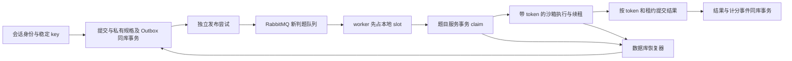

# J2：可靠判题的本机开发记录

日期：2026-10-17。代码基线仍为 `b2f43551a4929babe6f5b8be22007670f18767b9`；J1/J2 修改尚未提交、推送。当前源文件哈希、工作区补丁与测试分类见 [J2 证据目录](../../outputs/validation/j2-local-20261017/)。

本轮实现可靠提交、执行权和恢复的主路径，保持 Java 8 / Spring Boot 2.6.13 / Spring AMQP 2.4.7。开发阶段不启动部署、Docker 或压测。真实 MySQL/RabbitMQ 尚未运行，不能把 H2 或消息替身结果记成真实依赖验收。

## 数据与调用链



未另建服务或引入分布式事务。方案中的提交扩展字段实现为一对一的 `submission_execution` 权威表：它与 `question_submit`、`judge_spec`、`reliable_outbox` 同库、同事务写入。旧记录没有该表行，保留旧语义，不回填伪造的 acceptedAt、资源或 attempt。这样旧实体查询在迁移兼容期不必依赖新增列。

[V001 增量 SQL](../../codeoj-backend/mysql-init/migrations/V001__reliable_judging.sql) 新增六张表：`judge_spec`、`submission_execution`、`judge_attempt`、`reliable_outbox`、`publish_attempt`、`operation_audit`，并把旧 `code` 字段扩大到 MEDIUMTEXT，容纳既有 256KiB 源码预算。该 SQL 尚未在真实 MySQL 执行，也不会由应用自动重置或初始化数据库。

## 已实现的行为

- `ReliableSubmissionService` 校验请求并调用独立代理 Bean `SubmissionAcceptance`。`(userId,requestKey)` 数据库唯一；相同内容重放返回原 ID，不同内容返回 HTTP 409。唯一冲突在事务完整回滚后回读；死锁等暂时失败最多重试三笔完整事务。
- 请求哈希绑定 PRACTICE、题目 ID、语言和完整源码，不含追踪 ID。判题规格保存当时的用例、限制、TEXT_V1 比较规则及内容哈希；排队后修改/删除原题，不改变已受理任务。
- 会话仅用于确定身份。新受理在事务中锁定同库当前账户行，拒绝封禁/删除账户。管理员重试同样在事务内复核当前角色，防止旧会话保留已撤销权限；新查询入口及可靠模式下的旧列表代码脱敏也复核管理员当前角色。
- claim 在行锁之后读取数据库 UTC 时间，检查事件 ID、调度代次、QUEUED、到期时间和总额度，然后创建 attempt/token。心跳和结果要求 token、attempt、有效租约、单次期限、总期限同时成立。
- 结果事务同时更新提交、关闭 attempt、写 `JUDGE_RESULT` Outbox；练习通过统计在同事务只累加一次。相同终态结果重放幂等；矛盾终态或旧结果拒绝并留审计。
- `JUDGE_RESULT` 目前只持久化，等待 J5 成绩投影接入。当前 relay 只发布 `JUDGE_DISPATCH`，不能把这些待消费结果事件宣称为已经计分。
- Outbox 每次发送前先持久化 publish_attempt。Confirm ACK、NACK、Return、发送异常、未知 Confirm 分别记证据。ACK+Return 不是路由成功；同步异常仍为 UNKNOWN；晚到失败不撤销其他尝试的 ACK，已明确的单次证据不可覆盖。
- 新消息只含 eventId、submissionId、dispatchGeneration、payloadVersion 和 traceId。持久消息、持久交换机/队列、mandatory、correlated Confirm、独立隔离队列均已配置；毒消息拒绝且不修改业务状态，实际 Broker 路由仍未验证。
- worker 先占本地 slot 再 claim。无 slot 先持久化延后状态再 ACK。任务平台失败先写 RETRY_WAIT/NEEDS_ATTENTION；无法查询或落盘时不 ACK，并采用有限上限的退避后重投。重复/过期代次和另一有效执行者不会被写成 FAILED。
- 内部 RPC 使用既有内部鉴权。错误返回非 2xx，claim 响应必须明确包含 claimed，缺失值不能被解读为 false 后误 ACK。旧通用实体更新入口在可靠模式下不能改新权威提交。
- 扫描长 QUEUED、到期 RETRY_WAIT 与过期 RUNNING，原子递增调度代次并写新事件。多次扫描同一恢复点只产生一个新代次；Broker Confirm 不会令业务扫描失效。
- 管理员查询可定位提交、attempt、发布证据和审计。诊断投影不含源码、用例、规格内容或完整 token。人工重试要求 reason 和 expectedVersion，不能改已完成判定；耗尽后必须显式增加有限尝试/调度额度或恢复期限，累计 attempt 不清零，策略前后值留档。

## 第一版有限策略

| 项目 | 当前值/规则 |
| --- | --- |
| recoveryPolicyVersion | 初始 1；显式追加预算后递增 |
| 单提交自动执行尝试 | 最多 3 次，用户 verdict 不重试 |
| 单提交自动调度代次 | 最多 10 代；长 QUEUED 阈值 30 秒 |
| 总恢复期限 | 数据库受理后 15 分钟，自动恢复不重置 |
| attempt 期限 | 最多 60 秒，受总期限截断 |
| 数据库租约 | 15 秒，worker 每 5 秒尝试续租 |
| 平台失败退避 | 2/4/8…秒，最大 60 秒；仍受上述总额度限制 |
| 同事件发布尝试 | 最多 20 次，15 秒 Confirm 租约；未知结果保留证据 |
| 自动任务扫描 | 默认每秒，恢复最多 50 条、发布最多 20 条；每条业务变更独立事务 |
| worker/sandbox 默认 slot | 每实例分别为 2；不把数据库 token 当作物理资源限制 |
| 无法持久化后的消费退避 | 2/4/8/16/30 秒，不立即无限热重入 |
| 人工追加 | 单次最多 10 次执行、10 代调度、3600 秒；累计执行/调度上限 100，期限不超过本次数据库时间后一小时 |

关键时间使用 UTC DATETIME(6)，通过 JDBC 4.2 LocalDateTime 按字面 UTC 读写，避免使用 JVM 默认时区转换租约。DB 时间在获取行锁之后读取。客户端时间不参与受理与租约判断；worker 的本地时钟不延长数据库执行资格。

## 本机执行身份的边界

请求可携带 executionToken 和数据库给出的 attempt 期限。原生执行器对同 token 的并发/重复请求复用同一 Future，内容不符拒绝；过期 token 不启动。缓存上限 64 个结果，保留至 token 期限后 60 秒，并定期清理；新请求不能通过无限缓存占满内存。

这是单个存活管理器内的去重。它不持久化执行登记，不能声称重启后可找回原 JVM，也不保证跨管理器只执行一次。有效业务结果由数据库 fencing 保证，物理执行可能重复。残留进程树、持久执行登记、跨重启终止、容器级资源与网络隔离仍未完成，JV25 只有部分本机证据。

## API 与前端

保留 `/api/question` 服务前缀；尚未增加方案中 `/api/submissions`、`/api/admin` 的网关别名。

| 实际接口 | 规则 |
| --- | --- |
| POST `/api/question/question_submit/do` | 可靠模式要求稳定 Idempotency-Key；兼容 requestKey 请求体字段，两者不一致 409；返回原 BaseResponse<Long>，可靠受理 HTTP 202 |
| GET `/api/question/submissions/{id}` | 本人/当前管理员；包含 executionStatus、acceptedAt（UTC ISO-8601）、activeAttempt；隐藏内部执行身份 |
| GET `/api/question/admin/operations?page=0` | 当前管理员；每页 50 条非完成任务 |
| GET `/api/question/admin/operations/{id}?page=0` | 当前管理员；分页查看执行、发布、审计信息，每类明细每页最多 100 条 |
| POST `/api/question/admin/operations/{id}/retry` | reason、expectedVersion、可选有限额度追加；同业务 ID，不清空历史 |
| POST `/api/question/inner/execution/{claim,heartbeat,complete,fail,defer}` | 既有内部密钥与网关拦截；前端不可直接调用 |

前端为同一份待确认提交保存稳定随机 key，sessionStorage 只保存内容指纹与 key，网络错误不自动换 key；已确认成功才清理。源码有意变化则视作新的提交操作。列表展示 QUEUED/RUNNING/RETRY_WAIT/COMPLETED/NEEDS_ATTENTION，优先显示 acceptedAt。浏览器实链尚未运行；生成 SDK 的新增字段/header 做了最小手工对齐，待真实 OpenAPI 服务可用后应统一重新生成。

## 切换与兼容约束

`RELIABLE_JUDGE_ENABLED` 默认 false。题目/判题服务都打开后才启用新写入、发布、恢复和新消费者；默认值不代表这些能力已经在当前机器运行。迁移与旧 `code_queue` 在途记录核对/排空必须先完成，不能让新旧消费者按不同状态规则修改同一记录。

已有新数据后，不能把关闭开关或回退旧二进制当作安全回滚：关闭可靠模式后仍有新队列/新状态，必须先核对并停止写入，保留新权威状态可读和新任务的处理能力。没有删除表、清空队列或清零 attempt 的回滚脚本。真实切换演练属于未验证项，本轮不执行部署。

## 验证与限制

最终功能测试为 83 个：模型 4、题目服务 37、判题服务 27、原生执行器 15；失败 0、错误 0、跳过 0。四个空基础设施 contextLoads 仍显式排除，不算通过。启用两项原生 RSS 用例的完整命令：

```sh
export JAVA_HOME="$(/usr/libexec/java_home -v 1.8)"
export PATH="$JAVA_HOME/bin:$PATH"
mvn -B -f codeoj-backend/pom.xml -Dcodeoj.native-observation=true test
```

H2 2.2.224 为 Java 8 兼容测试依赖。测试执行同一迁移 SQL，移除了 H2 不支持的字符集/排序规则，并用测试别名模拟 UTC_TIMESTAMP(6)；不能验证 MySQL 二进制排序、JDBC 时区、锁范围、隔离级别、崩溃持久性或真实 Broker 行为。

| 状态 | 本轮证据 |
| --- | --- |
| PASS | H2 真事务回滚、两线程同 key/同消息竞争、冻结规格、重复完成、租约过期/旧 token 拒绝、恢复代次、预算耗尽与人工追加 |
| PASS | 发布未来回调、Return、未知结果、毒消息、ACK/退避、worker 先占 slot；这些是消息/服务替身契约测试 |
| PASS | 当前账户/角色、旧会话降权、他人代码脱敏、RPC 错误非 200、诊断不暴露 token/规格 |
| PASS | 真实 Java 子进程同 token 只启动一次、过期 token 不启动；原有五类判题演示回归 |
| PASS | Java 8 全模块打包、前端构建；前端仍有既有 lint/dependency/bundle 警告 |
| FAIL | 本轮没有未解释的功能测试失败 |
| BLOCKED/UNTESTED | 真实 MySQL SQL/锁/事务故障、RabbitMQ 断连/Confirm 丢失/DLX、多实例恢复、旧队列切换、真实浏览器/API 全链路 |
| UNTESTED/未完成 | 原生管理器跨重启登记与回收、提交级容器隔离、任意进程树回收；计分事件尚未接 J5 |

这不是 J2 全部 JV 用例通过，也不是生产可用性结论。下一阶段为 J3 比赛与资格业务，真实依赖验证边界继续保留。

## 学习入口与参考

从 `ReliableSubmissionService.accept` → `SubmissionAcceptance.accept` 看受理与冲突回读；从 `OutboxStore` → `OutboxRelay` 看事件与单次发送证据；从 `ReliableJudgeConsumer` → `ReliableJudgeWorker` → `ExecutionCommands` 看 ACK、领取、续租及结果。最后读 `ExecutionRecovery` 和 `manualRetry`，解释“自动重试有界”与“人工显式追加额度”的区别。

DianPing 当前 `VoucherOrderHandler.createOrder` 和 `SeckillOrderPublisher.send` 提供了事务处理与发送尝试分离的参考，本轮未复制订单实体，也未复用其测试成绩。核对了 [RabbitMQ Confirm/消费确认语义](https://www.rabbitmq.com/docs/confirms)、[MySQL 8.0 锁定读](https://dev.mysql.com/doc/refman/8.0/en/innodb-locking-reads.html)、[Spring 5.3 声明式事务](https://docs.spring.io/spring-framework/docs/5.3.23/reference/html/data-access.html#transaction-declarative-annotations)；Spring AMQP 2.4.7 的 CorrelationData/Future/Returned API 另以实际依赖字节码核验，没有依赖新版 RabbitMQ 专属功能。
