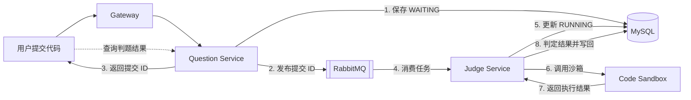

# 基础版本判题流程与图解

本页从整理前的项目 README 拆出，保存课程基础版本的流程说明与三张流程图。描述的是可靠判题开关关闭时的旧分支；其中部分实现细节也可能早于后续修复。学习当前实现请转到[源码链路](../learning/03-链路.md)，当前验证范围见[项目状态](../status.md)。

以下图示描述可靠判题开关关闭时的旧业务流程，旧调用需显式可信 native 模式；新版可靠路径为“受理事务/固定规格 → Outbox → claim/续租 → 隔离执行 → 带身份写回 → 计分”。详见[当前源码链路](../learning/03-链路.md)，不能用旧图推断新版没有 Outbox 或恢复机制。

用户提交代码后，题目服务先保存提交记录，再将提交 ID 投递到 RabbitMQ。判题服务异步消费任务，将状态更新为 `RUNNING`，调用代码沙箱执行程序，通过判题策略生成结果，最后把流程状态和 `judgeInfo` 写回数据库。

## 1. 提交与任务投递

提交接口完成请求参数、编程语言和题目校验后，以 `WAITING` 状态保存提交记录，再通过 `RabbitTemplate` 将提交 ID 发送到 RabbitMQ。消息发送方法正常返回后，接口向前端返回提交 ID。

> 图中的异常出口为主流程的简化表达：业务异常会保留对应错误码和消息，其他运行时异常由全局异常处理器转换为系统错误。

## 2. MQ 消费与消息确认

消费者收到提交 ID 后调用判题服务。判题正常完成时发送 ACK；出现异常时，消费者检查提交记录是否已经进入终态，必要时尝试将状态写为 `FAILED`，随后发送不重新入队的 NACK。

## 3. 沙箱执行与结果判定

判题服务读取题目和提交信息，校验提交状态后将其更新为 `RUNNING`。服务通过工厂选择代码沙箱，使用代理记录调用日志，再把沙箱输出交给判题策略处理，最终将流程状态更新为 `SUCCEED` 并保存 `judgeInfo`。

`SUCCEED` 表示判题流程已经完成；代码是否通过由 `judgeInfo` 中的 AC、WA 等结果表示。

## 实现要点

### 异步判题

题目服务只负责校验请求、保存提交记录和发布任务，耗时的代码执行由判题服务异步完成。接口可以先返回提交 ID，前端再查询判题状态和结果。

### 状态流转

提交记录以 `WAITING` 状态创建，判题开始后更新为 `RUNNING`，流程结束后写为 `SUCCEED`；消费或判题异常时，消费者尝试写为 `FAILED`。

### 沙箱抽象

`CodeSandboxFactory` 根据配置选择沙箱实现，`CodeSandboxProxy` 统一包装沙箱调用。判题服务通过 `ExecuteCodeRequest` 和 `ExecuteCodeResponse` 与沙箱交互，降低业务编排与执行实现之间的耦合。

### 判题策略

`JudgeManager` 根据提交语言选择判题策略。Java 使用 `JavaLanguageJudgeStrategy`，其他情况进入默认策略，策略根据测试用例、程序输出、时间和内存信息生成 `JudgeInfo`。
