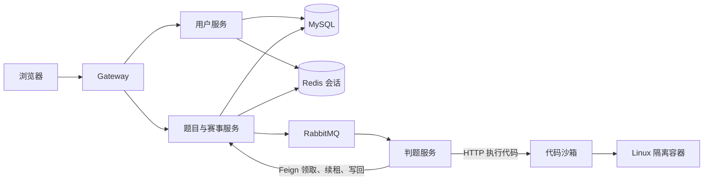

# 01 从零认识 CodeOJ：业务、架构与阅读路线

这套资料面向这样的起点：能读懂 Spring Boot 的 Controller、Service、Mapper 和基本 SQL，了解 Redis、RabbitMQ 的用途，但还不能把 CodeOJ 的完整流程串起来。目标是读完文档和关键源码后，能介绍项目、画出调用链，并解释面试追问中的设计与故障场景。

先读本篇，再按[完整链路](03-链路.md)走一遍。模块篇负责展开代码，最后用[面试篇](04-面试.md)检查自己是否真的理解。本文依据当前工作区源码重写；运行证据及未验证范围统一见[项目状态](../status.md)。

## 1. 项目解决什么问题

CodeOJ 是在线判题与赛事平台。对用户而言，最基本的功能是：打开题目、编写 Java 程序、提交，然后知道程序是否正确。对比赛而言，还要解决发布试题、限额报名、资格检查、计分和结算。

“判题”比一次普通 CRUD 多了两件事。第一，服务器要真正编译、运行用户上传的代码，执行时间较长，也可能遇到死循环。第二，要把运行输出与隐藏的标准答案比较，不能因为程序退出成功就判为正确。

因此业务分成三个角色：题目服务接收并保存提交，判题服务组织一次判题，沙箱实际执行代码。用户提交后拿到 ID，稍后查询结果。这就是异步判题。

| 用户动作 | 系统实际要完成的事 | 学习时要追到的终点 |
| --- | --- | --- |
| 登录 | 校验密码，建立共享会话 | 后续题目请求能识别当前账号 |
| 浏览题目 | 查询题干、限制并隐藏测试答案 | 页面能做题，但拿不到隐藏用例 |
| 提交程序 | 保存代码与判题依据，安排后台执行 | 查到本次提交的最终判定 |
| 报名比赛 | 预留名额，再确认参赛资格 | MySQL 中存在确认资格 |
| 参加比赛 | 按已发布试题和比赛窗口受理代码 | 判题结果归属正确的比赛与题目 |
| 查看榜单 | 从判题事实计算成绩，处理迟到结果 | 排名可解释、可重建、可结算 |

### 基础功能和二次开发怎样区分

课程基础流程包括用户与题目管理、提交、MQ 异步消费、远程沙箱和判题策略。当前扩展的重点是可靠判题、固定规格、租约恢复、隔离执行与回收、比赛快照、异步报名、榜单与结算。它们都要从当前代码中理解，不能把旧教程中的类名直接当成当前主链。

学习时先理解“提交后最终能看到答案”的正常流程，再逐步加入“断网、重复消息、进程崩溃时怎么办”。这样每个新增机制都有对应的问题。

## 2. 先记住各部分的职责

图中 MQ 发送实际由题目服务的 Outbox 发布器完成；成绩事件还会回到题目服务的榜单消费者。先掌握上述方向，再读各自细节。

| 仓库模块 | 可以把它理解成 | 关键职责 |
| --- | --- | --- |
| `codeoj-frontend` | 用户的操作界面 | 发请求、保存重试身份、展示状态 |
| `codeoj-backend-gateway` | 对外 API 入口 | 按路径转发、限制内部接口访问 |
| `codeoj-backend-user-service` | 账号服务 | 注册、登录、查询当前账号 |
| `codeoj-backend-question-service` | 业务事实的主要管理者 | 题目、提交、执行状态、赛事、资格、榜单 |
| `codeoj-backend-judge-service` | 判题任务执行者 | 消费事件、领取任务、调用沙箱、比较答案、写回 |
| `codeoj-backend-codesandbox` | 用户程序的运行环境 | 编译、运行、资源限制、物理对象回收 |
| `codeoj-backend-common` | 通用工具与约定 | 响应、错误码、异常、权限注解 |
| `codeoj-backend-model` | 各层共享的数据类型 | DTO、实体、VO、消息和沙箱协议 |
| `codeoj-backend-service-client` | 服务之间的调用合同 | Feign 接口、账号解析、内部鉴权 |

后端模块和版本以[父 POM](../../codeoj-backend/pom.xml)为准：Java 8、Spring Boot 2.6.13、Spring Cloud。不要把 Maven 模块数当成独立部署进程数：common、model、service-client 是依赖库。

### 三种中间件分别存什么

MySQL 存“已经受理哪份代码、谁有执行权、谁有资格、最后结果是什么”。RabbitMQ 负责通知“有任务需要处理”。Redis 有三种不同用途：共享登录会话、报名预留账本、榜单页缓存。报名账本具有恢复意义，不能因为榜单缓存可重建，就把所有 Redis 数据都当作可随意删除的缓存。

## 3. 用三个故事建立全貌

### 故事一：普通练习

小林打开一道求和题，提交读取 `1 2` 并输出 `3` 的 Java 代码。题目服务保存代码和当时的隐藏用例，记录“等待判题”，返回提交 ID。后台发布消息；判题服务领取任务，把代码与输入交给沙箱。沙箱运行得到 `3`，判题策略比较标准答案，写回 AC。页面再次查询，显示结果。

这里有两个返回：提交接口返回“受理 ID”，查询接口返回“执行状态与判定”。提交 HTTP 成功不代表 AC。

### 故事二：限额报名

小林抢到 Redis 中的一份预留，页面先显示确认中；确认消息消费后，MySQL 条件扣减剩余容量并生成资格，才能显示已报名。即使前端拿到预留响应，比赛提交时仍检查数据库资格。

你已学过秒杀，相关基础无需重学。重点看当前为什么增加请求账本、未知状态恢复、关闸对账和版本检查，见[赛事与报名](02-模块/07-赛事与报名.md)。

### 故事三：比赛和榜单

管理员发布比赛时固定题目快照。小林比赛中提交的代码引用这个版本；判题完成后产生结果事件。榜单依据提交受理时间计算每题最早 AC，消息晚到也可能使排名变化。比赛时间结束后，还需等未决判题和报名收敛，才可完成最终结算。

## 4. 推荐阅读顺序

按下面路线读，不要求先逐个目录翻完。

| 轮次 | 阅读内容 | 读源码时完成的动作 | 完成标志 |
| --- | --- | --- | --- |
| 第一轮：串流程 | 本篇 → [链路 1、2](03-链路.md#1-一次提交如何受理) | 从提交按钮跟到结果查询，先只走正常分支 | 能画出浏览器、题目服务、MQ、判题、沙箱之间的箭头 |
| 第二轮：补基础业务 | [前端](02-模块/01-前端.md) → [用户与鉴权](02-模块/02-公共层与用户服务.md) → [题目与受理](02-模块/03-网关与题目服务.md) | 找到登录、题目脱敏、受理事务和结果 VO | 能说明“谁调用、读写什么、返回什么” |
| 第三轮：判题设计 | [判题与 MQ](02-模块/04-判题服务与消息队列.md) → [沙箱](02-模块/05-代码沙箱.md) → [链路 3、4](03-链路.md#3-消息重复或进程崩溃后如何恢复) | 加上重复、超时、宕机和回收分支 | 能解释每种故障由谁恢复、旧结果在哪被拒绝 |
| 第四轮：赛事扩展 | [赛事与报名](02-模块/07-赛事与报名.md) → [榜单与结算](02-模块/08-榜单与结算.md) | 对照已学秒杀，手算名额和乱序计分 | 能区分预留/资格、受理时间/完成时间、实时榜/最终榜 |
| 第五轮：表达与验证 | [运行配置](02-模块/06-部署与运行.md) → [面试练习](04-面试.md) | 画图、口述、读对应测试断言 | 能回答追问，并指出当前实现与未验证边界 |

每篇模块文档都有“先读哪个方法、如何理解、练习与核对”。遇到术语先看它保护的业务动作，不要先背定义。

## 5. 阅读前确认分支

仓库保留两条判题流程，普通提交的分叉在 [QuestionSubmitServiceImpl.doQuestionSubmit](../../codeoj-backend/codeoj-backend-question-service/src/main/java/com/codeoj/codeojbackendquestionservice/service/impl/QuestionSubmitServiceImpl.java)。

| 条件 | 实际阅读路线 |
| --- | --- |
| `RELIABLE_JUDGE_ENABLED=true` | `ReliableSubmissionService → SubmissionAcceptance → Outbox → ReliableJudgeConsumer → ReliableJudgeWorker` |
| 可靠判题关闭 | `MyMessageProducer → MyMessageConsumer → JudgeServiceImpl`，只作基础版本对照 |
| `ASYNC_REGISTRATION_ENABLED=true` 且单场采用 Redis 模式 | Redis 预留与异步确认报名 |
| 单场 `DB_SYNC` | 同步数据库报名，不能拿它解释 Redis 故障恢复 |
| `SCOREBOARD_ENABLED=true` | 结果投影、榜单缓存与结算 |

本套教程主体讲可靠判题及赛事扩展。业务开关默认关闭，学习当前主链时应核对运行脚本注入的配置；迁移需要 V001—V005。沙箱默认 `isolated`，`native` 是显式可信样例模式。旧链路对照见[历史图解](../history/legacy-judge-walkthrough.md)，实际启动见[运行配置](02-模块/06-部署与运行.md)。

## 6. 第一遍需要认识的数据

| 名称 | 白话解释 | 出现的位置 |
| --- | --- | --- |
| `question` | 题库中的题目和当前判题设置 | 浏览和普通练习 |
| `question_submit` | 用户交上来的程序及兼容展示结果 | 一次提交 |
| `judge_spec` | 这次判题固定使用的用例、限制、比较规则 | 受理与领取 |
| `submission_execution` | 这份提交目前由谁执行、处于什么阶段 | 执行状态与恢复 |
| `judge_attempt` | 每次执行尝试的记录 | 领取、失败、完成 |
| `reliable_outbox` | 已落库、待发布的业务事件 | 判题、报名、成绩通知 |
| `publish_attempt` | 某个事件每次发送的确认记录 | 发布重试 |
| `contest_problem_snapshot` | 比赛发布时固定的题目版本 | 比赛提交 |
| `contest_registration_request` / `contest_registration` | 报名处理请求 / 最终资格 | 报名确认 |
| 榜单投影与回执表 | 从结果算出的排名 / 已处理事件记录 | 计分与重建 |

第一次不用背全部字段。先记住：提交、执行、事件、资格、排名是不同业务对象，所以需要不同记录。

## 7. 学到什么程度可以开始面试练习

不看文档，完成下面四项：

1. 画一次提交从按钮到最终显示的时序，标出异步边界和结果查询。
2. 指出受理事务写入哪些数据，并解释为什么事务中不直接调用 MQ 和沙箱。
3. 给出消息重复、worker 被杀、结果写库后未 ACK 三个场景的处理过程。
4. 讲清比赛快照、报名资格和计分规则各自接在判题主链的哪里。

如果某一步只能背类名，回对应模块读“输入、处理、输出”和示例。完成这四项后，再用面试篇练习两分钟介绍与深入追问。

第一遍可略读样式、论坛、重复 CRUD、全部 DTO 字段及历史部署细节；题目创建、登录鉴权、关键 SQL、判题策略、报名和榜单仍在本套资料中覆盖。学习范围与是否通过生产验收是两件事，后者只引用[当前证据](../status.md)。
