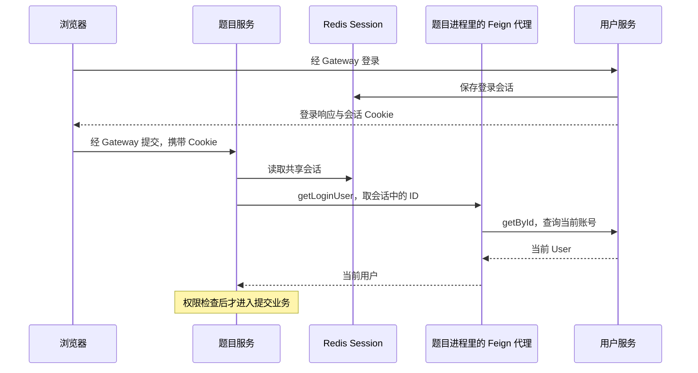

# 链路一：登录、跨服务获取用户与权限检查

这条链解决两个问题：**浏览器怎样保持登录？题目服务怎样知道当前用户及其权限？**

先建立服务关系，再读登录和后续请求。正文只给源码位置、方法作用和阅读重点，不复制源码。

**本篇导航：** [全局](#1-全局关系哪些在同一进程哪些需要网络) → [正常请求](#2-正常流程从登录到下一次业务请求) → [机制与设计](#3-机制与设计解释刚才的账号查询) → [变化与故障](#4-第二遍沿同一请求分析变化和故障) → [练习](#5-跟读练习先识别当前用户再观察降权) → [自测](#6-阅读检查)

## 本篇怎样分遍阅读

先按第 2 节完整跟一次登录与下一次题目请求；纸上只画两条请求线。第 3 节解释这条线上各组件为什么存在，第 4 节再改一个条件推演降权或故障。最后用第 5、6 节核对。

## 1. 全局关系：哪些在同一进程，哪些需要网络

| 角色 | 运行在哪里 | 负责什么 |
| --- | --- | --- |
| 浏览器 | 用户电脑 | 发登录请求，后续携带会话 Cookie |
| Gateway | 独立 Java 进程 | 将 /api/user、/api/question 等请求路由到服务 |
| 用户服务 | 独立 Java 进程 | 查询 user 表、校验密码、提供当前账号数据 |
| 题目服务 | 另一个 Java 进程 | 处理题目和提交，需要知道当前用户 |
| service-client | 被各服务依赖的 JAR | 提供 Feign 声明和共享解析逻辑，本身不监听端口 |
| Redis | 独立存储 | 保存 Spring Session，使多个业务服务可识别同一会话 |

**关键区别：** 两个服务依赖相同 JAR，只是各自加载了相同类型；不会因此共享同一个 Java 对象或 Spring 容器。

```text
第一次：浏览器 → Gateway → 用户服务 → 校验账号密码 → 保存 Redis 会话
                                    ← 返回登录资料与会话 Cookie
下一次：浏览器携带 Cookie → Gateway → 题目服务 → 识别当前用户后处理业务
```

## 2. 正常流程：从登录到下一次业务请求

### 2.1 登录页面把账号密码交给用户服务

| 按顺序读 | 方法作用 | 先看哪些内容 |
| --- | --- | --- |
| [UserLoginView.vue](../../codeoj-frontend/src/views/user/UserLoginView.vue) 的 handleSubmit | 发送登录表单、更新页面登录状态 | userLoginUsingPost、成功分支、store 和跳转 |
| [userLogin](../../codeoj-backend/codeoj-backend-user-service/src/main/java/com/codeoj/codeojbackenduserservice/controller/UserController.java)<br>UserController | 解析登录 DTO，调用业务 Service | 参数校验、委托、响应包装 |
| [userLogin](../../codeoj-backend/codeoj-backend-user-service/src/main/java/com/codeoj/codeojbackenduserservice/service/impl/UserServiceImpl.java)<br>UserServiceImpl | 校验凭据并建立会话 | 账号查询、密码验证、setAttribute、返回 VO |

登录请求经 Gateway 到用户服务；此时题目服务还未参与。页面收到登录成功后，下一次请求才利用会话继续业务。

若需要理解注册，再读 [UserServiceImpl.userRegister](../../codeoj-backend/codeoj-backend-user-service/src/main/java/com/codeoj/codeojbackenduserservice/service/impl/UserServiceImpl.java)：检查账号/两次密码、查询重复、BCrypt 编码、保存用户和默认昵称。

注册得到账号，登录建立会话，是两个动作。

### 2.2 查到账号并校验密码

继续 userLogin：先按账号查询 User，再交给 checkPassword 验证输入。校验失败就抛异常，下面的会话保存不会发生；本例用户 7 验证通过，继续到 setAttribute。

历史密码升级也是这里调用的兼容步骤，详细算法集中在第 3.8 节。现在先确认“密码通过后才建立会话”，再沿同一个请求往下读。

### 2.3 setAttribute 为什么会写到 Redis

**先读配置：** 用户、题目服务中的 spring.session、Redis 地址/编号、Cookie path。然后回到 userLogin 中保存 USER_LOGIN_STATE 的调用。

Spring Session 的过滤器包装了请求，使业务仍使用 HttpSession API，底层会话由 Redis 支撑。业务没有直接调用 RedisTemplate，并不表示登录态只在本机内存。

参见 [HttpSession 集成说明](https://docs.spring.io/spring-session/reference/http-session.html)。

| 位置 | 保存什么 | 不能混成什么 |
| --- | --- | --- |
| Cookie | 会话标识 | 不是当前角色的可信副本 |
| Redis Session | USER_LOGIN_STATE 对应的用户对象等会话数据 | 不是 user 表的实时状态 |
| 前端 store | 页面展示和导航用的登录资料 | 不是后端授权依据 |
| MySQL user | 当前账号、角色、删除状态与密码摘要 | 是刷新账号的来源 |

多个业务服务需要共享相容的会话配置。Cookie path=/api、Redis 编号和序列化等条件不一致，会出现“这里登录了，另一个服务却不认识”。

### 2.4 下一次请求先找 ID，再查当前账号

登录请求已经返回。现在浏览器携带 Cookie 向题目服务提交程序，这是第二条 HTTP 请求。题目服务先识别用户 7，暂时还不接受程序。

按下面顺序读，不要同时跳进所有类：

| 顺序 | 方法 | 作用与输入输出 |
| --- | --- | --- |
| 1 | [getLoginUser](../../codeoj-backend/codeoj-backend-service-client/src/main/java/com/codeoj/codeojbackendserviceclient/service/UserFeignClient.java)<br>UserFeignClient | 接收当前请求，把解析工作交给 requireLogin |
| 2 | [requireLogin](../../codeoj-backend/codeoj-backend-service-client/src/main/java/com/codeoj/codeojbackendserviceclient/auth/SessionUserResolver.java)<br>SessionUserResolver | 调用 permitNull；没有有效用户时抛未登录错误 |
| 3 | [permitNull](../../codeoj-backend/codeoj-backend-service-client/src/main/java/com/codeoj/codeojbackendserviceclient/auth/SessionUserResolver.java)<br>SessionUserResolver | 从现有 Session 取 User 的 ID，调用 lookup，再检查当前账号 |
| 4 | UserFeignClient.getById | 接收刚取出的 ID，经 HTTP 查询当前 User |
| 5 | UserInnerController.getById | 在用户服务调用本地数据库查询，返回实体 |

**阅读边界：** 先读 permitNull 的正常路径，停在返回 current；下一轮再看会话缺失、删除和封禁。

### 2.5 把当前账号交回题目业务

假设浏览器已登录，题目服务收到一次提交请求，会话里保存着用户 7。下面是教学推演，不是本轮运行日志。



> 图中 getLoginUser 的逻辑在题目服务进程内执行。真正发 HTTP 的是它后续调用的 getById。

| 顺序 | 当前执行位置 | 手上有什么数据 | 这一步交给谁 |
| --- | --- | --- | --- |
| 1 | 题目服务的 Session 解析逻辑 | 当前 HttpServletRequest、Redis 还原的 Session | 取出旧 User 对象中的 ID=7 |
| 2 | UserFeignClient 的 default getLoginUser | userId=7，查询回调是代理的 getById | 调用 lookup.apply(7) |
| 3 | 调用方 Feign 代理 | 逻辑服务名、/api/user/inner/get/id、参数 7 | 向用户服务实例发 GET，请求参数为 userId=7 |
| 4 | 用户服务 UserInnerController | 已解析的 long userId=7 | 调用本地 userService.getById(7) |
| 5 | 用户服务数据库查询 | 当前 user 表记录 | 返回当前角色、删除状态等账号信息 |
| 6 | 题目服务 SessionUserResolver | 远端返回的当前 User | 验证 ID、删除与封禁，再交给调用者 |

**跨网络的是什么？** 这一条内部请求携带用户 ID 和服务鉴权头；没有把 HttpServletRequest 对象发到用户服务，也不需要把浏览器 Cookie 原样转发给 getById。

**为什么可以这样做？** 题目服务已经通过共享 Session 找到了用户 ID。远端需要补的是“这个 ID 现在对应什么账号”，而不是重新解析一次浏览器请求。

如果根本没有有效 Session，permitNull 会在调用 lookup 前返回空，因此不能把 default getLoginUser 理解成“每次调用都必定发一次 HTTP”。

#### 从辅助方法回到业务

lookup 返回以后，先回 permitNull 完成账号状态检查，再回 requireLogin，最后回调用 getLoginUser 的 Controller 或权限切面。不要从 UserInnerController 又重新开始读整个登录接口。

打开 [QuestionController.doQuestionSubmit](../../codeoj-backend/codeoj-backend-question-service/src/main/java/com/codeoj/codeojbackendquestionservice/controller/QuestionController.java) 或 [AuthInterceptor.doInterceptor](../../codeoj-backend/codeoj-backend-service-client/src/main/java/com/codeoj/codeojbackendserviceclient/aop/AuthInterceptor.java)，定位 getLoginUser 的下一行：前者把当前用户带入提交业务，后者继续比较 mustRole。

### 2.6 业务继续前检查角色和操作条件

现在已经得到当前 User；接下来要判断本次操作是否允许。角色检查与资源归属各有作用，通过后才继续提交受理。

| 方法 | 作用 | 为什么放在这里 |
| --- | --- | --- |
| [doInterceptor](../../codeoj-backend/codeoj-backend-service-client/src/main/java/com/codeoj/codeojbackendserviceclient/aop/AuthInterceptor.java)<br>AuthInterceptor | 读取 AuthCheck.mustRole，获取当前用户，满足角色才 proceed | 为带注解的方法执行通用权限检查 |
| [requireAccount](../../codeoj-backend/codeoj-backend-question-service/src/main/java/com/codeoj/codeojbackendquestionservice/submission/ExecutionRepository.java)<br>ExecutionRepository | 查当前数据库账号；可检查指定角色并加行锁 | 关键写事务里再次确认账号状态 |
| Controller 的本人/管理员检查 | 比较资源归属与当前身份 | 通用角色不能替代具体资源权限 |

**阅读顺序：** 先看 doInterceptor 的 mustRole 分支，再在实际 Controller 找一个注解调用；最后在受理或赛事事务定位 requireAccount。

AOP 由 Spring 代理在方法入口执行。它不是网关魔法，也不会自动覆盖所有没有注解的内部调用。业务仍需明确检查参赛资格、资源归属等条件。

## 3. 机制与设计：解释刚才的账号查询

正常请求已走通。现在回到“题目服务为何能使用用户服务的数据”，依次解释远程代理、两套入口、方法引用、浏览器凭据和服务鉴权。下面各节用于说明原因，不再启动一条新业务线。

### 3.1 Spring 为调用方创建代理

先打开 [CodeojBackendQuestionServiceApplication](../../codeoj-backend/codeoj-backend-question-service/src/main/java/com/codeoj/codeojbackendquestionservice/CodeojBackendQuestionServiceApplication.java) 和 [UserFeignClient](../../codeoj-backend/codeoj-backend-service-client/src/main/java/com/codeoj/codeojbackendserviceclient/service/UserFeignClient.java)。

| 声明 | 在这里起什么作用 |
| --- | --- |
| @EnableFeignClients | 扫描 service-client 中的 Feign 接口，为调用方注册客户端 Bean |
| @FeignClient 的 name | 指定目标逻辑服务名 codeoj-backend-user-service |
| @FeignClient 的 path | 指定远程接口公共前缀 /api/user/inner |
| getById 上的 @GetMapping | 指定 HTTP 方法和方法路径 /get/id |
| 参数上的 @RequestParam | 将 Java 参数映射为请求查询参数 userId |
| 返回类型 User | 将远端响应转换为调用方使用的 User 对象 |

调用方注入的是 Feign 创建的客户端代理。代理根据接口声明构造请求、定位服务地址、发送 HTTP、解析响应；你不需要手写这段网络客户端逻辑。

参见 [OpenFeign 3.1.5 文档](https://docs.spring.io/spring-cloud-openfeign/docs/3.1.5/reference/html/)。

例如 getById 的远程请求路径为 **/api/user/inner/get/id**，userId 作为查询参数。服务名还需要解析为实例地址：当前本机脚本使用静态发现，不能把 name 本身当成固定 URL，也不能认定本轮使用了 Nacos。

**接着读：** [run-native-stack.py](../../scripts/local/run-native-stack.py) 生成 simple discovery 实例地址的位置。理解地址从配置来即可，第一遍不必进入 Feign 框架内部类。

### 3.2 为什么还需要 UserInnerController

| 文件/对象 | 所在一端 | 方法被调用后实际做什么 |
| --- | --- | --- |
| UserFeignClient 的客户端代理 | 题目服务等调用方 | 把接口方法转成远程请求 |
| UserInnerController | 用户服务提供方 | 接收 HTTP，调用本地 UserService 查询数据库 |
| UserServiceImpl | 用户服务提供方 | 执行当前进程里的业务与数据访问 |

打开 [UserInnerController.getById](../../codeoj-backend/codeoj-backend-user-service/src/main/java/com/codeoj/codeojbackenduserservice/controller/inner/UserInnerController.java)：它把 userId 交给本地 userService.getById，返回查询结果。

这里 implements UserFeignClient 用于对齐方法签名，**并不让题目服务直接拿到这个 Controller 对象**。两个进程之间仍有 HTTP 和序列化。

共享契约的收益与升级耦合，在第 3.3.1 节结合两套入口继续解释。

### 3.3 两套 HTTP 入口：为什么公开接口与内部接口分开

源码对照：[UserController](../../codeoj-backend/codeoj-backend-user-service/src/main/java/com/codeoj/codeojbackenduserservice/controller/UserController.java)、[UserInnerController](../../codeoj-backend/codeoj-backend-user-service/src/main/java/com/codeoj/codeojbackenduserservice/controller/inner/UserInnerController.java)、[用户服务 context-path 配置](../../codeoj-backend/codeoj-backend-user-service/src/main/resources/application.yml)。

| 对照项 | 面向浏览器的公开接口 | 面向业务服务的内部接口 |
| --- | --- | --- |
| 例子 | /api/user/login、/api/user/get/login | /api/user/inner/get/id、/api/user/inner/get/ids |
| Controller | UserController | UserInnerController |
| 主要调用者 | 登录页面、前端 store | 题目服务等 Feign 调用方 |
| 关键输入 | 账号密码，或浏览器会话 | 明确的用户 ID / ID 集合 |
| 成功响应 | BaseResponse 包装的 LoginUserVO 等 | getById 直接返回 User，listByIds 返回列表 |
| 主要目的 | 登录、展示本人资料和公开业务 | 提供内部查询能力，供其他服务完成业务判断 |
| 访问控制 | 用户身份与业务权限 | 内部服务凭据，及调用业务自身的权限约束 |

**为什么不能只留一个 get/login？** 公开 get/login 的任务是按当前浏览器请求返回脱敏登录资料。内部 get/id 的任务是按明确 ID 查询账号，供本服务刷新角色或批量组装业务数据，两者输入和返回契约不同。

路径也分两端理解：客户端 path 是要请求的远程前缀；提供方由 context-path=/api/user、Controller 的 /inner 和方法 /get/id 拼出实际路由。

> 内部接口返回实体不意味着可以向浏览器公开实体。它是更受限的服务契约，内部凭据也必须保护。

### 3.3.1 设计推演：两套入口分开的到底是什么

用户 7 的浏览器要表达“登录”或“查看我的资料”；题目服务要表达“按 ID=7 查当前账号”。两者都有用户信息，但输入、调用者和允许返回的字段不同，因此用公开 Controller 与 InnerController 分开表达契约。

**两套入口分别表达调用契约与信任条件，复用同一份用户业务。** UserController 和 UserInnerController 都在用户服务内，继续复用本地 UserService。service-client 则是调用方依赖的契约 JAR，既不保存另一份用户数据库，也不单独启动一个 Client 服务。

| 设计动作 | 当前机制带来的收益 | 必须接受的代价或边界 |
| --- | --- | --- |
| 浏览器使用公开 DTO/VO，服务查询使用内部契约 | 公开展示与内部账号判断各取所需 | 内部返回 User 更完整，内部路径和服务凭据必须受保护 |
| 调用方写 Feign 接口，提供方由 Controller 接收 | HTTP 路径、参数和 Java 类型集中声明，业务代码无需手拼请求 | 接口看似本地调用，仍可能超时、服务不可用或响应不兼容 |
| 多模块引用 service-client | 复用远程声明和账号解析规则 | 修改公共类型会影响多个模块；同一份源码不保证线上两端已同步升级 |

阅读 [UserFeignClient](../../codeoj-backend/codeoj-backend-service-client/src/main/java/com/codeoj/codeojbackendserviceclient/service/UserFeignClient.java) 与 [UserInnerController](../../codeoj-backend/codeoj-backend-user-service/src/main/java/com/codeoj/codeojbackenduserservice/controller/inner/UserInnerController.java)，再回公开 UserController 的登录/当前用户接口：核对它们怎样复用本地 Service，而不是把同一个 HTTP 接口换个名字复制一份。

当前 Controller 直接 implements 带 Feign 注解的接口，是现有耦合方式。分开“公共契约、客户端声明、服务端入口”可作为改进方向；仓库没有完成这项拆分，也不能把直接共享 Feign 接口说成所有项目都应采用的标准。框架约束见 [OpenFeign 接口继承说明](https://docs.spring.io/spring-cloud-openfeign/docs/3.1.5/reference/html/#_feign_inheritance_support)。

### 3.4 UserFeignClient 的方法并非全是远程接口

| 方法 | 作用 | 输入 → 返回 | 执行位置 |
| --- | --- | --- | --- |
| [getById](../../codeoj-backend/codeoj-backend-service-client/src/main/java/com/codeoj/codeojbackendserviceclient/service/UserFeignClient.java)<br>UserFeignClient | 按 ID 查询当前账号 | userId → User | 代理发 HTTP |
| [listByIds](../../codeoj-backend/codeoj-backend-service-client/src/main/java/com/codeoj/codeojbackendserviceclient/service/UserFeignClient.java)<br>UserFeignClient | 批量补充账号资料 | ID 集合 → User 列表 | 代理发 HTTP |
| [getLoginUser](../../codeoj-backend/codeoj-backend-service-client/src/main/java/com/codeoj/codeojbackendserviceclient/service/UserFeignClient.java)<br>UserFeignClient | 从当前请求还原身份，再刷新账号 | HttpServletRequest → 当前 User | default 方法本地执行，必要时调用远程 getById |
| [isAdmin](../../codeoj-backend/codeoj-backend-service-client/src/main/java/com/codeoj/codeojbackendserviceclient/service/UserFeignClient.java)<br>UserFeignClient | 判断传入当前账号是否管理员 | User → boolean | 本地判断，不自动查数据库 |
| [getUserVO](../../codeoj-backend/codeoj-backend-service-client/src/main/java/com/codeoj/codeojbackendserviceclient/service/UserFeignClient.java)<br>UserFeignClient | 转成允许对外展示的用户结构 | User → UserVO | 本地转换，不自动发 HTTP |

**读源码时特别注意：** isAdmin 只能相信调用者传入的是本次查询的当前用户；它自己不会刷新一个过期的 Session User。

### 3.5 this::getById 到底传了什么

它传递的是一个“给我 ID，我就查询 User”的函数能力，此时还没有查询。permitNull 真正取得 userId 后，执行 lookup.apply，才触发这个查询。

| 调用位置 | 传入的查询能力 | 执行 lookup 时发生什么 |
| --- | --- | --- |
| 题目服务使用 UserFeignClient.getLoginUser | Feign 代理的 getById | 访问用户服务内部 HTTP 接口 |
| 用户服务使用 [getLoginUser](../../codeoj-backend/codeoj-backend-user-service/src/main/java/com/codeoj/codeojbackenduserservice/service/impl/UserServiceImpl.java)<br>UserServiceImpl | 本地 Service 的 getById | 在用户服务内查询数据库 |

所以相同解析器能复用“取身份、刷新账号、检查状态”的规则，而不强制每个调用者都走同一种查询方式。

**getById 的方法体在哪里？** UserServiceImpl 继承 MyBatis-Plus ServiceImpl，本地通用查询由继承能力提供；UserFeignClient 的同名方法则由客户端代理提供。名字相同，不代表是同一个执行对象。

### 3.5.1 设计推演：共享 Session 后为什么仍要查账号

共享 Session 解决“多个服务认出同一个用户”；查询当前账号解决“这个用户现在还能做什么”。会话里曾保存 admin，不代表 user 表里现在仍是 admin。两项机制面对的是不同的变化。

当前过程是：Redis Session 给出用户 ID → lookup 查询当前账号 → 账号状态检查 → 角色/资源权限判断。[SessionUserResolver.permitNull](../../codeoj-backend/codeoj-backend-service-client/src/main/java/com/codeoj/codeojbackendserviceclient/auth/SessionUserResolver.java) 特意使用已有会话，并在查询失败时让异常向外传播；它没有拿旧角色兜底放行。

**为什么关键写事务里还会 requireAccount？** HTTP 身份解析与最终落库之间仍有时间间隔。[ExecutionRepository.requireAccount](../../codeoj-backend/codeoj-backend-question-service/src/main/java/com/codeoj/codeojbackendquestionservice/submission/ExecutionRepository.java) 在当前数据库事务中再次检查账号，并可按参数锁定记录；它把关键写入的前置条件放在写入边界附近。它不是一次跨用户服务和题目服务的分布式事务。

这个选择让降权、封禁、删除后的检查依据更新，但查询当前账号会增加 HTTP/数据库访问；用户服务异常也会影响这条业务路径。Feign 只简化调用表达，没有消除可用性依赖。当前代码也没有“每个浏览器请求全局只查一次”的缓存保证。

回读 [CurrentAccountAuthorizationTest.lookupFailureNeverFallsBackToCachedAdmin](../../codeoj-backend/codeoj-backend-service-client/src/test/java/com/codeoj/codeojbackendserviceclient/auth/CurrentAccountAuthorizationTest.java) 和 realAnnotationProxyRejectsDemotedAdminBeforeExecutingBody，分别解释不可用与降权为何都不能沿用旧管理员身份。

#### 静态跟读时怎样跨过 Feign 这一步

在 permitNull 看到 lookup.apply 后，先返回调用处确认它传入的是 this::getById，且当前 this 是调用方 Feign 代理。打开 [UserFeignClient.getById](../../codeoj-backend/codeoj-backend-service-client/src/main/java/com/codeoj/codeojbackendserviceclient/service/UserFeignClient.java) 的 HTTP 映射，再按 /api/user/inner/get/id 打开 [UserInnerController.getById](../../codeoj-backend/codeoj-backend-user-service/src/main/java/com/codeoj/codeojbackenduserservice/controller/inner/UserInnerController.java)；这是切到另一进程阅读，不是拿到了本地 Controller 实例。

远端 User 返回后，回 permitNull 的 current 校验 → requireLogin 的返回/异常 → 最初题目 Controller 的 getLoginUser 下一行，继续提交业务。在纸上分别标“远程去程”和“本地回程”，不用在框架内部寻找一个普通 Java 调用者。

### 3.6 浏览器为什么会把会话带到下一次请求

源码：[OpenAPI.ts](../../codeoj-frontend/generated/core/OpenAPI.ts)、[request.ts](../../codeoj-frontend/generated/core/request.ts)。

| 读什么 | 在这条链里解决什么问题 |
| --- | --- |
| OpenAPI.WITH_CREDENTIALS | 生成客户端启用凭据选项 |
| request 中的 withCredentials | 把该设置传给实际 HTTP 请求库 |
| Cookie path=/api | 决定浏览器在哪些路径携带该会话 Cookie |
| 同源 API 代理 | 完整本机启动时，让页面请求与 API 入口配合 |

前端 store 丢失但 Cookie 还有效时，可以重新请求公开 get/login 恢复页面信息。反过来，store 还显示管理员也不能让后端跳过当前账号检查。

### 3.7 内部 HTTP 请求怎样通过服务凭据检查

| 顺序 | 源码 | 方法职责 |
| --- | --- | --- |
| 1 | [innerAuthRequestInterceptor](../../codeoj-backend/codeoj-backend-service-client/src/main/java/com/codeoj/codeojbackendserviceclient/config/FeignInnerAuthConfig.java)<br>FeignInnerAuthConfig | 返回 Feign 请求拦截器，为发送请求附加 X-Inner-Secret |
| 2 | [doFilterInternal](../../codeoj-backend/codeoj-backend-service-client/src/main/java/com/codeoj/codeojbackendserviceclient/filter/InnerApiAuthFilter.java)<br>InnerApiAuthFilter | 在业务服务端检查内部路径与密钥，失败直接拒绝 |
| 3 | [filter](../../codeoj-backend/codeoj-backend-gateway/src/main/java/com/codeoj/codeojbackendgateway/filter/GlobalAuthFilter.java)<br>GlobalAuthFilter | 请求经过 Gateway 时，同样限制内部路径 |

Feign 拦截器在发送端工作，Servlet Filter 在接收端工作，AOP 在业务方法入口工作。三个名字都像“拦截”，但位置和职责不同。

**到这里回看全局：** 会话提供用户 ID，用户服务提供当前账号，权限逻辑决定能否做事，内部密钥保护服务查询通道。通过后才进入[提交链路](02-提交与判题链路.md)。

### 3.7.1 设计推演：网关、服务过滤器和 AOP 为何都保留

如果所有保护只写在 Gateway，经网关的请求可被检查，但直连业务服务端口不会经过它。因此 [InnerApiAuthFilter.doFilterInternal](../../codeoj-backend/codeoj-backend-service-client/src/main/java/com/codeoj/codeojbackendserviceclient/filter/InnerApiAuthFilter.java) 在服务内再次检查 /inner/ 路径；发送端 Feign 拦截器负责附加同一约定的服务凭据。

服务凭据回答“调用方是否被允许使用内部通道”；[AuthInterceptor.doInterceptor](../../codeoj-backend/codeoj-backend-service-client/src/main/java/com/codeoj/codeojbackendserviceclient/aop/AuthInterceptor.java) 回答当前用户是否满足角色；业务事务里的资格、归属和账号检查回答这次操作本身是否合法。内部调用通过不代表某个用户自动取得管理员权限。

多层检查的代价是约定需要一致：路径、密钥、组件扫描与具体业务校验都要配合。当前使用的是共享内部密钥，不能据此宣称已有按服务身份划分的细粒度授权；网关代码中的 JWT TODO 也不是已实现机制。按 filter → Controller/AOP → 业务事务定位各层，不把所有“拦截”理解成一个地方。

### 3.8 密码校验与旧密码升级各做什么

| 方法 | 接收什么 | 返回或产生什么 |
| --- | --- | --- |
| [checkPassword](../../codeoj-backend/codeoj-backend-user-service/src/main/java/com/codeoj/codeojbackenduserservice/service/impl/UserServiceImpl.java)<br>UserServiceImpl | 数据库账号、输入密码 | 密码是否匹配；兼容 BCrypt 与旧固定盐 MD5 |
| [upgradePasswordIfNeeded](../../codeoj-backend/codeoj-backend-user-service/src/main/java/com/codeoj/codeojbackenduserservice/service/impl/UserServiceImpl.java)<br>UserServiceImpl | 已验证账号、明文输入 | 需要时尝试把旧摘要升级成 BCrypt |
| [getLoginUserVO](../../codeoj-backend/codeoj-backend-user-service/src/main/java/com/codeoj/codeojbackenduserservice/service/impl/UserServiceImpl.java)<br>UserServiceImpl | User | 不含密码等敏感字段的登录展示对象 |

**为什么先按账号查，再验密码？** BCrypt 带随机盐，不能把输入重新编码后按字符串相等查询。旧密码验证与升级是兼容逻辑，不说明所有历史账号都已迁移。

## 4. 第二遍：沿同一请求分析变化和故障

### 4.1 管理员降权，为什么旧 Cookie 不能保留旧角色

按第 2.4 节的路径推演：原 Session 还可以找到 U7，但 lookup 从 user 表读到新角色；AOP 或事务检查按当前角色拒绝。

| 情况 | 解析或业务处理 |
| --- | --- |
| 没有 Session / 无有效用户 ID | permitNull 返回空，requireLogin 转为未登录 |
| 当前账号不存在或删除 | 不返回原 Session User |
| 当前角色封禁 | 拒绝访问 |
| 当前查询失败 | 传播失败，不回退旧 admin |
| 管理员变普通用户 | 可能仍登录，但不再通过管理权限 |

### 4.2 Redis 不可用为何与普通未登录不同

读 [SessionAvailabilityFilter.doFilterInternal](../../codeoj-backend/codeoj-backend-service-client/src/main/java/com/codeoj/codeojbackendserviceclient/filter/SessionAvailabilityFilter.java)：先看它相对 SessionRepositoryFilter 的顺序，再看 Redis 异常识别、响应未提交条件和 503。

它保护的是会话存储失败。返回 SESSION_STORE_UNAVAILABLE，避免把基础设施异常表现成用户主动登出；不意味着所有远程失败都被它处理。

### 4.2.1 注解看起来相似，为什么作用位置不同

回到 [CodeojBackendQuestionServiceApplication](../../codeoj-backend/codeoj-backend-question-service/src/main/java/com/codeoj/codeojbackendquestionservice/CodeojBackendQuestionServiceApplication.java)，再对照 [CodeojBackendUserServiceApplication](../../codeoj-backend/codeoj-backend-user-service/src/main/java/com/codeoj/codeojbackenduserservice/CodeojBackendUserServiceApplication.java)。

| 注解 | 发现的对象 | 与当前请求的关系 |
| --- | --- | --- |
| @ComponentScan | 普通组件、配置、切面、过滤器等 Bean | 让共享包中的账号解析周边组件能进入本服务容器 |
| @EnableFeignClients | 声明远程接口的 Client | 为调用方建立 Feign 代理 |
| @MapperScan | 本服务数据库 Mapper | 创建数据库访问接口的代理，不是发 HTTP |

因此“接口没有手写实现”至少有两种不同情况：Feign 代理做远程访问，Mapper 代理做数据访问。追 getById 时，先判断 this 是哪个对象，再选择下一步源码。

### 4.3 隐藏按钮、内部密钥与个人资料分别有什么边界

- 页面守卫只能改善交互；直接 HTTP 请求仍要后端鉴权。
- 持有内部密钥，不等于某用户有管理员或参赛资格。
- getUserVO 做结构转换，不刷新角色；isAdmin 做判断，不刷新账号。
- 方法进入了权限切面，不代表同类所有直接调用都会再次进入切面。

## 纸上推演：当前账号在哪个分支被接受或拒绝

先不看下面练习表，把每种情况写成“是否查询账号 → 解析结果 → 角色判断 → 方法体能否执行”。统一使用用户 7。

1. Session 有有效 ID，当前账号为 user，只要求登录。
2. Session 仍存 admin，当前账号为 user，但方法要求 admin。
3. 没有 Session，进入 requireLogin；此时 lookup 会不会调用？

写完依次读 [SessionUserResolver.permitNull](../../codeoj-backend/codeoj-backend-service-client/src/main/java/com/codeoj/codeojbackendserviceclient/auth/SessionUserResolver.java)、requireLogin 与 [AuthInterceptor.doInterceptor](../../codeoj-backend/codeoj-backend-service-client/src/main/java/com/codeoj/codeojbackendserviceclient/aop/AuthInterceptor.java) 核对。第一种返回当前用户并允许登录型方法；第二种有身份但无管理员权限；第三种不查询账号，requireLogin 抛未登录。把差异落在具体条件上，再读现有降权练习。

## 5. 跟读练习：先识别当前用户，再观察降权

### 5.1 正常练习：两次请求怎样认出同一个用户

按正文用户 7 的例子，打开 [UserServiceImpl.userLogin](../../codeoj-backend/codeoj-backend-user-service/src/main/java/com/codeoj/codeojbackenduserservice/service/impl/UserServiceImpl.java)，从查到有效账号和密码验证成功处读到 setAttribute、getLoginUserVO；再打开 [UserFeignClient.getLoginUser](../../codeoj-backend/codeoj-backend-service-client/src/main/java/com/codeoj/codeojbackendserviceclient/service/UserFeignClient.java) 与 [SessionUserResolver.permitNull](../../codeoj-backend/codeoj-backend-service-client/src/main/java/com/codeoj/codeojbackendserviceclient/auth/SessionUserResolver.java)。

| 观察位置 | 你应得到的正常结论 |
| --- | --- |
| 登录 Service 的返回前 | 会话保存 USER_LOGIN_STATE；返回给页面的是登录展示对象，不把密码摘要返回页面 |
| 下一次题目请求进入 getLoginUser | 使用当前请求读取既有会话，取得 ID=7 |
| permitNull 返回 current | 用户服务按 ID 返回当前有效账号，题目业务拿到这个 User |

纸上写出 Cookie、Session User、当前 User、LoginUserVO 分别在哪里即可。首次不用同时调试 Redis 和浏览器。已有 [CurrentAccountAuthorizationTest.sessionOnlySuppliesIdentityAndEveryRequestReadsCurrentAccount](../../codeoj-backend/codeoj-backend-service-client/src/test/java/com/codeoj/codeojbackendserviceclient/auth/CurrentAccountAuthorizationTest.java) 可核对“每次按 ID 刷新”这一步，它使用请求和账号查询替身，不覆盖真实登录或 HTTP。

### 5.2 深入练习：旧会话仍是管理员，当前账号已降权

入口：[CurrentAccountAuthorizationTest.realAnnotationProxyRejectsDemotedAdminBeforeExecutingBody](../../codeoj-backend/codeoj-backend-service-client/src/test/java/com/codeoj/codeojbackendserviceclient/auth/CurrentAccountAuthorizationTest.java)。先读该测试及 session、operations 两个辅助方法；需要动态观察时，在 IDE 调试这一条测试。

| 顺序 | 在哪里停或查看 | 先预测，再核对 |
| --- | --- | --- |
| 1 | session("admin") 后 | 会话 User 的 ID=7、角色 admin；这只是旧会话资料 |
| 2 | getById 的替身返回值 | 同一 ID 的当前角色为 user；本练习没有真实 Feign HTTP |
| 3 | SessionUserResolver.permitNull 返回前 | 返回 current 角色 user，而非会话中的 admin |
| 4 | AuthInterceptor.doInterceptor 比较 mustRole | 管理员要求不满足，抛 NO_AUTH_ERROR，不进入受保护方法体 |

对照 [SessionUserResolver.permitNull](../../codeoj-backend/codeoj-backend-service-client/src/main/java/com/codeoj/codeojbackendserviceclient/auth/SessionUserResolver.java) → [AuthInterceptor.doInterceptor](../../codeoj-backend/codeoj-backend-service-client/src/main/java/com/codeoj/codeojbackendserviceclient/aop/AuthInterceptor.java)。读完回测试的 denied 断言，解释为什么不需要先注销旧会话。

本练习用 MockHttpServletRequest、模拟账号查询和真实 AOP 代理验证授权逻辑，不验证浏览器 Cookie、Redis Session 或服务发现。可再读 sessionOnlySuppliesIdentityAndEveryRequestReadsCurrentAccount 核对每次重新查询。

## 6. 阅读检查

| 你应能回答 | 通过时至少包含 | 常见漏点 / 回查位置 |
| --- | --- | --- |
| service-client 是库，为什么仍能发远程请求？ | 调用方扫描接口、创建代理、按配置寻址并发送 HTTP | 不是共享远端 Bean；第 1、3.1—3.2 节 |
| 公开 get/login 与内部 get/id 为何都存在？ | 浏览器会话查询与明确 ID 查询的调用者、参数和返回契约不同 | 不能只说路径不同；第 3.3 节 |
| getLoginUser、lookup、isAdmin、getUserVO 各做什么？ | 本地解析 → 必要时远程 lookup；后两者只判断或转换 | 不能把所有 Client 方法当 HTTP；第 2.4—2.5 节及第 3.5 节 |
| 同 Cookie 降权后为何拒绝？ | Session 提供 ID，查询当前账号，再检查 mustRole | 不能信旧角色或前端 store；上述练习 |
| 查询账号失败能否回退旧管理员？ | 异常不能变成旧权限成功；与普通未登录区分 | 第 4.1—4.2 节及 lookupFailureNeverFallsBackToCachedAdmin |

测试只需按问题找断言：[CurrentAccountAuthorizationTest](../../codeoj-backend/codeoj-backend-service-client/src/test/java/com/codeoj/codeojbackendserviceclient/auth/CurrentAccountAuthorizationTest.java)、[SessionAvailabilityFilterTest](../../codeoj-backend/codeoj-backend-service-client/src/test/java/com/codeoj/codeojbackendserviceclient/filter/SessionAvailabilityFilterTest.java)、[CurrentUserServiceTest](../../codeoj-backend/codeoj-backend-user-service/src/test/java/com/codeoj/codeojbackenduserservice/service/CurrentUserServiceTest.java)。

测试中的请求、账号查询和代理有各自夹具，静态阅读时先识别它们。
