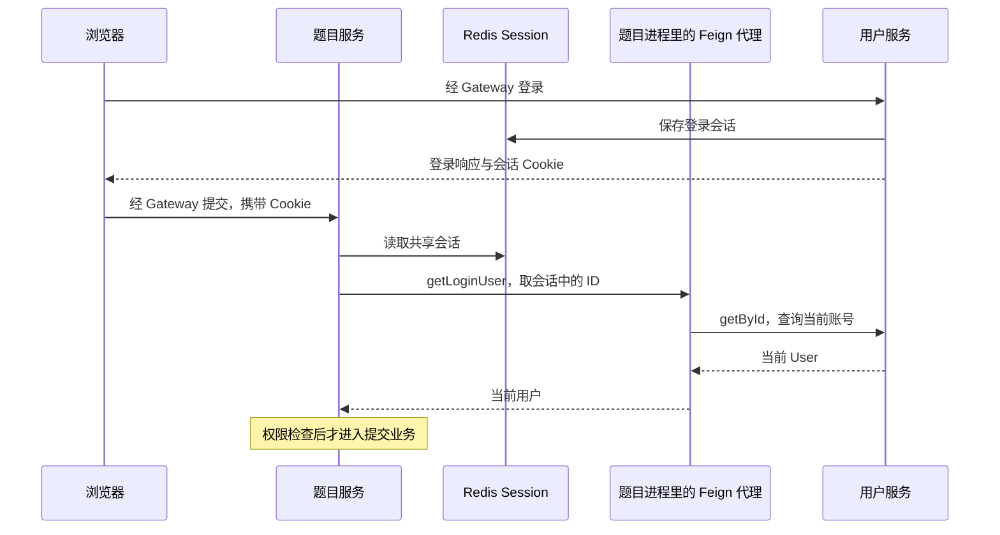

# 链路一：登录、跨服务获取用户与权限检查

这条链解决两个问题：**浏览器怎样保持登录？题目服务怎样知道当前用户及其权限？**

先建立服务关系，再读登录和后续请求。正文只给源码位置、方法作用和阅读重点，不复制源码。

**本篇导航：** [全局关系](#1-全局关系哪些在同一进程哪些需要网络) → [Client 机制](#2-必要机制client-为什么是接口却能被注入调用) → [两套 API](#3-两套-http-入口为什么公开接口与内部接口分开) → [正常请求](#4-第一遍正常登录与后续请求) → [变化与故障](#5-第二遍沿同一请求分析变化和故障) → [检查理解](#6-阅读检查)

## 1. 全局关系：哪些在同一进程，哪些需要网络

| 角色 | 运行在哪里 | 负责什么 |
| --- | --- | --- |
| 浏览器 | 用户电脑 | 发登录请求，后续携带会话 Cookie |
| Gateway | 独立 Java 进程 | 将 /api/user、/api/question 等请求路由到服务 |
| 用户服务 | 独立 Java 进程 | 查询 user 表、校验密码、提供当前账号数据 |
| 题目服务 | 另一个 Java 进程 | 处理题目和提交，需要知道当前用户 |
| service-client | 被各服务依赖的 JAR | 提供 Feign 声明和共享解析逻辑，本身不监听端口 |
| Redis | 独立存储 | 保存 Spring Session，使多个业务服务可识别同一会话 |

**关键区别：** 两个服务依赖相同 JAR，只是各自加载了相同类型；不会因此共享同一个 Java 对象或 Spring 容器。

题目服务无法像本地 Service 一样直接调用另一个进程里的 UserServiceImpl，需要用 HTTP。UserFeignClient 就是题目服务这一端的 HTTP 调用入口。

> 图中 getLoginUser 的逻辑在题目服务进程内执行。真正发 HTTP 的是它后续调用的 getById。

## 2. 必要机制：Client 为什么是接口，却能被注入调用

### 2.1 Spring 为调用方创建代理

先打开 [CodeojBackendQuestionServiceApplication](../../codeoj-backend/codeoj-backend-question-service/src/main/java/com/codeoj/codeojbackendquestionservice/CodeojBackendQuestionServiceApplication.java) 和 [UserFeignClient](../../codeoj-backend/codeoj-backend-service-client/src/main/java/com/codeoj/codeojbackendserviceclient/service/UserFeignClient.java)。

| 声明 | 在这里起什么作用 |
| --- | --- |
| @EnableFeignClients | 扫描 service-client 中的 Feign 接口，为调用方注册客户端 Bean |
| @FeignClient 的 name | 指定目标逻辑服务名 codeoj-backend-user-service |
| @FeignClient 的 path | 指定远程接口公共前缀 /api/user/inner |
| getById 上的 @GetMapping | 指定 HTTP 方法和方法路径 /get/id |
| 参数上的 @RequestParam | 将 Java 参数映射为请求查询参数 userId |
| 返回类型 User | 将远端响应转换为调用方使用的 User 对象 |

调用方注入的是 Feign 创建的客户端代理。代理根据接口声明构造请求、定位服务地址、发送 HTTP、解析响应；你不需要手写这段网络客户端逻辑。

参见 [OpenFeign 3.1.5 文档](https://docs.spring.io/spring-cloud-openfeign/docs/3.1.5/reference/html/)。

例如 getById 的远程请求路径为 **/api/user/inner/get/id**，userId 作为查询参数。服务名还需要解析为实例地址：当前本机脚本使用静态发现，不能把 name 本身当成固定 URL，也不能认定本轮使用了 Nacos。

**接着读：** [run-native-stack.py](../../scripts/local/run-native-stack.py) 生成 simple discovery 实例地址的位置。理解地址从配置来即可，第一遍不必进入 Feign 框架内部类。

### 2.2 为什么还需要 UserInnerController

| 文件/对象 | 所在一端 | 方法被调用后实际做什么 |
| --- | --- | --- |
| UserFeignClient 的客户端代理 | 题目服务等调用方 | 把接口方法转成远程请求 |
| UserInnerController | 用户服务提供方 | 接收 HTTP，调用本地 UserService 查询数据库 |
| UserServiceImpl | 用户服务提供方 | 执行当前进程里的业务与数据访问 |

打开 [UserInnerController.getById](../../codeoj-backend/codeoj-backend-user-service/src/main/java/com/codeoj/codeojbackenduserservice/controller/inner/UserInnerController.java)：它把 userId 交给本地 userService.getById，返回查询结果。

这里 implements UserFeignClient 用于对齐方法签名，**并不让题目服务直接拿到这个 Controller 对象**。两个进程之间仍有 HTTP 和序列化。

当前写法把提供端接口与 Feign 客户端绑定得较紧。理解现有实现即可，不把这种共享方式写成普遍最佳实践；官方的接口继承说明也提示避免直接共享带 @FeignClient 的客户端接口。

### 2.3 UserFeignClient 的方法并非全是远程接口

| 方法 | 作用 | 输入 → 返回 | 执行位置 |
| --- | --- | --- | --- |
| [getById](../../codeoj-backend/codeoj-backend-service-client/src/main/java/com/codeoj/codeojbackendserviceclient/service/UserFeignClient.java) UserFeignClient | 按 ID 查询当前账号 | userId → User | 代理发 HTTP |
| [listByIds](../../codeoj-backend/codeoj-backend-service-client/src/main/java/com/codeoj/codeojbackendserviceclient/service/UserFeignClient.java) UserFeignClient | 批量补充账号资料 | ID 集合 → User 列表 | 代理发 HTTP |
| [getLoginUser](../../codeoj-backend/codeoj-backend-service-client/src/main/java/com/codeoj/codeojbackendserviceclient/service/UserFeignClient.java) UserFeignClient | 从当前请求还原身份，再刷新账号 | HttpServletRequest → 当前 User | default 方法本地执行，必要时调用远程 getById |
| [isAdmin](../../codeoj-backend/codeoj-backend-service-client/src/main/java/com/codeoj/codeojbackendserviceclient/service/UserFeignClient.java) UserFeignClient | 判断传入当前账号是否管理员 | User → boolean | 本地判断，不自动查数据库 |
| [getUserVO](../../codeoj-backend/codeoj-backend-service-client/src/main/java/com/codeoj/codeojbackendserviceclient/service/UserFeignClient.java) UserFeignClient | 转成允许对外展示的用户结构 | User → UserVO | 本地转换，不自动发 HTTP |

**读源码时特别注意：** isAdmin 只能相信调用者传入的是本次查询的当前用户；它自己不会刷新一个过期的 Session User。

## 3. 两套 HTTP 入口：为什么公开接口与内部接口分开

源码对照：[UserController](../../codeoj-backend/codeoj-backend-user-service/src/main/java/com/codeoj/codeojbackenduserservice/controller/UserController.java)、[UserInnerController](../../codeoj-backend/codeoj-backend-user-service/src/main/java/com/codeoj/codeojbackenduserservice/controller/inner/UserInnerController.java)、[用户服务 context-path 配置](../../codeoj-backend/codeoj-backend-user-service/src/main/resources/application.yml)。

| 对照项 | 面向浏览器的公开接口 | 面向业务服务的内部接口 |
| --- | --- | --- |
| 例子 | /api/user/login、/api/user/get/login | /api/user/inner/get/id、/api/user/inner/get/ids |
| Controller | UserController | UserInnerController |
| 主要调用者 | 登录页面、前端 store | 题目服务等 Feign 调用方 |
| 关键输入 | 账号密码，或浏览器会话 | 明确的用户 ID / ID 集合 |
| 成功响应 | BaseResponse 包装的 LoginUserVO 等 | getById 直接返回 User，listByIds 返回列表 |
| 主要目的 | 登录、展示本人资料和公开业务 | 提供内部查询能力，供其他服务完成业务判断 |
| 访问控制 | 用户身份与业务权限 | 内部服务凭据，及调用业务自身的权限约束 |

**为什么不能只留一个 get/login？** 公开 get/login 的任务是按当前浏览器请求返回脱敏登录资料。内部 get/id 的任务是按明确 ID 查询账号，供本服务刷新角色或批量组装业务数据，两者输入和返回契约不同。

路径也分两端理解：客户端 path 是要请求的远程前缀；提供方由 context-path=/api/user、Controller 的 /inner 和方法 /get/id 拼出实际路由。

> 内部接口返回实体不意味着可以向浏览器公开实体。它是更受限的服务契约，内部凭据也必须保护。

## 4. 第一遍：正常登录与后续请求

### 4.1 登录页面把账号密码交给用户服务

| 按顺序读 | 方法作用 | 先看哪些内容 |
| --- | --- | --- |
| [UserLoginView.vue](../../codeoj-frontend/src/views/user/UserLoginView.vue) 的 handleSubmit | 发送登录表单、更新页面登录状态 | userLoginUsingPost、成功分支、store 和跳转 |
| [userLogin](../../codeoj-backend/codeoj-backend-user-service/src/main/java/com/codeoj/codeojbackenduserservice/controller/UserController.java) UserController | 解析登录 DTO，调用业务 Service | 参数校验、委托、响应包装 |
| [userLogin](../../codeoj-backend/codeoj-backend-user-service/src/main/java/com/codeoj/codeojbackenduserservice/service/impl/UserServiceImpl.java) UserServiceImpl | 校验凭据并建立会话 | 账号查询、密码验证、setAttribute、返回 VO |

登录请求经 Gateway 到用户服务；此时题目服务还未参与。页面收到登录成功后，下一次请求才利用会话继续业务。

若需要理解注册，再读 [UserServiceImpl.userRegister](../../codeoj-backend/codeoj-backend-user-service/src/main/java/com/codeoj/codeojbackenduserservice/service/impl/UserServiceImpl.java)：检查账号/两次密码、查询重复、BCrypt 编码、保存用户和默认昵称。

注册得到账号，登录建立会话，是两个动作。

### 4.2 密码校验与旧密码升级各做什么

| 方法 | 接收什么 | 返回或产生什么 |
| --- | --- | --- |
| [checkPassword](../../codeoj-backend/codeoj-backend-user-service/src/main/java/com/codeoj/codeojbackenduserservice/service/impl/UserServiceImpl.java) UserServiceImpl | 数据库账号、输入密码 | 密码是否匹配；兼容 BCrypt 与旧固定盐 MD5 |
| [upgradePasswordIfNeeded](../../codeoj-backend/codeoj-backend-user-service/src/main/java/com/codeoj/codeojbackenduserservice/service/impl/UserServiceImpl.java) UserServiceImpl | 已验证账号、明文输入 | 需要时尝试把旧摘要升级成 BCrypt |
| [getLoginUserVO](../../codeoj-backend/codeoj-backend-user-service/src/main/java/com/codeoj/codeojbackenduserservice/service/impl/UserServiceImpl.java) UserServiceImpl | User | 不含密码等敏感字段的登录展示对象 |

**为什么先按账号查，再验密码？** BCrypt 带随机盐，不能把输入重新编码后按字符串相等查询。旧密码验证与升级是兼容逻辑，不说明所有历史账号都已迁移。

### 4.3 setAttribute 为什么会写到 Redis

**先读配置：** 用户、题目服务中的 spring.session、Redis 地址/编号、Cookie path。然后回到 userLogin 中保存 USER_LOGIN_STATE 的调用。

Spring Session 的过滤器包装了请求，使业务仍使用 HttpSession API，底层会话由 Redis 支撑。业务没有直接调用 RedisTemplate，并不表示登录态只在本机内存。

参见 [HttpSession 集成说明](https://docs.spring.io/spring-session/reference/http-session.html)。

| 位置 | 保存什么 | 不能混成什么 |
| --- | --- | --- |
| Cookie | 会话标识 | 不是当前角色的可信副本 |
| Redis Session | USER_LOGIN_STATE 对应的用户对象等会话数据 | 不是 user 表的实时状态 |
| 前端 store | 页面展示和导航用的登录资料 | 不是后端授权依据 |
| MySQL user | 当前账号、角色、删除状态与密码摘要 | 是刷新账号的来源 |

多个业务服务需要共享相容的会话配置。Cookie path=/api、Redis 编号和序列化等条件不一致，会出现“这里登录了，另一个服务却不认识”。

### 4.4 后续请求先从 Session 找 ID，再查询当前账号

按下面顺序读，不要同时跳进所有类：

| 顺序 | 方法 | 作用与输入输出 |
| --- | --- | --- |
| 1 | [getLoginUser](../../codeoj-backend/codeoj-backend-service-client/src/main/java/com/codeoj/codeojbackendserviceclient/service/UserFeignClient.java) UserFeignClient | 接收当前请求，把解析工作交给 requireLogin |
| 2 | [requireLogin](../../codeoj-backend/codeoj-backend-service-client/src/main/java/com/codeoj/codeojbackendserviceclient/auth/SessionUserResolver.java) SessionUserResolver | 调用 permitNull；没有有效用户时抛未登录错误 |
| 3 | [permitNull](../../codeoj-backend/codeoj-backend-service-client/src/main/java/com/codeoj/codeojbackendserviceclient/auth/SessionUserResolver.java) SessionUserResolver | 从现有 Session 取 User 的 ID，调用 lookup，再检查当前账号 |
| 4 | UserFeignClient.getById | 接收刚取出的 ID，经 HTTP 查询当前 User |
| 5 | UserInnerController.getById | 在用户服务调用本地数据库查询，返回实体 |

**阅读边界：** 先读 permitNull 的正常路径，停在返回 current；下一轮再看会话缺失、删除和封禁。

### 4.5 this::getById 到底传了什么

它传递的是一个“给我 ID，我就查询 User”的函数能力，此时还没有查询。permitNull 真正取得 userId 后，执行 lookup.apply，才触发这个查询。

| 调用位置 | 传入的查询能力 | 执行 lookup 时发生什么 |
| --- | --- | --- |
| 题目服务使用 UserFeignClient.getLoginUser | Feign 代理的 getById | 访问用户服务内部 HTTP 接口 |
| 用户服务使用 [getLoginUser](../../codeoj-backend/codeoj-backend-user-service/src/main/java/com/codeoj/codeojbackenduserservice/service/impl/UserServiceImpl.java) UserServiceImpl | 本地 Service 的 getById | 在用户服务内查询数据库 |

所以相同解析器能复用“取身份、刷新账号、检查状态”的规则，而不强制每个调用者都走同一种查询方式。

**getById 的方法体在哪里？** UserServiceImpl 继承 MyBatis-Plus ServiceImpl，本地通用查询由继承能力提供；UserFeignClient 的同名方法则由客户端代理提供。名字相同，不代表是同一个执行对象。

### 4.5.1 用用户 7 跟完一次真实调用形状

假设浏览器已登录，题目服务收到一次提交请求，会话里保存着用户 7。下面是教学推演，不是本轮运行日志。

| 顺序 | 当前执行位置 | 手上有什么数据 | 这一步交给谁 |
| --- | --- | --- | --- |
| 1 | 题目服务的 Session 解析逻辑 | 当前 HttpServletRequest、Redis 还原的 Session | 取出旧 User 对象中的 ID=7 |
| 2 | UserFeignClient 的 default getLoginUser | userId=7，查询回调是代理的 getById | 调用 lookup.apply(7) |
| 3 | 调用方 Feign 代理 | 逻辑服务名、/api/user/inner/get/id、参数 7 | 向用户服务实例发 GET，请求参数为 userId=7 |
| 4 | 用户服务 UserInnerController | 已解析的 long userId=7 | 调用本地 userService.getById(7) |
| 5 | 用户服务数据库查询 | 当前 user 表记录 | 返回当前角色、删除状态等账号信息 |
| 6 | 题目服务 SessionUserResolver | 远端返回的当前 User | 验证 ID、删除与封禁，再交给调用者 |

**跨网络的是什么？** 这一条内部请求携带用户 ID 和服务鉴权头；没有把 HttpServletRequest 对象发到用户服务，也不需要把浏览器 Cookie 原样转发给 getById。

**为什么可以这样做？** 题目服务已经通过共享 Session 找到了用户 ID。远端需要补的是“这个 ID 现在对应什么账号”，而不是重新解析一次浏览器请求。

如果根本没有有效 Session，permitNull 会在调用 lookup 前返回空，因此不能把 default getLoginUser 理解成“每次调用都必定发一次 HTTP”。

#### 从辅助方法回到业务

lookup 返回以后，先回 permitNull 完成账号状态检查，再回 requireLogin，最后回调用 getLoginUser 的 Controller 或权限切面。不要从 UserInnerController 又重新开始读整个登录接口。

打开 [QuestionController.doQuestionSubmit](../../codeoj-backend/codeoj-backend-question-service/src/main/java/com/codeoj/codeojbackendquestionservice/controller/QuestionController.java) 或 [AuthInterceptor.doInterceptor](../../codeoj-backend/codeoj-backend-service-client/src/main/java/com/codeoj/codeojbackendserviceclient/aop/AuthInterceptor.java)，定位 getLoginUser 的下一行：前者把当前用户带入提交业务，后者继续比较 mustRole。

### 4.5.2 浏览器为什么会把会话带到下一次请求

源码：[OpenAPI.ts](../../codeoj-frontend/generated/core/OpenAPI.ts)、[request.ts](../../codeoj-frontend/generated/core/request.ts)。

| 读什么 | 在这条链里解决什么问题 |
| --- | --- |
| OpenAPI.WITH_CREDENTIALS | 生成客户端启用凭据选项 |
| request 中的 withCredentials | 把该设置传给实际 HTTP 请求库 |
| Cookie path=/api | 决定浏览器在哪些路径携带该会话 Cookie |
| 同源 API 代理 | 完整本机启动时，让页面请求与 API 入口配合 |

前端 store 丢失但 Cookie 还有效时，可以重新请求公开 get/login 恢复页面信息。反过来，store 还显示管理员也不能让后端跳过当前账号检查。

### 4.6 当前账号怎样进入权限检查

| 方法 | 作用 | 为什么放在这里 |
| --- | --- | --- |
| [doInterceptor](../../codeoj-backend/codeoj-backend-service-client/src/main/java/com/codeoj/codeojbackendserviceclient/aop/AuthInterceptor.java) AuthInterceptor | 读取 AuthCheck.mustRole，获取当前用户，满足角色才 proceed | 为带注解的方法执行通用权限检查 |
| [requireAccount](../../codeoj-backend/codeoj-backend-question-service/src/main/java/com/codeoj/codeojbackendquestionservice/submission/ExecutionRepository.java) ExecutionRepository | 查当前数据库账号；可检查指定角色并加行锁 | 关键写事务里再次确认账号状态 |
| Controller 的本人/管理员检查 | 比较资源归属与当前身份 | 通用角色不能替代具体资源权限 |

**阅读顺序：** 先看 doInterceptor 的 mustRole 分支，再在实际 Controller 找一个注解调用；最后在受理或赛事事务定位 requireAccount。

AOP 由 Spring 代理在方法入口执行。它不是网关魔法，也不会自动覆盖所有没有注解的内部调用。业务仍需明确检查参赛资格、资源归属等条件。

### 4.7 内部 HTTP 请求怎样通过服务凭据检查

| 顺序 | 源码 | 方法职责 |
| --- | --- | --- |
| 1 | [innerAuthRequestInterceptor](../../codeoj-backend/codeoj-backend-service-client/src/main/java/com/codeoj/codeojbackendserviceclient/config/FeignInnerAuthConfig.java) FeignInnerAuthConfig | 返回 Feign 请求拦截器，为发送请求附加 X-Inner-Secret |
| 2 | [doFilterInternal](../../codeoj-backend/codeoj-backend-service-client/src/main/java/com/codeoj/codeojbackendserviceclient/filter/InnerApiAuthFilter.java) InnerApiAuthFilter | 在业务服务端检查内部路径与密钥，失败直接拒绝 |
| 3 | [filter](../../codeoj-backend/codeoj-backend-gateway/src/main/java/com/codeoj/codeojbackendgateway/filter/GlobalAuthFilter.java) GlobalAuthFilter | 请求经过 Gateway 时，同样限制内部路径 |

Feign 拦截器在发送端工作，Servlet Filter 在接收端工作，AOP 在业务方法入口工作。三个名字都像“拦截”，但位置和职责不同。

**到这里回看全局：** 会话提供用户 ID，用户服务提供当前账号，权限逻辑决定能否做事，内部密钥保护服务查询通道。通过后才进入[提交链路](02-提交与判题链路.md)。

## 5. 第二遍：沿同一请求分析变化和故障

### 5.1 管理员降权，为什么旧 Cookie 不能保留旧角色

按 4.4 的路径推演：原 Session 还可以找到 U7，但 lookup 从 user 表读到新角色；AOP 或事务检查按当前角色拒绝。

| 情况 | 解析或业务处理 |
| --- | --- |
| 没有 Session / 无有效用户 ID | permitNull 返回空，requireLogin 转为未登录 |
| 当前账号不存在或删除 | 不返回原 Session User |
| 当前角色封禁 | 拒绝访问 |
| 当前查询失败 | 传播失败，不回退旧 admin |
| 管理员变普通用户 | 可能仍登录，但不再通过管理权限 |

### 5.2 Redis 不可用为何与普通未登录不同

读 [SessionAvailabilityFilter.doFilterInternal](../../codeoj-backend/codeoj-backend-service-client/src/main/java/com/codeoj/codeojbackendserviceclient/filter/SessionAvailabilityFilter.java)：先看它相对 SessionRepositoryFilter 的顺序，再看 Redis 异常识别、响应未提交条件和 503。

它保护的是会话存储失败。返回 SESSION_STORE_UNAVAILABLE，避免把基础设施异常表现成用户主动登出；不意味着所有远程失败都被它处理。

### 5.2.1 注解看起来相似，为什么作用位置不同

回到 [CodeojBackendQuestionServiceApplication](../../codeoj-backend/codeoj-backend-question-service/src/main/java/com/codeoj/codeojbackendquestionservice/CodeojBackendQuestionServiceApplication.java)，再对照 [CodeojBackendUserServiceApplication](../../codeoj-backend/codeoj-backend-user-service/src/main/java/com/codeoj/codeojbackenduserservice/CodeojBackendUserServiceApplication.java)。

| 注解 | 发现的对象 | 与当前请求的关系 |
| --- | --- | --- |
| @ComponentScan | 普通组件、配置、切面、过滤器等 Bean | 让共享包中的账号解析周边组件能进入本服务容器 |
| @EnableFeignClients | 声明远程接口的 Client | 为调用方建立 Feign 代理 |
| @MapperScan | 本服务数据库 Mapper | 创建数据库访问接口的代理，不是发 HTTP |

因此“接口没有手写实现”至少有两种不同情况：Feign 代理做远程访问，Mapper 代理做数据访问。追 getById 时，先判断 this 是哪个对象，再选择下一步源码。

### 5.3 隐藏按钮、内部密钥与个人资料分别有什么边界

- 页面守卫只能改善交互；直接 HTTP 请求仍要后端鉴权。
- 持有内部密钥，不等于某用户有管理员或参赛资格。
- getUserVO 做结构转换，不刷新角色；isAdmin 做判断，不刷新账号。
- 方法进入了权限切面，不代表同类所有直接调用都会再次进入切面。

## 6. 阅读检查

| 你应能回答 | 回查位置 |
| --- | --- |
| service-client 是库，为什么仍能发远程请求？ | 第 1、2 节：JAR、启动扫描、代理、服务地址 |
| 公开 get/login 与内部 get/id 为何都存在？ | 第 3 节：调用者、参数、返回与权限 |
| getLoginUser 是本地还是远程？ | 第 4.4—4.5 节：本地解析与 lookup 的真正执行 |
| lookup、isAdmin、getUserVO 分别做什么？ | 方法表及调用先后 |
| 同 Cookie 降权后拒绝在哪里发生？ | 当前账号刷新与权限检查 |

测试只需按问题找断言：[CurrentAccountAuthorizationTest](../../codeoj-backend/codeoj-backend-service-client/src/test/java/com/codeoj/codeojbackendserviceclient/auth/CurrentAccountAuthorizationTest.java)、[SessionAvailabilityFilterTest](../../codeoj-backend/codeoj-backend-service-client/src/test/java/com/codeoj/codeojbackendserviceclient/filter/SessionAvailabilityFilterTest.java)、[CurrentUserServiceTest](../../codeoj-backend/codeoj-backend-user-service/src/test/java/com/codeoj/codeojbackenduserservice/service/CurrentUserServiceTest.java)。

先识别夹具；本次文档修改未重跑业务测试。
