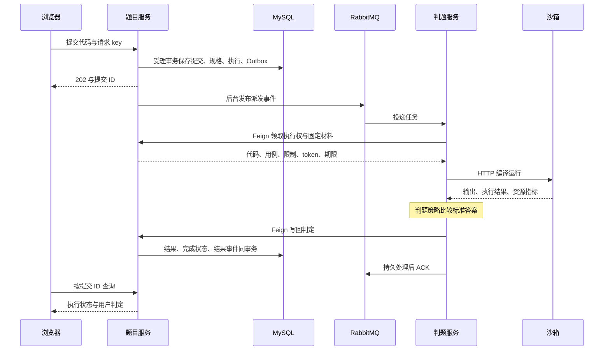

# 链路二：从打开题目到查询判题结果

这条链是项目主线。用户已登录，打开普通题目并提交 Java 程序，最终另发查询请求看到结果。第一遍读完完整正常流程，第二遍再沿相同位置理解幂等、消息重复、失联和有限恢复。


**本篇导航：** [全局与边界](#全局位置三段工作接成一次判题) → [页面与受理](#0-先知道题目与请求从哪里来) → [发布与消息](#mq-基础结构在本项目中怎样对应) → [领取与执行](#16-worker-领取执行权获取完整判题材料) → [结果查询](#21-页面另发请求看到结果) → [异常推演](#第二遍沿同一链路分析重试与故障) → [自测](#阅读成果检查)

## 全局位置：三段工作接成一次判题



图中省略 Gateway 和周期续租；发布 MQ 与浏览器收到 202 没有固定先后。请一直区分：**受理请求、后台判题、结果查询是三段工作**，没有一个数据库事务包住整条链。

| 本次场景 | 教学示例 |
| --- | --- |
| 用户与题目 | 当前用户 7，题目 42，Java 求和程序 A |
| 请求身份 | req-demo-20261027-001，由页面保留；用户 ID 由后端解析 |
| 受理后标识 | 提交简称 S1、固定规格 H1、第一次派发事件 E1；这些是符号，不是实测 ID |
| 判题材料 | 用例输入如 1 2，标准答案 3；只有输入送沙箱，标准答案留在判题端 |

[Gateway 配置](../../codeoj-backend/codeoj-backend-gateway/src/main/resources/application.yml)将普通 /api/question 路径转给题目服务。

本链开启可靠判题；比赛额外检查在[链路四](04-赛事报名与参赛链路.md)，沙箱内部执行在[链路三](03-沙箱执行与回收链路.md)。

## 读源码前，先把调用方式分清

| 你会看到的调用 | 实际发生什么 | 当前链路中的例子 |
| --- | --- | --- |
| 普通 Bean 方法 | 在同一个 Java 进程中调用对象 | Controller → 提交 Service |
| 事务代理方法 | 同进程调用，但代理先建立/加入事务，返回时处理提交/回滚 | ReliableSubmissionService → SubmissionAcceptance |
| Feign 方法 | 客户端代理发 HTTP，远端再执行本地方法 | worker → QuestionInnerController |
| RabbitListener 方法 | RabbitMQ 客户端容器收到消息后调用，不是原请求线程继续执行 | ReliableJudgeConsumer.receive |
| Scheduled 方法 | Spring 调度器按周期触发，不依赖用户再次点击 | OutboxRelay.tick、ExecutionRecovery.tick |

**为什么先区分？** 这些代码写起来都像调用一个方法，但事务、失败和生命周期不同。调用关系不能只画一串没有边界的箭头。

### 本链路的阅读分段

| 阶段 | 读哪些步骤 | 这一段完成什么 |
| --- | --- | --- |
| 页面与受理 | 第 0—12 步 | 从编辑器到数据库保存提交及待派发事件 |
| 事件发布 | 第 13—15 步 | 把持久意图交给 MQ，开始后台处理 |
| 执行与判定 | 第 16—20 步 | 领取材料、调用沙箱、比较答案、保存判定 |
| 查询 | 第 21—22 步 | 独立查询最终结果，回顾全部状态变化 |
| 异常 | 第二遍 | 在已理解的正常流程上推演丢响应、重复、失联 |

## 第一遍：正常流程

### 0. 先知道题目与请求从哪里来

**先认识本步方法：**

| 方法与源码 | 这个方法负责什么 | 接收什么 → 返回或改变什么 |
| --- | --- | --- |
| [addQuestion](../../codeoj-backend/codeoj-backend-question-service/src/main/java/com/codeoj/codeojbackendquestionservice/controller/QuestionController.java)<br>QuestionController | 将建题 DTO 转换、校验并保存题目 | 题干/规格与当前用户 → 题目 ID |
| [getQuestionVOById](../../codeoj-backend/codeoj-backend-question-service/src/main/java/com/codeoj/codeojbackendquestionservice/controller/QuestionController.java)<br>QuestionController | 按 ID 查询并组装做题页面数据 | 题目 ID → QuestionVO |
| [validQuestion](../../codeoj-backend/codeoj-backend-question-service/src/main/java/com/codeoj/codeojbackendquestionservice/service/impl/QuestionServiceImpl.java)<br>QuestionServiceImpl | 检查题目字段是否符合新增/更新约束 | Question、操作类型 → 通过或异常 |
| [getQuestionVO](../../codeoj-backend/codeoj-backend-question-service/src/main/java/com/codeoj/codeojbackendquestionservice/service/impl/QuestionServiceImpl.java)<br>QuestionServiceImpl | 将题目实体转换为展示结构 | Question、请求 → 脱敏 VO |

**阅读范围：** 题目创建先看 DTO 转实体、judgeCase/judgeConfig 的 JSON 保存和创建人；题目查询看 Entity 到 VO；页面看 loadData、form、doSubmit，不读样式。

题库 question 保存题干、限制和隐藏用例。题目 VO 供做题页面展示，不包含隐藏用例；完整题目查询及删除有各自的本人/管理员检查，不凭页面名称推断所有 CRUD 的角色要求相同。

页面 doSubmit 对题目、语言和代码生成指纹，内容未变时沿用待确认 key；同时传到 body 和 Idempotency-Key header。成功清除待确认身份并跳转提交列表。按钮 loading 防本页双击，后端幂等还要覆盖响应丢失与并发。

**当前进度：** 还在用户交互与 HTTP 入口，数据库中尚未有这次提交。接下来进入受理阶段。

### 1. Controller 整理请求，确定是谁提交

**先认识本步方法：**

| 方法与源码 | 这个方法负责什么 | 接收什么 → 返回或改变什么 |
| --- | --- | --- |
| [doQuestionSubmit](../../codeoj-backend/codeoj-backend-question-service/src/main/java/com/codeoj/codeojbackendquestionservice/controller/QuestionController.java)<br>QuestionController | 统一请求 key、取得当前用户、调用受理入口 | 提交 DTO、请求 → 包装后的提交 ID |

**阅读范围：** 读完整个 doQuestionSubmit 方法，依次找到请求 key 整理、题目 ID 检查、当前用户获取、Service 调用和响应返回。

先看 key 的处理。页面可以通过 `Idempotency-Key` 请求头传 key，请求体 DTO 也有 requestKey。如果两边同时提供，就要求相同；随后把 header 中的值统一写入 DTO。后面的 Service 只需从 DTO 读取，不必再区分它来自哪。

接着检查请求和题目 ID。这个入口检查并不完整，语言、源码长度和 key 格式会在下一层继续检查，不能因为 Controller 里只有几项就认为其他参数没校验。

`userFeignClient.getLoginUser(request)` 根据请求会话获取当前用户，因此用户 7 的身份来自后端。这里包含当前账号解析；登录链路会另行展开，本段先把 loginUser 看作已经解析出的当前用户。

最后调用 `questionSubmitService.doQuestionSubmit`。先不要把后面的 202 理解为判题成功：Controller 目前只是在等待“受理完成后的 ID”。我们先进入这个 Service，返回时再看响应处理。

**带入本例：** 下层收到 questionId=42、language=java、代码 A、原 key，以及当前用户 7。

### 2. Service 入口先决定走哪套实现

**先认识本步方法：**

| 方法与源码 | 这个方法负责什么 | 接收什么 → 返回或改变什么 |
| --- | --- | --- |
| [doQuestionSubmit](../../codeoj-backend/codeoj-backend-question-service/src/main/java/com/codeoj/codeojbackendquestionservice/service/impl/QuestionSubmitServiceImpl.java)<br>QuestionSubmitServiceImpl | 按可靠开关选择本次提交的处理路线 | 提交 DTO、User → 提交 ID |

**阅读范围：** 只读 doQuestionSubmit 开头的 reliableEnabled 分支；这次先不进入后面的基础版实现。

当前 reliableEnabled=true，所以立即转入 `ReliableSubmissionService.accept`，并把返回值原样返回。这是一次本地 Spring Bean 调用，不是消息发送，也不是远程判题。

这个分支之后仍有基础版本的提交和 `MyMessageProducer.sendMessage` 代码，但本次请求不会进入。第一次跟读先沿这一个分支继续，避免把两套流程接在一起。

### 受理服务为什么拆为两层

| 类 | 负责什么 | 不在这里做什么 |
| --- | --- | --- |
| ReliableSubmissionService | 参数检查、整次调用重试、唯一冲突后的回读 | 不把外层循环包成一个持续失败的事务 |
| SubmissionAcceptance | 一次完整受理的数据库事务 | 不调用 MQ 或沙箱网络服务 |
| ExecutionRepository | 执行明确 SQL、映射记录、提供数据库时间 | 不决定页面怎样重试 |

**为什么新增 Repository，而已有 Mapper 还保留？** 普通题目 CRUD 使用 MyBatis-Plus；执行控制需要显式行锁、版本条件及多张表的 SQL，因此这里用 JdbcTemplate 表达。

JdbcTemplate 负责传参数、执行 SQL 和映射结果；它不会仅因名字叫 Repository 就自动开始业务事务。事务范围来自上层代理与事务管理器。

### 3. 外层受理服务检查参数，再调用事务服务

**先认识本步方法：**

| 方法与源码 | 这个方法负责什么 | 接收什么 → 返回或改变什么 |
| --- | --- | --- |
| [accept](../../codeoj-backend/codeoj-backend-question-service/src/main/java/com/codeoj/codeojbackendquestionservice/submission/ReliableSubmissionService.java)<br>ReliableSubmissionService | 校验输入，并在事务外处理整次受理重试 | 提交 DTO、User → 原有或新提交 ID |

**阅读范围：** 读 accept 开头的参数校验，分别找出用户、提交内容和 requestKey 的限制。

这段条件较长，可以按输入对象分成三组看：

- **用户：** 需要有效的用户对象与 ID，不能是 ban 角色。
- **提交内容：** 题目 ID 为正、语言是 Java、代码非空，UTF-8 编码后不超过 256 KiB。
- **请求身份：** key 必填，只允许给定字符，长度为 8—128。

本例参数合法，进入下面的循环。第一遍只读正常路径：

**阅读范围：** 接着找到 for 循环中的 acceptance.accept 调用；第一遍先沿 try 正常进入，暂时跳过 catch。

`acceptance` 是另一个 Spring Bean，即 `SubmissionAcceptance`。它的 accept 方法带有事务注解；当前链路中的外层方法没有事务注解，因此这次跨 Bean 调用会经代理进入数据库事务。

循环为什么最多 3 次、catch 为什么放在这里，留到第二遍解释。现在先进入第一次 `acceptance.accept`。

### 事务注解怎样让多条 SQL 成为一组

阅读入口：[SubmissionAcceptance](../../codeoj-backend/codeoj-backend-question-service/src/main/java/com/codeoj/codeojbackendquestionservice/submission/SubmissionAcceptance.java) 的 accept 注解与 [ExecutionRepository](../../codeoj-backend/codeoj-backend-question-service/src/main/java/com/codeoj/codeojbackendquestionservice/submission/ExecutionRepository.java) 的 JdbcTemplate 调用。

正常路径可分为四步：

1. 外层调用独立 Bean 的 accept，进入 Spring 事务代理。
2. 事务管理器取得并管理数据库连接；本次同步调用中的相关 JDBC 操作参加同一事务。
3. accept 目标方法返回后，代理尝试提交，调用方才正常得到 ID。
4. 若按回滚规则抛出异常，代理回滚未提交变更，把失败交回调用方。

这里配置 rollbackFor=Exception，内部 freezeSpec/write 又在同一调用线程中执行，所以代码、执行记录和事件可以一起成功或回滚。

这套本地事务机制不会跨越 MQ、HTTP 或其他进程。

代理与 JDBC 事务关系可对照 [Spring 事务说明](https://docs.spring.io/spring-framework/docs/5.3.x/reference/html/data-access.html#transaction-declarative)。

### 4. 事务方法先看这次请求是否已经受理

**先认识本步方法：**

| 方法与源码 | 这个方法负责什么 | 接收什么 → 返回或改变什么 |
| --- | --- | --- |
| [accept](../../codeoj-backend/codeoj-backend-question-service/src/main/java/com/codeoj/codeojbackendquestionservice/submission/SubmissionAcceptance.java)<br>SubmissionAcceptance | 在事务内完成一次普通练习受理 | 合法请求、User → 提交 ID |
| [requestHash](../../codeoj-backend/codeoj-backend-question-service/src/main/java/com/codeoj/codeojbackendquestionservice/submission/SubmissionAcceptance.java)<br>SubmissionAcceptance | 计算一次请求的内容摘要 | 题目/语言/代码 → requestHash |
| [byKey](../../codeoj-backend/codeoj-backend-question-service/src/main/java/com/codeoj/codeojbackendquestionservice/submission/ExecutionRepository.java)<br>ExecutionRepository | 按用户和请求 key 找原执行记录 | userId、key → ExecutionRecord 或空 |

**阅读范围：** 读 accept 的事务注解及方法开头，停在 requireAccount 调用之前；关注 hash、prior 和提前返回的位置。

这里暂时出现了两个容易混淆的值：requestKey 是“哪一次请求”，hash 是“这次请求包含什么内容”。先跟进 `requestHash`：

**阅读范围：** 读完整个 requestHash 方法，确认哪些字段参与摘要，再回到 accept。

它把请求类型 PRACTICE、题目 ID、语言、完整代码按固定顺序装进 Map，序列化后交给 `ExecutionRepository.hash` 计算 SHA-256。

注意 requestKey 没放进这份内容，用户 ID 也没放进去：用户与 key 在查询条件中确定身份，hash 另外核对内容。

回到 accept，继续读 `repository.byKey`：

**阅读范围：** 读完整个 byKey 方法，重点看查询的表、WHERE 条件以及查不到时返回什么。

它查的是 `submission_execution`，条件为 userId 和 requestKey。本例首次提交，用户 7 没有用这个 key 受理过，所以 prior 为 null，跳过 return replay，继续往下。

第一次阅读到这里，先记住“不重复创建已有请求”的分支入口即可。找到旧记录后如何处理，会在第二遍展开。

### 5. 进入写入前，再检查当前数据库账号

**先认识本步方法：**

| 方法与源码 | 这个方法负责什么 | 接收什么 → 返回或改变什么 |
| --- | --- | --- |
| [requireAccount](../../codeoj-backend/codeoj-backend-question-service/src/main/java/com/codeoj/codeojbackendquestionservice/submission/ExecutionRepository.java)<br>ExecutionRepository | 检查当前数据库账号，可要求角色和行锁 | 用户 ID、角色要求、lock → 通过或异常 |

**阅读范围：** 回到 accept，定位 requireAccount 调用，记下用户 ID、角色要求和加锁标志这三个参数。

这三个参数分别是用户 ID、要求的角色、是否加锁。调用传入 null 和 true，含义是“不要求一定为管理员，但要检查当前账号有效，并锁定账号记录”。继续看实际 SQL：

**阅读范围：** 进入 requireAccount，读账号查询、FOR UPDATE 的拼接和异常判断，然后回到 accept。

查询排除逻辑删除；允许 user/admin，其他状态不能继续受理。role 为 null 时不额外指定某一种角色，lock=true 时附加 `FOR UPDATE`。

为什么入口已经有 loginUser，这里还要检查？入口解析与业务落库不是同一个时间点，受理事务需要根据当前数据库账号决定能否写入。这里的锁也会使竞争同一账号记录的事务等待；它不是提交内容去重的唯一依据。

**本例变化：** 用户 7 当前有效，事务继续；还没有插入提交记录。

### 6. 从题库取出这次判题需要的材料

源码：[SubmissionAcceptance.accept](../../codeoj-backend/codeoj-backend-question-service/src/main/java/com/codeoj/codeojbackendquestionservice/submission/SubmissionAcceptance.java)，约第 38—47 行。

**阅读范围：** 从 accept 的题目查询读到 JudgeConfig、JudgeCase 的解析，停在 freezeSpec 调用之前。

SQL 只读取题目 42 的 judgeConfig 和 judgeCase，并排除已删除题目。rows 为空表示题目不存在，直接抛异常退出当前事务。

数据库中这两个字段是 JSON 字符串，因此取出后还要解析成 `JudgeConfig` 和 `List<JudgeCase>`。limits 表示时间/内存限制，cases 的每项含输入与期望输出。例如某项输入为 `1 2`、期望输出为 `3`。

这里没有执行用户程序。当前只是在准备一份后续判题依据，下一步将它固定下来。

### 7. freezeSpec：把判题依据固定为可引用的数据

**先认识本步方法：**

| 方法与源码 | 这个方法负责什么 | 接收什么 → 返回或改变什么 |
| --- | --- | --- |
| [freezeSpec](../../codeoj-backend/codeoj-backend-question-service/src/main/java/com/codeoj/codeojbackendquestionservice/submission/SubmissionAcceptance.java)<br>SubmissionAcceptance | 校验并保存可复用的固定判题规格 | 限制、用例 → specHash |

调用位置仍在 `SubmissionAcceptance.accept`，进入同类的 freezeSpec：

**阅读范围：** 读 freezeSpec：先看 validateSpec 校验哪些材料，再看 payload 组成、hash 计算、规格插入和返回值。

先调用 validateSpec 检查规格是否合法，例如限制为正、用例非空且不超过 20、输入总量和单个期望输出受限。它检查的是平台保存的判题材料，和第 3 步检查用户代码不是一回事。

然后构造 payload：version 表示规格格式版本，comparator=TEXT_V1 表示输出比较规则，limits 和 cases 保存具体限制与用例。payload 的 hash 就是 specHash，既作为数据库键，也供执行记录引用。

`INSERT ... ON DUPLICATE KEY UPDATE specHash=specHash` 的作用是复用同 hash 的已有规格。多次提交用同一份判题依据时，不要求为每份提交重复保存一份 payload。这里的重复是“规格相同”，不是“用户提交重复”。

本例把规格简称 H1。即使受理后题库发生修改，后面的执行仍引用 H1，而不是临时拿最新用例判旧提交。

### 8. write：先保存用户交来的代码

**先认识本步方法：**

| 方法与源码 | 这个方法负责什么 | 接收什么 → 返回或改变什么 |
| --- | --- | --- |
| [write](../../codeoj-backend/codeoj-backend-question-service/src/main/java/com/codeoj/codeojbackendquestionservice/submission/SubmissionAcceptance.java)<br>SubmissionAcceptance | 在已有事务中保存提交、执行和派发事件 | 代码/身份/规格/比赛上下文 → 提交 ID |

回到 accept，接下来的调用是：

**阅读范围：** 回到 accept，读 freezeSpec 与 write 两处调用，结合 write 的方法签名核对参数含义。

write 的几个参数依次提供原请求、用户 ID、请求内容 hash、规格 hash，以及可选比赛上下文和数据库时间。普通练习的三个比赛参数为 null；比赛提交会复用这个方法并提供对应值。

`repository.now()` 查询数据库 UTC 时间，作为本次受理的时间基准。进入 write 后，先看第一段：

**阅读范围：** 进入 write，先读 ID 生成和 question_submit 的 INSERT；暂时停在 eventId 生成之前。

`IdWorker.getId()` 生成提交 ID，下面简称 S1。INSERT 保存语言、源码、题目、用户，兼容 status 初始为 0，judgeInfo 初始为空 JSON。

这条记录回答“用户交了什么”，但它还没有保存派发代次、执行身份和恢复预算，所以不能仅凭这张表描述完整执行流程。

### 9. 再创建 QUEUED 执行记录

源码：[SubmissionAcceptance.write](../../codeoj-backend/codeoj-backend-question-service/src/main/java/com/codeoj/codeojbackendquestionservice/submission/SubmissionAcceptance.java)，约第 60—66 行。

**阅读范围：** 继续读 eventId 生成及 submission_execution 的 INSERT，把列名、VALUES 和参数列表对应起来。

SQL 比较长，先把列名与 VALUES 对应起来，阅读下面这些组即可：

| 字段组 | 初始值 | 为什么现在需要 |
| --- | --- | --- |
| submissionId/userId/requestKey/requestHash | S1、7、原 key、请求摘要 | 关联代码并支持同请求回读 |
| judgeSpecHash | H1 | 后台按固定判题依据执行 |
| executionStatus | QUEUED | 已受理，等待领取 |
| dispatchGeneration/dispatchEventId | 1、新 UUID（简称 E1） | 标记当前第一次派发 |
| activeAttempt | 0 | 尚未有人真正领取执行 |
| nextRunAt/queuedAt/acceptedAt | 同一数据库时间 | 到期判断、排队与受理时间 |
| recoveryDeadlineAt | 受理时间 + 15 分钟 | 总自动恢复期限 |
| maxAttempts/maxDispatches | 3 / 10 | 限制执行尝试与派发次数 |
| recoveryPolicyVersion/resultVersion/stateVersion | 1 / 0 / 0 | 初始化策略、结果和状态版本 |

E1 和 S1 是不同身份：S1 标识这份提交，E1 标识当前派发事件。第一次受理尚未生成 executionToken，也没有创建 `judge_attempt`。这些会在 worker 真正领取成功时产生。

本段之后有 `if(contestId!=null)` 补充比赛上下文，本例条件为 false，继续读下面的事件写入。

### 10. insertDispatch：保存待发布事件，仍没有发 MQ

**先认识本步方法：**

| 方法与源码 | 这个方法负责什么 | 接收什么 → 返回或改变什么 |
| --- | --- | --- |
| [dispatch](../../codeoj-backend/codeoj-backend-question-service/src/main/java/com/codeoj/codeojbackendquestionservice/submission/ExecutionRepository.java)<br>ExecutionRepository | 组装派发消息，不执行网络发送 | 提交 ID、代次、事件 ID → JudgeDispatch |
| [insertDispatch](../../codeoj-backend/codeoj-backend-question-service/src/main/java/com/codeoj/codeojbackendquestionservice/submission/ExecutionRepository.java)<br>ExecutionRepository | 将派发消息写入 Outbox | ExecutionRecord、时间 → 数据库待发布事件 |
| [tick](../../codeoj-backend/codeoj-backend-question-service/src/main/java/com/codeoj/codeojbackendquestionservice/submission/outbox/OutboxRelay.java)<br>OutboxRelay | 定时扫描并协调派发事件发送 | 调度触发 → 每批事件的发布处理 |

**阅读范围：** 读 write 末尾的 find、insertDispatch 和返回 ID，随后跟进 insertDispatch。

find 把刚写入的执行记录读成 ExecutionRecord，随后把它传给 insertDispatch。名字里虽然有 Dispatch，但还要打开方法判断它究竟做了什么：

**阅读范围：** 先读 dispatch 如何构造消息，再读 insertDispatch 如何把消息写入 Outbox，注意是否出现 MQ 客户端调用。

先看 `dispatch`，它构造 JudgeDispatch：提交 ID、派发代次、事件 ID、协议版本和 traceId。消息里没有用户源码，也没有隐藏用例。

再看 `insertDispatch`，它执行的仍然是 SQL INSERT：保存 E1、类型 JUDGE_DISPATCH、提交 ID、代次、序列化消息，初始状态 PENDING、发送次数 0。

因此这里完成的是“记下待发布意图”，不是“Broker 已收到任务”。

真正发送由定时后台 [OutboxRelay.tick](../../codeoj-backend/codeoj-backend-question-service/src/main/java/com/codeoj/codeojbackendquestionservice/submission/outbox/OutboxRelay.java) 在另一条调用路径中进行，后续段落再展开。

### 11. 返回 ID，事务提交后回到 Controller

write 返回 S1，回到 accept，最后执行：

源码：[SubmissionAcceptance.accept](../../codeoj-backend/codeoj-backend-question-service/src/main/java/com/codeoj/codeojbackendquestionservice/submission/SubmissionAcceptance.java)，约第 49—50 行。

**阅读范围：** 回到 accept，读末尾提交数更新和 return，再回到 Controller 看 202 与响应 data。

题目 42 的提交数加 1；随后事务方法目标返回。Spring 代理还要提交数据库事务，提交成功后，调用方 `ReliableSubmissionService` 才正常拿到 S1。如果提交阶段失败，外层收到的是异常，不能按目标方法已经 return 就认定数据库一定成功。

S1 再经 `QuestionSubmitServiceImpl` 返回 Controller。现在回看第 1 步的结尾：设置 HTTP 202，`ResultUtils.success` 把 S1 放入响应 data。客户端得到的是已受理的提交 ID，不是 AC。

### 12. 受理阶段结束，检查我们留下了什么

在受理事务刚提交的那个时间点，本例的数据关系为：

```text
question_submit：S1 → 用户7、题目42、代码A、status=0
submission_execution：S1 → H1、QUEUED、generation=1、event=E1、attempt=0
judge_spec：H1 → 固定用例、资源限制、TEXT_V1
reliable_outbox：E1 → JUDGE_DISPATCH、S1、generation=1、PENDING
question：42 的 submitNum 加1
```

这些变更属于同一受理事务。`judge_spec` 可能复用已有记录；上图表示引用关系，不表示每次一定新增一行规格。

后台随时可能在提交后继续派发，因此你稍后查询时，状态可能已向前推进。上图描述事务提交瞬间的语义，不承诺用户一定能在页面观察到每个中间态。

到这里，先关闭源码，用自己的话说明：为什么一份提交要涉及提交记录、固定规格、执行记录和事件四类数据？能解释各自用途，再沿下面的后台流程继续。

### MQ 基础结构在本项目中怎样对应

| 概念 | 本项目对象 | 作用 |
| --- | --- | --- |
| RabbitTemplate | 发布端使用的 Spring Bean | 把消息交给 Broker |
| DirectExchange | codeoj.judge.v1.exchange | 按路由键选择匹配的绑定 |
| routingKey | judge | 将本次派发导向判题队列 |
| Queue | codeoj.judge.v1.queue | 保存等待消费与尚未确认的投递 |
| Binding | exchange + judge → queue | 描述交换机怎样把消息路由进队列 |
| Listener container | @RabbitListener 背后的运行容器 | 与 Broker 通信、调度 receive |
| Channel / deliveryTag | 当前消费者投递的通道与标识 | 指定 ACK/NACK 处理哪次投递 |

**先读配置：** [ReliableJudgeTopology](../../codeoj-backend/codeoj-backend-judge-service/src/main/java/com/codeoj/codeojbackendjudgeservice/rabbitmq/ReliableJudgeTopology.java)、[ReliableJudgeConfiguration](../../codeoj-backend/codeoj-backend-question-service/src/main/java/com/codeoj/codeojbackendquestionservice/submission/ReliableJudgeConfiguration.java)、[题目服务 MQ 配置](../../codeoj-backend/codeoj-backend-question-service/src/main/resources/application.yml)。

拓扑声明 durable，消息设置 persistent；correlated confirm 让回调对应一次发布，mandatory 与 return 配置用于观察不可路由。这些控制交付环节，不直接代表业务完成。

**定时扫描怎样启动？** Spring 的调度配置启用后，@Scheduled 周期调用 tick。每次只扫描候选；claim 再加数据库条件，防多个发布器同时把候选当成自己的发送权。

### 13. 后台发布器找到 E1 并领取发布权

**先认识本步方法：**

| 方法与源码 | 这个方法负责什么 | 接收什么 → 返回或改变什么 |
| --- | --- | --- |
| [due](../../codeoj-backend/codeoj-backend-question-service/src/main/java/com/codeoj/codeojbackendquestionservice/submission/outbox/OutboxStore.java)<br>OutboxStore | 按事件类型筛选到期、可领取的待发事件 | 事件类型 → eventId 列表 |
| [claim](../../codeoj-backend/codeoj-backend-question-service/src/main/java/com/codeoj/codeojbackendquestionservice/submission/outbox/OutboxStore.java)<br>OutboxStore | 锁定事件并授予一次有期限的发送权 | eventId、类型 → Publication 或空 |

**回到全局：** S1 已经受理，原 HTTP 请求可以结束。后台要把数据库中的待处理意图交给 MQ，这是另一个执行时机。

**阅读范围：** 从定时入口读 due、claim、publish，先只追 JUDGE_DISPATCH；随后打开 OutboxStore。

**阅读范围：** due 看事件类型、PENDING、到期时间和租约条件；claim 看事件行锁、预算、发布 token 与 publish_attempt 的创建。

扫描只找候选，不授予发送权。claim 加锁再检查，生成本次发布 token，登记 UNKNOWN 与发布租约，返回 Publication。这个 token 标识一次发送，不是后面的执行 token。

### 14. 事务外真正发送，记录 Broker 确认

**先认识本步方法：**

| 方法与源码 | 这个方法负责什么 | 接收什么 → 返回或改变什么 |
| --- | --- | --- |
| [publish](../../codeoj-backend/codeoj-backend-question-service/src/main/java/com/codeoj/codeojbackendquestionservice/submission/outbox/OutboxDelivery.java)<br>OutboxDelivery | 发送持久消息并注册确认结果回调 | Publication、交换机/路由 → 异步记录发送证据 |

**阅读范围：** 看消息体、persistent、messageId、CorrelationData、Confirm/Return 回调与 rabbit.send；先沿 ACK 且无 Return 分支。

Publication 已由 claim 事务返回，publish 此时才调用网络。消息 E1 只带提交、代次和协议等引用，不含源码与用例。正常回调进入 OutboxStore.record，保存发送证据并将事件标记 CONFIRMED。

再读 [ReliableJudgeTopology](../../codeoj-backend/codeoj-backend-judge-service/src/main/java/com/codeoj/codeojbackendjudgeservice/rabbitmq/ReliableJudgeTopology.java) 的交换机、judge 路由、工作队列和隔离队列，知道消息进入哪一个消费者。

旧 code_exchange/code_queue 不属于本链。

### 15. Consumer 校验消息并进入 worker

**先认识本步方法：**

| 方法与源码 | 这个方法负责什么 | 接收什么 → 返回或改变什么 |
| --- | --- | --- |
| [receive](../../codeoj-backend/codeoj-backend-judge-service/src/main/java/com/codeoj/codeojbackendjudgeservice/rabbitmq/ReliableJudgeConsumer.java)<br>ReliableJudgeConsumer | 校验投递、调用 worker、决定 ACK/重投 | MQ Message、Channel → 投递被处理或异常 |

**阅读范围：** 先读消息大小、解析、valid，再进入 worker.process；暂时不展开 catch，记住 ACK 在正常返回之后。

Consumer 收到的是“请尝试处理 S1”，还没有执行权。它把合法 JudgeDispatch 交给 worker，不能自行拿消息内容直接运行用户程序。

### 内部执行接口为什么不直接开放普通 update

阅读：[QuestionFeignClient](../../codeoj-backend/codeoj-backend-service-client/src/main/java/com/codeoj/codeojbackendserviceclient/service/QuestionFeignClient.java)、[QuestionInnerController](../../codeoj-backend/codeoj-backend-question-service/src/main/java/com/codeoj/codeojbackendquestionservice/controller/inner/QuestionInnerController.java)、[ExecutionRpcAdvice](../../codeoj-backend/codeoj-backend-question-service/src/main/java/com/codeoj/codeojbackendquestionservice/submission/ExecutionRpcAdvice.java)。

Feign 原理见[登录链路第 2 节](01-登录与权限链路.md#2-必要机制client-为什么是接口却能被注入调用)。

| 内部命令 | 调用方交什么 | 提供方决定什么 |
| --- | --- | --- |
| claimExecution | 派发事件身份 | 能否授予执行权；成功后返回固定材料 |
| heartbeatExecution | attempt/token | 是否仍为有效 owner，能否续租 |
| completeExecution | attempt/token 和判定 | 是否接受本次结果并发出结果事件 |
| failExecution | attempt/token 和平台错误 | 是否转等待或人工处理 |
| deferExecution | 当前派发身份 | 无本地容量时能否持久延后 |

这些是带前置条件的业务命令。若允许 worker 普通更新 status，就可能绕过当前代次、期限和不可变结果规则。

HTTP 200 下的“未领取”是一个确定业务结果；远端 503、异常或缺少 claimed 字段是“不能确定”。ExecutionRpcAdvice 防止权威服务异常被包装成一个看似正常的默认 false。

### 16. worker 领取执行权，获取完整判题材料

**先认识本步方法：**

| 方法与源码 | 这个方法负责什么 | 接收什么 → 返回或改变什么 |
| --- | --- | --- |
| [process](../../codeoj-backend/codeoj-backend-judge-service/src/main/java/com/codeoj/codeojbackendjudgeservice/judge/ReliableJudgeWorker.java)<br>ReliableJudgeWorker | 协调领取、心跳、沙箱、判定和写回 | JudgeDispatch → 持久处理或异常 |
| [claimExecution](../../codeoj-backend/codeoj-backend-service-client/src/main/java/com/codeoj/codeojbackendserviceclient/service/QuestionFeignClient.java)<br>QuestionFeignClient | 将领取声明转换为内部 HTTP 请求 | JudgeDispatch → JudgeLease |
| [claimExecution](../../codeoj-backend/codeoj-backend-question-service/src/main/java/com/codeoj/codeojbackendquestionservice/controller/inner/QuestionInnerController.java)<br>QuestionInnerController | 接收内部领取请求，交给执行事务 | JudgeDispatch → JudgeLease |
| [claim](../../codeoj-backend/codeoj-backend-question-service/src/main/java/com/codeoj/codeojbackendquestionservice/submission/ExecutionCommands.java)<br>ExecutionCommands | 锁执行记录并授予当前一次执行权 | JudgeDispatch → 携带材料的 lease 或未领取 |

**阅读范围：** 先看 slots.tryAcquire，再跟 claimExecution；第一遍假设本地有名额并领取成功，后续再回到此方法。

源码交接：[QuestionFeignClient.claimExecution](../../codeoj-backend/codeoj-backend-service-client/src/main/java/com/codeoj/codeojbackendserviceclient/service/QuestionFeignClient.java) → [QuestionInnerController.claimExecution](../../codeoj-backend/codeoj-backend-question-service/src/main/java/com/codeoj/codeojbackendquestionservice/controller/inner/QuestionInnerController.java) → [ExecutionCommands.claim](../../codeoj-backend/codeoj-backend-question-service/src/main/java/com/codeoj/codeojbackendquestionservice/submission/ExecutionCommands.java)。

**阅读范围：** 对照 Feign 的 HTTP 映射与服务端委托；claim 从执行行锁读到 JudgeLease 返回，重点看状态/派发检查、规格读取、attempt/token 创建和 judge_attempt 插入。

claim 锁住 S1 并核验 QUEUED、当前事件/代次、到期与恢复预算。读取 H1 时检查 hash 与支持的规格版本，然后创建第 1 次尝试、执行 token T1、租约和绝对期限，把执行状态改为 RUNNING。

返回的 JudgeLease 既携带代码、用例和限制，也携带执行身份。派发消息与领取响应不同：前者通知可处理，后者才授予当前执行权和材料。题目服务保管业务状态，判题服务通过 HTTP 命令改变它。

数据对照：[JudgeDispatch](../../codeoj-backend/codeoj-backend-model/src/main/java/com/codeoj/codeojbackendmodel/model/reliability/JudgeDispatch.java)、[JudgeLease](../../codeoj-backend/codeoj-backend-model/src/main/java/com/codeoj/codeojbackendmodel/model/reliability/JudgeLease.java)、[ExecutionCommand](../../codeoj-backend/codeoj-backend-model/src/main/java/com/codeoj/codeojbackendmodel/model/reliability/ExecutionCommand.java)。

只看本步骤涉及的字段，分别标出派发身份、执行材料与写回身份。

### 16.1 claim 的每个提前返回分别说明什么

继续打开 [ExecutionCommands.claim](../../codeoj-backend/codeoj-backend-question-service/src/main/java/com/codeoj/codeojbackendquestionservice/submission/ExecutionCommands.java)。先按分支顺序读，不要看到多个 return lease 就认为含义相同。

| 分支条件 | 返回给 worker 什么 | 数据库是否变化 | 为什么这样处理 |
| --- | --- | --- | --- |
| 找不到执行记录，或事件/代次不是当前 | claimed=false | 此次不授予执行权 | 消息不能凭空创建业务事实 |
| 已不是 QUEUED | claimed=false | 此次不创建新 attempt | 完成任务或已有 owner 不应重复领取 |
| 还没到 nextRunAt | claimed=false | 不提前执行 | 延后是业务状态，而非让线程一直等待 |
| 总期限或尝试预算耗尽 | claimed=false | 转 NEEDS_ATTENTION 并记录原因 | 拒绝继续消耗自动恢复预算 |
| 规格 hash/版本不支持 | claimed=false | 转 NEEDS_ATTENTION | 不拿错误或未知规则判用户代码 |
| 所有条件满足 | claimed=true，附代码/规格/token/期限 | QUEUED → RUNNING，新增 judge_attempt | 形成一次明确的执行尝试 |

**关键结论：** claimed=false 表示“这次没有授予执行权”，不能一概解释为“数据库没做任何事”。返回的 lease 也不携带上述每种原因；具体事实保存在权威状态和诊断中。

#### 材料分别从哪里取

- 源码和语言来自 question_submit，表示用户交了什么。
- 用例和限制来自 H1 指向的 judge_spec，表示此次应按什么规则判。
- token、attempt 和期限来自这次领取事务，表示谁现在拥有执行权。

收到 JudgeDispatch 时，这三部分并不都在消息里。领取事务把它们按当前事实组合为 [JudgeLease](../../codeoj-backend/codeoj-backend-model/src/main/java/com/codeoj/codeojbackendmodel/model/reliability/JudgeLease.java)，而不是再去取一份任意“最新题目”。

### 17. 领取后续租，并构造沙箱请求

**先认识本步方法：**

| 方法与源码 | 这个方法负责什么 | 接收什么 → 返回或改变什么 |
| --- | --- | --- |
| [heartbeat](../../codeoj-backend/codeoj-backend-question-service/src/main/java/com/codeoj/codeojbackendquestionservice/submission/ExecutionCommands.java)<br>ExecutionCommands | 为仍有效的执行者续租 | ExecutionCommand → boolean |

回到 [ReliableJudgeWorker.process](../../codeoj-backend/codeoj-backend-judge-service/src/main/java/com/codeoj/codeojbackendjudgeservice/judge/ReliableJudgeWorker.java)，读 heartbeat 调度和 ExecuteCodeRequest 构造；再跟 [ExecutionCommands.heartbeat](../../codeoj-backend/codeoj-backend-question-service/src/main/java/com/codeoj/codeojbackendquestionservice/submission/ExecutionCommands.java)。

**阅读范围：** 关注 5 秒调度、lease 的 attempt/token、输入提取、时间/内存与绝对期限。第一遍只看有效续租成功。

题目服务约 15 秒的租约在有效 owner 续租后延长，但受尝试绝对期限约束。worker 把代码、用例输入、资源限制、token、deadline 交给沙箱，期望输出仍在 lease.cases。数据库时间与本地调度作用不同，不因为本地定时器仍在运行就认为执行权仍有效。

### 17.1 用时间线理解续租为何不能无限延长

下面用领取时刻 T=0 推演，假设总恢复期限还很远，采用当前 15 秒租约与 60 秒尝试期限。实际还受更早的总恢复期限约束。

| 数据库时刻 | 操作 | 更新后的 leaseUntil | attemptDeadlineAt |
| --- | --- | --- | --- |
| T=0 | claim 成功 | T=15 | T=60 |
| T=5 | 有效 heartbeat | T=20 | 仍是 T=60 |
| T=10 | 有效 heartbeat | T=25 | 仍是 T=60 |
| T=55 | 前面一直正常每 5 秒续租 | 取 T=70 与 T=60 中更早者，即 T=60 | 仍是 T=60 |
| T=60 | 再心跳或提交结果 | 已到期限，不能按有效 owner 继续 | 不因请求到来而重置 |

**为什么需要两个时间？** leaseUntil 让失联 worker 尽快失去执行权，attemptDeadlineAt 限制一次尝试的总长度。不断续租只能延长前者，不能改写后者。

读完 heartbeat 后回到 worker，看 ScheduledFuture 怎样创建和取消。Java 定时任务只负责发续租请求，是否成功始终由题目服务的 owned 条件决定。

### 18. 暂时把沙箱看作一个执行边界

**先认识本步方法：**

| 方法与源码 | 这个方法负责什么 | 接收什么 → 返回或改变什么 |
| --- | --- | --- |
| [newInstance](../../codeoj-backend/codeoj-backend-judge-service/src/main/java/com/codeoj/codeojbackendjudgeservice/judge/codesandbox/CodeSandboxFactory.java)<br>CodeSandboxFactory | 按配置选择沙箱调用实现 | 类型字符串 → CodeSandbox |
| [executeCode](../../codeoj-backend/codeoj-backend-judge-service/src/main/java/com/codeoj/codeojbackendjudgeservice/judge/codesandbox/CodeSandboxProxy.java)<br>CodeSandboxProxy | 包装沙箱执行并记录有限诊断 | 执行请求 → 下层执行响应 |
| [executeCode](../../codeoj-backend/codeoj-backend-judge-service/src/main/java/com/codeoj/codeojbackendjudgeservice/judge/codesandbox/impl/RemoteCodeSandbox.java)<br>RemoteCodeSandbox | 通过有界 HTTP 调用远端沙箱 | ExecuteCodeRequest → ExecuteCodeResponse 或异常 |

**阅读范围：** 工厂看当前支持 remote，代理看执行前后包装，HTTP 客户端看请求/响应契约、auth 和超时。

工厂、代理、策略分别有具体职责，不能据此声称当前支持所有语言与执行器。远端返回 outcome、输出与资源指标。编译和逐用例运行细节见[链路三](03-沙箱执行与回收链路.md)；第一遍先带着“得到输出及可信执行信息”回到 worker，把整条提交链读完。

### 判题扩展点为什么有工厂、代理和策略

| 结构 | 当前职责 | 读源码时别混淆 |
| --- | --- | --- |
| CodeSandboxFactory | 选择 CodeSandbox 调用实现 | 当前工厂只支持 remote，不表示支持全部执行器 |
| CodeSandboxProxy | 包装一次调用的前后诊断 | 不是给远程服务生成 HTTP 代理的 OpenFeign |
| JudgeManager / JudgeStrategy | 按语言选择答案判定算法 | 沙箱负责运行，策略负责资源和输出判定 |
| JudgeContext | 把规格、输出、指标等交给策略 | 是本地上下文，不是新增的一次远程请求 |

两种“代理”目的不同：Feign 解决跨进程请求，CodeSandboxProxy 是项目手写的调用包装。不能只背设计模式名称，要指明替换点和调用对象。

### 19. 执行正常以后，在哪里比较答案

**先认识本步方法：**

| 方法与源码 | 这个方法负责什么 | 接收什么 → 返回或改变什么 |
| --- | --- | --- |
| [userVerdict](../../codeoj-backend/codeoj-backend-judge-service/src/main/java/com/codeoj/codeojbackendjudgeservice/judge/SandboxResultMapper.java)<br>SandboxResultMapper | 校验执行协议，映射明确错误或要求继续比较 | 沙箱响应 → 判定 / null / 平台异常 |
| [doJudge](../../codeoj-backend/codeoj-backend-judge-service/src/main/java/com/codeoj/codeojbackendjudgeservice/judge/JudgeManager.java)<br>JudgeManager | 按语言选择并调用判题策略 | JudgeContext → JudgeInfo |
| [doJudge](../../codeoj-backend/codeoj-backend-judge-service/src/main/java/com/codeoj/codeojbackendjudgeservice/judge/strategy/JavaLanguageJudgeStrategy.java)<br>JavaLanguageJudgeStrategy | 检查资源、输出数量和每个用例的答案 | JudgeContext → 用户判定与指标 |
| [normalize](../../codeoj-backend/codeoj-backend-model/src/main/java/com/codeoj/codeojbackendmodel/model/codesandbox/TextOutputComparator.java)<br>TextOutputComparator | 按 TEXT_V1 规范换行，不任意删除空白 | 原字符串 → 规范化字符串 |
| [matches](../../codeoj-backend/codeoj-backend-model/src/main/java/com/codeoj/codeojbackendmodel/model/codesandbox/TextOutputComparator.java)<br>TextOutputComparator | 比较规范化后的期望与实际输出 | 两个输出字符串 → boolean |

**阅读范围：** 先看 outcome/status 协议一致性，正常 EXECUTED 为什么返回 null，再回 worker 的 result==null 分支。

EXECUTED 表示运行结束，null 表示还需比较答案，不是执行失败。

worker 以 H1 的限制、用例和实际输出构造 JudgeContext，经 [JudgeManager.doJudge](../../codeoj-backend/codeoj-backend-judge-service/src/main/java/com/codeoj/codeojbackendjudgeservice/judge/JudgeManager.java) 选择 [JavaLanguageJudgeStrategy.doJudge](../../codeoj-backend/codeoj-backend-judge-service/src/main/java/com/codeoj/codeojbackendjudgeservice/judge/strategy/JavaLanguageJudgeStrategy.java)。

**阅读范围：** 策略从必要指标、输出数量、限制校验读到逐用例比较。

再打开 [TextOutputComparator.normalize/matches](../../codeoj-backend/codeoj-backend-model/src/main/java/com/codeoj/codeojbackendmodel/model/codesandbox/TextOutputComparator.java)，理解当前 TEXT_V1 的换行规则。

时间是 ms，内存是 KiB。策略先判断资源，再逐个比较答案；CRLF 转 LF，只忽略一个末尾换行，其他空白保留。全部合格才得到 AC。沙箱只接收输入，判题策略持有标准答案。

### 20. 带执行身份写回结果，再结束消息投递

**先认识本步方法：**

| 方法与源码 | 这个方法负责什么 | 接收什么 → 返回或改变什么 |
| --- | --- | --- |
| [completeExecution](../../codeoj-backend/codeoj-backend-service-client/src/main/java/com/codeoj/codeojbackendserviceclient/service/QuestionFeignClient.java)<br>QuestionFeignClient | 通过内部 HTTP 请求提交完成判定 | ExecutionCommand → boolean |
| [completeExecution](../../codeoj-backend/codeoj-backend-question-service/src/main/java/com/codeoj/codeojbackendquestionservice/controller/inner/QuestionInnerController.java)<br>QuestionInnerController | 将完成请求交给执行事务 | ExecutionCommand → boolean |
| [complete](../../codeoj-backend/codeoj-backend-question-service/src/main/java/com/codeoj/codeojbackendquestionservice/submission/ExecutionCommands.java)<br>ExecutionCommands | 核验 owner，原子保存结果及结果事件 | 带 token 的判定 → 是否接受完成 |

源码交接：worker → [QuestionFeignClient.completeExecution](../../codeoj-backend/codeoj-backend-service-client/src/main/java/com/codeoj/codeojbackendserviceclient/service/QuestionFeignClient.java) → [QuestionInnerController.completeExecution](../../codeoj-backend/codeoj-backend-question-service/src/main/java/com/codeoj/codeojbackendquestionservice/controller/inner/QuestionInnerController.java) → [ExecutionCommands.complete](../../codeoj-backend/codeoj-backend-question-service/src/main/java/com/codeoj/codeojbackendquestionservice/submission/ExecutionCommands.java)。

**阅读范围：** complete 看 canonicalResult、执行行锁、owned、finishAttempt、执行/兼容结果保存和 JUDGE_RESULT 插入；先沿当前 token 有效且首次完成分支。

题目服务检查 T1 与期限，把第 1 次尝试标记完成，S1 改为 COMPLETED，保存规范结果与摘要，增加 resultVersion，同事务生成结果事件。普通练习 AC 更新题目通过次数；比赛结果留给榜单链处理。

worker finally 取消心跳并归还本地名额；Consumer 在 worker 正常返回后 ACK。这个顺序不保证每个正常返回都表示 AC：第一遍是正常完成场景，重复、延后和拒绝旧结果留到第二遍。

### 20.1 complete 不只是把一个 status 改成成功

按 [ExecutionCommands.complete](../../codeoj-backend/codeoj-backend-question-service/src/main/java/com/codeoj/codeojbackendquestionservice/submission/ExecutionCommands.java) 的顺序，把一次写回分成三类判断：

| 判断 | 保护什么 | 本例该怎样理解 |
| --- | --- | --- |
| canonicalResult | 判定、资源数值和必要字段符合协议 | 不是任意 JSON 都能成为用户结果 |
| 已 COMPLETED 且 sameToken | 检查是不是同一结果的重复回放 | 摘要相同可回放，异内容记录冲突并拒绝 |
| owned | 检查仍为当前有效 owner | 旧 token 或超期结果不能覆盖新尝试 |

首次有效完成时，尝试状态、执行状态、兼容 judgeInfo、结果版本/摘要、JUDGE_RESULT 事件一起落库。普通练习的 acceptedNum 是通过提交次数，不是“独立通过人数”。

**为什么保存摘要？** 它用于比较规范化结果内容；同一个 token 重复提交相同结果可以回放，但不能悄悄把先前 AC 改成 WA。

Consumer ACK 只说明本次投递已得到可持久判断的处理。真正给用户显示什么，还要读保存的 verdict，不能从 ACK 或旧 status=2 推断 AC。

### 21. 页面另发请求看到结果

**先认识本步方法：**

| 方法与源码 | 这个方法负责什么 | 接收什么 → 返回或改变什么 |
| --- | --- | --- |
| [get](../../codeoj-backend/codeoj-backend-question-service/src/main/java/com/codeoj/codeojbackendquestionservice/submission/SubmissionStatusController.java)<br>SubmissionStatusController | 检查可见性并返回单次提交状态 | 提交 ID、当前请求 → 提交 VO |
| [getQuestionSubmitVO](../../codeoj-backend/codeoj-backend-question-service/src/main/java/com/codeoj/codeojbackendquestionservice/service/impl/QuestionSubmitServiceImpl.java)<br>QuestionSubmitServiceImpl | 补执行状态并按访问者脱敏源码 | 提交实体、当前 User → QuestionSubmitVO |

**阅读范围：** 单次查询看本人/管理员检查与 VO 组装；列表看 loadData、refreshJudgingStatus；比赛页看 poll 与 submissionStatus。

普通页面成功后跳提交列表，当前页有兼容 status=0/1 时每 3 秒刷新，结束或卸载时停止。比赛页每 2 秒按 lastId 查单次状态，目前未按终态自动停止。这是页面交互区别，底层仍复用可靠判题。

VO 从 sidecar 补充 executionStatus、acceptedAt、activeAttempt。列表他人提交可以有公开信息，但源码按权限脱敏；单次状态接口检查本人/管理员，不把不同接口的可见性规则混成一种。

### 21.1 提交 ID 为什么要注意前后端类型

源码：[JsonConfig](../../codeoj-backend/codeoj-backend-common/src/main/java/com/codeoj/codeojbackendcommon/config/JsonConfig.java)、[赛事请求类型](../../codeoj-frontend/src/api/contest.ts)。

后端生成的 ID 可能超过 JavaScript Number 的安全整数范围。JsonConfig 将 Java Long 序列化为字符串；赛事视图也显式将多处 ID 转成字符串，前端类型以 string 保存这些身份。

不要为了比较或拼 URL 随手转 Number，否则可能把不同提交读成同一个近似数字。读页面请求时，保留 ID 原值，再跟到查询接口。

### 22. 回看全局数据变化

| 时间点 | 执行记录 | 尝试记录 | 用户能理解的状态 |
| --- | --- | --- | --- |
| 受理后 | QUEUED、H1、E1、attempt=0 | 无 | 已提交，等待判题 |
| 领取后 | RUNNING、attempt=1、T1、租约 | 第 1 次 RUNNING | 后台正在执行 |
| 完成后 | COMPLETED、resultVersion=1、结果摘要 | 第 1 次 COMPLETED | 有 AC/WA 等最终判定 |

浏览器受理成功、Broker 接收、代码执行完成、答案正确是四个不同节点。读完这一遍，应能不看类名先讲出它们的先后与依赖。

## 第二遍：沿同一链路分析重试与故障

### 数据库受理成功，但客户端没有收到响应

**先认识本步方法：**

| 方法与源码 | 这个方法负责什么 | 接收什么 → 返回或改变什么 |
| --- | --- | --- |
| [replay](../../codeoj-backend/codeoj-backend-question-service/src/main/java/com/codeoj/codeojbackendquestionservice/submission/SubmissionAcceptance.java)<br>SubmissionAcceptance | 确认原请求内容一致，再返回原提交 ID | 原记录、当前 hash → ID 或冲突 |

假设刚才的事务已提交，响应在网络上丢失。客户端保留代码 A 和原 key 再请求一次。

Controller 仍会校验身份，可靠受理仍检查参数。进入 accept 后，byKey 这次能找到 S1，于是转入第 4 步跳过的 replay：

**阅读范围：** 读完整个 replay 方法，分别跟踪摘要相同与不同时的结果。

原记录保存的 requestHash 与本次 hash 相同，返回 S1。后面的读题、write、提交数更新都不会再次执行。因此不会因为“只差一个响应”而生成第二份提交。

若仍用原 key，却把代码 A 改成 B，请求 hash 改变，抛出 `IDEMPOTENCY_CONTENT_CONFLICT`。

[SubmissionConflictAdvice](../../codeoj-backend/codeoj-backend-question-service/src/main/java/com/codeoj/codeojbackendquestionservice/submission/SubmissionConflictAdvice.java) 将这类冲突映射为 HTTP 409。

还有一种情况：第一次请求根本没到达服务，或整个事务已回滚。此时查不到旧记录，原 key 的重试可以走首次受理路径。客户端不必先猜测上次究竟成功还是失败。

### 同一用户两个请求并发，都没查到旧记录

只做第 4 步的“先查再插”并不足够：两个请求可能都在初始查询时得到 null。数据库还需要约束身份唯一。

源码：[V001：请求唯一约束](../../codeoj-backend/mysql-init/migrations/V001__reliable_judging.sql)，约第 35—35 行。

**阅读范围：** 在 V001 的 submission_execution 建表语句中，定位 uk_submission_request，确认唯一键包含哪些列。

该约束在 `submission_execution` 上，保护同 userId、同 key 只能存在一条执行记录。并发受理还可能在账号行锁处等待，但无论调度顺序怎样，最终不能依赖一次普通查询保证唯一。

如果其中一方插入时触发唯一约束，异常抛出 `SubmissionAcceptance.accept`，代理先结束失败事务，再回到外层。现在读第 3 步暂时略过的 catch：

源码：[ReliableSubmissionService.accept](../../codeoj-backend/codeoj-backend-question-service/src/main/java/com/codeoj/codeojbackendquestionservice/submission/ReliableSubmissionService.java)，约第 30—39 行。

**阅读范围：** 回到外层 accept，读 DuplicateKeyException 与 TransientDataAccessException 两个 catch，并结合外层 for 理解回读与整事务重试。

`DuplicateKeyException` 分支重新按 userId/key 查旧记录，找到后仍用 replay 比较内容：同内容拿到同一个 S1，内容不同则冲突。若查不到对应原记录，就把异常抛出，不把所有唯一键错误都冒充为成功重试。

为什么要在独立外层 Bean 处理？为了在原事务已经回滚之后回读，而不是捕获异常后继续操作一个可能已经失败的事务。

`TransientDataAccessException` 则在最多 3 次循环内重新调用整个 accept。这里重试的是整次事务，不是单独补发最后一条 SQL。它也不是客户端请求次数限制，更不是 MQ 的重投次数。

### 代码已插入，但 Outbox 插入失败

回到第一遍第 8—10 步。假设 `question_submit` 和执行记录都已插入，但最后插 Outbox 时失败，异常向外抛出。

由于这些写入处在 accept 开启的同一事务中，未提交变更一起回滚。若 H1 是本事务首次插入，它也回滚；若 H1 早已存在，被其他提交引用的规格不会因为这次失败而删除。

这避免留下“接口看似受理了一份新代码，却没有任何可恢复派发意图”的数据库状态。不要把 `write` 中的 return id 当成独立提交点。

### 事务刚提交，API 进程就退出

这次与“Outbox 插入失败”不同：S1 和 E1 已提交，进程退出不会撤销已提交的记录。等服务及后台发布器恢复后，仍可扫描 PENDING 的 E1 并继续派发；客户端也能用原身份回读 S1。

这就是当前受理事务里保留 Outbox 的目的。它不保证后面的消息永不重复、程序只执行一次；这里只先解决“受理成功后仍有持久的待处理依据”。重复消息和执行恢复在下面继续解释。

### 补清事务注解的实际边界

目前这条路径是：外层 ReliableSubmissionService 调用独立 Bean 的 `SubmissionAcceptance.accept`，由代理建立事务；accept 内部再调用同类 freezeSpec/write，内部代码已经处在外层事务中。

freezeSpec 和 write 标注 MANDATORY，用于它们经代理被其他调用方调用时，要求调用者已有事务。普通练习中的同类直接调用不会重新触发它们的事务注解，但也不会因此退出 accept 的现有事务。比赛事务从另一个 Bean 调用 write 时，才会经过对应代理检查。

Spring 对[默认代理与同类调用的说明](https://docs.spring.io/spring-framework/docs/5.3.x/reference/html/data-access.html#transaction-declarative-annotations)支持这一点。

不要把它背成“同类调用必然没有事务”，要看外层调用是否已建立事务。

本例数据库事务中没有调用 MQ、Redis、Feign 或沙箱。Controller 获取用户发生在受理事务之前，后台 MQ 发布发生在受理事务之外；本地数据库回滚不能撤销已经发生的外部副作用。

### Confirm 丢失、Return 与迟到回调

**先认识本步方法：**

| 方法与源码 | 这个方法负责什么 | 接收什么 → 返回或改变什么 |
| --- | --- | --- |
| [record](../../codeoj-backend/codeoj-backend-question-service/src/main/java/com/codeoj/codeojbackendquestionservice/submission/outbox/OutboxStore.java)<br>OutboxStore | 按发布 token 合并 Confirm/Return 证据 | 事件、发布 token、确认结果 → 更新发布状态 |

回到 [OutboxStore.claim/record](../../codeoj-backend/codeoj-backend-question-service/src/main/java/com/codeoj/codeojbackendquestionservice/submission/outbox/OutboxStore.java) 和 [OutboxDelivery.publish](../../codeoj-backend/codeoj-backend-question-service/src/main/java/com/codeoj/codeojbackendquestionservice/submission/outbox/OutboxDelivery.java)。

同一事件可以发送多次，publish_attempt 保留每次 UNKNOWN/ACK/NACK，旧回调有各自 token。

Broker 可能已收消息而 Confirm 丢失，所以 UNKNOWN 不等于未发送。ACK 且无 Return 才收敛为发布确认；迟到失败不能撤销别次成功或释放更新的发送租约。消费端仍需幂等。发布预算耗尽有 ATTENTION，不是无限重发。

Publisher Confirm、Return、Consumer ACK 分别对应发布确认、路由失败、投递结束，它们均不证明 AC。[RabbitMQ 官方说明](https://www.rabbitmq.com/docs/confirms)解释了发布与消费确认的独立性。

### 用一条事件区分“事件 ID”和“发送 token”

仍使用派发事件 E1。P1/P2 代表两次发送，T1/T2 则留给执行尝试；不要把这三种身份混为一谈。

| 时刻/动作 | reliable_outbox | publish_attempt | 此时能确定什么 |
| --- | --- | --- | --- |
| 受理事务保存 E1 | PENDING | 还没有发送记录 | 需要发布，但尚无 Broker 证据 |
| claim 第一次发送 | 保存 P1 的租约，计数 +1 | P1=UNKNOWN | 一个发布器取得本次发送权 |
| Broker 接收，Confirm 丢失 | 仍待确认 | P1 仍 UNKNOWN | 无法认定没发出去 |
| 发布租约过期，再次 claim | 保存 P2 的租约 | 新增 P2=UNKNOWN，保留 P1 | 同一 E1 可能被发第二次 |
| P2 收到 NACK | 按 P2 的条件安排重试 | P2=NACK | 只确定这次发送被否定 |
| P1 的无 Return ACK 晚到 | 可收敛为 CONFIRMED | P1=ACK，P2 历史保留 | E1 已有一次明确成功发布的证据 |

对照 [OutboxStore.record](../../codeoj-backend/codeoj-backend-question-service/src/main/java/com/codeoj/codeojbackendquestionservice/submission/outbox/OutboxStore.java) 的两个更新条件：成功证据可收敛事件；失败只能处理自己仍拥有的 PENDING 租约，不能把别次 ACK 反改成失败。

即使 Outbox 收敛，消费端仍可能见到两份 E1。接下来由 claim 的业务状态挡住重复执行权，不能靠删除一条发送历史解决。

### 重复消息与旧结果在不同位置被挡住

**先认识本步方法：**

| 方法与源码 | 这个方法负责什么 | 接收什么 → 返回或改变什么 |
| --- | --- | --- |
| [currentMessage](../../codeoj-backend/codeoj-backend-question-service/src/main/java/com/codeoj/codeojbackendquestionservice/submission/ExecutionCommands.java)<br>ExecutionCommands | 检查派发代次和事件是否仍为当前 | 执行记录、派发消息 → boolean |
| [sameToken](../../codeoj-backend/codeoj-backend-question-service/src/main/java/com/codeoj/codeojbackendquestionservice/submission/ExecutionCommands.java)<br>ExecutionCommands | 比较执行 attempt 与 token | 执行记录、写回命令 → boolean |
| [owned](../../codeoj-backend/codeoj-backend-question-service/src/main/java/com/codeoj/codeojbackendquestionservice/submission/ExecutionCommands.java)<br>ExecutionCommands | 组合状态、身份和全部有效时间条件 | 执行记录、命令、DB 时间 → boolean |
| [find](../../codeoj-backend/codeoj-backend-question-service/src/main/java/com/codeoj/codeojbackendquestionservice/submission/ExecutionRepository.java)<br>ExecutionRepository | 读取执行记录，可附带行锁 | 提交 ID、lock → ExecutionRecord 或空 |
| [save](../../codeoj-backend/codeoj-backend-question-service/src/main/java/com/codeoj/codeojbackendquestionservice/submission/ExecutionRepository.java)<br>ExecutionRepository | 带 stateVersion 条件更新执行状态 | ExecutionRecord → 更新一行或冲突 |

回到 [ExecutionCommands.claim/currentMessage/sameToken/owned](../../codeoj-backend/codeoj-backend-question-service/src/main/java/com/codeoj/codeojbackendquestionservice/submission/ExecutionCommands.java) 和 [ExecutionRepository.find/save](../../codeoj-backend/codeoj-backend-question-service/src/main/java/com/codeoj/codeojbackendquestionservice/submission/ExecutionRepository.java)。

**阅读范围：** 先看 SELECT FOR UPDATE 和 stateVersion 更新，再把 message 的代次/事件与 command 的 attempt/token 分开。owned 还要检查 RUNNING、租约、尝试期限和总恢复期限。

两个消费者都能收到 E1，但只有满足当前数据库状态的一方能领取。锁不跨整个远程运行，因此之后仍需 token。数据库时间在取得执行行锁后读取，避免等锁时已经过期却沿用旧时间。

若结果已经持久保存而 ACK 前退出，重投读到 COMPLETED，不再领取执行；重复 complete 同 token 还核对结果摘要，异内容拒绝，不重复生成结果事件。

### worker 失联后，怎么继续执行

**先认识本步方法：**

| 方法与源码 | 这个方法负责什么 | 接收什么 → 返回或改变什么 |
| --- | --- | --- |
| [tick](../../codeoj-backend/codeoj-backend-question-service/src/main/java/com/codeoj/codeojbackendquestionservice/submission/ExecutionRecovery.java)<br>ExecutionRecovery | 扫描恢复候选并逐条交给恢复事务 | 调度触发 → recover 调用 |
| [manualRetry](../../codeoj-backend/codeoj-backend-question-service/src/main/java/com/codeoj/codeojbackendquestionservice/submission/ExecutionCommands.java)<br>ExecutionCommands | 按管理员、版本、原因和有限预算重开任务 | 提交 ID、管理命令、actor → 状态/审计更新 |

**阅读范围：** 先看 recoverable 扫描，再进入 ExecutionCommands.recover；不要把扫描候选当作已经完成恢复。

recover 锁行后检查当前时间和预算，处理租约过期、RETRY_WAIT 到期、QUEUED 长期未领。允许恢复时结束旧 attempt，生成新代次与事件 E2，清掉旧 token 等待重新领取；新领取生成 T2。

旧 T1 晚到会被 owned 拒绝。

次数、派发数、总期限耗尽则 NEEDS_ATTENTION；[ExecutionCommands.manualRetry](../../codeoj-backend/codeoj-backend-question-service/src/main/java/com/codeoj/codeojbackendquestionservice/submission/ExecutionCommands.java) 要求管理员、期望版本、原因和明确的有限预算扩展。

**全局提醒：** 数据库拒绝旧结果不等于旧容器已停止。停止用户进程与回收物理对象在[链路三](03-沙箱执行与回收链路.md)完成。

### 资源不够、续租失败或 Consumer 报错

回到 worker 的 slots/defer、heartbeat 的 lost 标志与 Consumer 的 catch。无本地名额时调用 deferExecution，只有能确认持久延后才正常返回；否则异常传到 Consumer。

明确续租失败标记 lost，不再主动完成；心跳网络异常只说明未知，最终数据库检查兜底。Consumer 对无法证明已持久处理的异常先退避再 NACK 重投；坏消息拒绝进入配置的隔离队列，不随便改 DB。

本地 Semaphore、DB lease、沙箱物理 slot 是三种容量/执行权。等待平台名额不是用户 TLE。

### WA、CE 与平台错误为什么不同

**先认识本步方法：**

| 方法与源码 | 这个方法负责什么 | 接收什么 → 返回或改变什么 |
| --- | --- | --- |
| [fail](../../codeoj-backend/codeoj-backend-question-service/src/main/java/com/codeoj/codeojbackendquestionservice/submission/ExecutionCommands.java)<br>ExecutionCommands | 持久记录平台失败并安排等待或人工处理 | 带 token 的错误命令 → 是否接受 |

**阅读范围：** 结合 SandboxResultMapper、JavaLanguageJudgeStrategy，追踪用户判定进入 complete，平台异常进入 fail 的分界。

输出错误 WA、编译错误 CE、明确资源超限可以是一次 COMPLETED 判题；HTTP 超时、协议矛盾、缺必要指标属于平台失败，进入 RETRY_WAIT 或 NEEDS_ATTENTION，不能默认 WA/TLE，也不能补零判 AC。

执行状态、outcome 和 verdict 是三层语义；兼容 question_submit.status 也不能完整表达恢复状态。

类型对照：[ExecutionStatus](../../codeoj-backend/codeoj-backend-model/src/main/java/com/codeoj/codeojbackendmodel/model/reliability/ExecutionStatus.java)、[SandboxOutcome](../../codeoj-backend/codeoj-backend-model/src/main/java/com/codeoj/codeojbackendmodel/model/codesandbox/SandboxOutcome.java)、[JudgeVerdict](../../codeoj-backend/codeoj-backend-model/src/main/java/com/codeoj/codeojbackendmodel/model/enums/JudgeVerdict.java)、[JudgeInfo](../../codeoj-backend/codeoj-backend-model/src/main/java/com/codeoj/codeojbackendmodel/model/codesandbox/JudgeInfo.java)。

## 用现有测试核对推演

这里阅读已有测试，不新增测试，也不把本次文档检查说成真实环境验收。

[ReliableExecutionTest](../../codeoj-backend/codeoj-backend-question-service/src/test/java/com/codeoj/codeojbackendquestionservice/submission/ReliableExecutionTest.java) 使用真实 Spring/JDBC 事务与 H2 MySQL 模式，不能验证真实 MySQL 的全部锁和排序规则，也没有启动 RabbitMQ。

### 重试与内容冲突测试

源码：[ReliableExecutionTest.stableKeyReplaysOriginalAndConflictingContentDoesNotCreateSubmission](../../codeoj-backend/codeoj-backend-question-service/src/test/java/com/codeoj/codeojbackendquestionservice/submission/ReliableExecutionTest.java)，约第 91—98 行。

**阅读范围：** 读这个测试的请求准备、两次 accept、修改代码后的调用和计数断言；解释每个断言验证什么。

顺着断言读：第一次 accept 得到 ID；第二次同请求仍返回该 ID；改代码而沿用 key 时抛冲突；提交、执行、事件都只有一条，题目提交数仍为 1。

测试中的代码文本只是受理夹具，没有调用沙箱。它能检查受理幂等，不能据此说明 Java 程序已经执行成功。

### Outbox 失败回滚测试

源码：[ReliableExecutionTest.outboxInsertFailureRollsBackSubmissionSnapshotAndAuthority](../../codeoj-backend/codeoj-backend-question-service/src/test/java/com/codeoj/codeojbackendquestionservice/submission/ReliableExecutionTest.java)，约第 101—107 行。

**阅读范围：** 读这个测试如何制造 Outbox 插入失败，再检查提交、执行、规格和提交数的回滚断言。

测试先人为添加约束，令正常 JUDGE_DISPATCH 插入失败；随后检查异常和各表计数。本测试每次重建空夹具，所以 judge_spec 为 0 的断言对应“本次新插入规格被回滚”，不表示真实业务中所有旧规格应被删除。

同文件中的 `concurrentSameKeyCreatesOneFactAndEvent` 还检查两个并发请求最终返回同一个 ID，提交和事件各一份。建议你打开测试，解释 CountDownLatch、两个 Future 和最终断言各保护什么。

消息和 worker 继续读 [OutboxRelayTest](../../codeoj-backend/codeoj-backend-question-service/src/test/java/com/codeoj/codeojbackendquestionservice/submission/outbox/OutboxRelayTest.java)、[ReliableJudgeWorkerTest](../../codeoj-backend/codeoj-backend-judge-service/src/test/java/com/codeoj/codeojbackendjudgeservice/judge/ReliableJudgeWorkerTest.java)、[ReliableJudgeConsumerTest](../../codeoj-backend/codeoj-backend-judge-service/src/test/java/com/codeoj/codeojbackendjudgeservice/rabbitmq/ReliableJudgeConsumerTest.java)；判题协议读 [SandboxResultMapperTest](../../codeoj-backend/codeoj-backend-judge-service/src/test/java/com/codeoj/codeojbackendjudgeservice/judge/SandboxResultMapperTest.java)、[JavaLanguageJudgeStrategyTest](../../codeoj-backend/codeoj-backend-judge-service/src/test/java/com/codeoj/codeojbackendjudgeservice/judge/strategy/JavaLanguageJudgeStrategyTest.java)、[TextOutputComparatorTest](../../codeoj-backend/codeoj-backend-model/src/test/java/com/codeoj/codeojbackendmodel/model/codesandbox/TextOutputComparatorTest.java)。

先识别 H2、RabbitTemplate/Feign/HTTP 替身，再确定断言边界。本次没有运行这些业务测试。

## 阅读成果检查

1. 画出“受理 HTTP → 后台 MQ → 内部领取/写回 HTTP → 页面查询”四段交接，分别标出数据库事务。
2. 解释 requestKey/requestHash、specHash、派发代次/eventId、attempt/token；画受理、领取、完成三次数据变化。
3. 推演响应丢失、Confirm 丢失、worker 被杀、DB 完成后未 ACK，各指出恢复者与拒绝旧操作的位置。
4. 区分 COMPLETED/EXECUTED/AC，以及用户错误和平台失败。

核对：幂等不是只查 messageId；数据库锁不是跨沙箱的大事务；ACK 不代表 AC；物理回收不由 DB token 直接完成。

接下来进入[沙箱执行与回收](03-沙箱执行与回收链路.md)，展开第 18 步暂时当作黑盒的执行过程。
