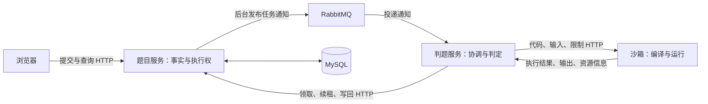

# 链路二：提交与判题

用户提交 Java 代码后，平台怎样保存、执行并形成判定？本篇按 **机制解释 → 源码对照 → 纸上推演** 展开，先建立完整理解，再打开源码核对。

阅读场景是普通练习，开启 `codeoj.reliable-judge.enabled=true`（默认关闭），只沿可靠实现阅读。比赛准入和成绩计算分别见[赛事链路](04-赛事报名与参赛链路.md)、[榜单链路](05-成绩榜单与结算链路.md)。

## 第一部分：先把机制讲清楚

### 1. 判题的输入与结果

假设用户 7 打开题目 42，提交一个求和程序 P。题目准备了两组测试：输入 `1 2` 应输出 `3`，输入 `2 5` 应输出 `7`，并规定时间和内存限制。下文 S1 表示提交，H1 表示固定规格，E1 表示派发事件，T1 表示执行凭证；均为教学符号。

| 材料 | 来自哪里 | 用来做什么 |
| --- | --- | --- |
| 语言与源代码 | 用户的提交 | 确定要编译、运行哪个程序 |
| 输入与标准输出 | 题目保存的隐藏用例 | 输入供程序处理，标准输出供平台核对 |
| 资源限制与比较规则 | 题目的判题配置及固定规格 | 确定怎样才算超限、怎样才算输出相同 |

**沙箱运行程序，判题服务判断答案。** 沙箱接收代码、输入和资源限制，返回实际输出、执行结果及资源信息。标准输出留在判题服务，用来比较答案，不交给用户程序。

若 P 正常运行并产生 `3`、`7`，还要确认用例数量完整、资源数据有效、时间和内存未超限，才能判 AC。若第二组得到 `8`，资源未超限时判 WA。编译失败可以直接形成 CE，不需要再比较答案。

沿这个过程，会遇到四种不同的“成功”：

| 你看到的结果 | 它实际说明什么 |
| --- | --- |
| 提交接口返回 202 和提交 ID | 平台已受理，后续可以按 ID 跟踪；此时不要求代码已经运行 |
| 沙箱返回 EXECUTED | 程序完成运行，还需要判题服务检查资源和答案 |
| 执行记录变成 COMPLETED | 此次判题已形成并保存用户判定，判定可以是 AC、WA、CE 等 |
| 最终判定为 AC | 在本次固定规则下，资源与输出都符合要求 |

### 2. 服务分工与通信

**题目服务管理事实与执行权：** 保存题目、代码、固定规格、执行状态和最终结果，通过数据库事务决定谁能执行、哪些结果能生效。

**判题服务协调执行：** worker 领取材料，调用沙箱，解释响应并比较答案，再向题目服务写回判定。

**沙箱编译、运行并清理用户程序：** 提供受限执行环境，内部机制在[沙箱链路](03-沙箱执行与回收链路.md)展开。

这样拆分后，提交请求和数据库事务无需等待用户程序运行；后台可以独立使用执行资源。代价是必须处理跨进程交接中的重复、失联和迟到。当前用户服务与题目服务默认共用 `codeoj` 数据库，关键事务还会查账号表，不能仅凭服务划分推断数据完全独立。

#### 2.1 公开接口与内部接口

公开接口接收用户提交、提供结果查询，用户身份由后端会话确定。内部接口供后台领取、续租和写回；调用方必须交出派发或执行身份，由题目服务检查前置条件，不能任意 update status。

内部请求由服务凭据请求头、服务端过滤器及网关检查保护，路径名 `inner` 本身不提供鉴权。服务凭据验证调用方，任务 token 验证当前执行身份，两者不能替代。

#### 2.2 Client 怎样发起远程调用

判题端持有的 `QuestionFeignClient` 是一份 HTTP 调用契约。Spring OpenFeign 根据接口上的服务名、路径和方法注解创建客户端代理；worker 调用代理方法时，代理编码参数、定位服务地址并发出 HTTP 请求，收到响应后再转换成 Java 对象。

以领取为例：

1. worker 调用本进程里的 Client 代理，交出派发消息。
2. 代理向题目服务的 `/api/question/inner/execution/claim` 发 POST，请求体是派发数据；项目拦截器附加内部鉴权头。
3. 题目服务接收 HTTP，由内部 Controller 调用本地执行命令。
4. 数据库事务决定是否授予执行权；响应经网络回到代理，再成为 worker 得到的领取结果。

题目服务的 `QuestionInnerController` 实现同一接口，便于保持契约对应。它与调用端代理分属不同进程，IDE“跳到实现”只是定位接收端；运行仍依赖服务地址、网络与提供方。

普通 Service 调用在本进程继续；Feign 跨 HTTP；MQ 消费和定时扫描分别由监听容器、调度器触发。后两者不延续原提交请求的调用栈。

### 3. 受理：保存一份完整、可追踪的提交

服务已经保存 S1，响应却在途中丢失，用户就会重试。受理阶段既要避免重复提交，也要把后续判题所需事实一起保存。

#### 3.1 用请求身份区分重试与新提交

页面用 `requestKey` 标识一次待确认提交，重试沿用；新提交换 key。后端以“用户 + key”识别请求，再用 `requestHash` 核对内容；普通练习的摘要包含请求类型、题目、语言和代码。

假设用户 7 用 key K 交来程序 P：

- 第一次没有旧记录，创建 S1。
- 同用户、同 key、同内容重试，返回原来的 S1，不重新增加提交数、执行记录和派发事件。
- 同用户、同 key，代码却换成 P2，报内容冲突，防止一个请求身份代表两份不同程序。
- 另一位用户使用同一个 key，属于另一组请求身份。

请求头 `Idempotency-Key` 与请求体 key 同时存在时必须一致。页面 loading 只能防本页连点，不能替代后端幂等。

**先查再插还不够。** 两个并发请求可能都查不到 K。数据库对 `(userId, requestKey)` 的唯一约束兜底，只允许一份事实成功；失败的一方退出并回滚本次事务后，回读成功记录，比较内容摘要再返回原 ID。不能把任意唯一冲突都直接当成提交成功。

#### 3.2 为什么受理时固定判题依据

提交进入后台前，管理员可能修改题目用例。如果执行时重新读取最新题目，S1 最终按什么规则判，就取决于排队时间和题库修改时机。

因此受理时把本次用例、时间/内存限制、规格版本及文本比较规则保存成固定规格，记为 H1。S1 持有 H1 的摘要引用。后台领取时校验规格内容与摘要，再取出材料；不会因为题库后来改变，就替换此次判题依据。

相同规格可以复用；代价是额外存储和版本校验。摘要不是加密，含隐藏用例的固定规格也不能返回普通做题页面。

#### 3.3 受理事务保存什么

| 数据 | 本例内容 | 为什么需要 |
| --- | --- | --- |
| `question_submit` | S1 的代码、语言、题目和提交者 | 留存用户交来的程序，兼容已有查询 |
| `judge_spec` | 固定规格 H1 | 留存本次判题依据；已有相同规格则复用 |
| `submission_execution` | S1 处于 QUEUED，尚未开始尝试 | 表达当前执行状态、身份、预算及结果版本 |
| `reliable_outbox` | 派发事件 E1，等待发布 | 留存“需要通知后台”的意图 |

这些写入和普通题目的提交数更新在同一个本地受理事务里完成。新受理还会检查数据库中的当前账号状态，不能只信旧会话。任一必要写入失败，就回滚此次事务；若 H1 是本次新建也一起回滚，已经存在的共享规格不会因此被删除。

事务提交后，Controller 返回 S1 和 HTTP 202。此时程序、规则、执行状态和待通知意图已保存，后台可能尚未消费，也可能已经开始工作。

#### 3.4 为什么拆成外层协调与内层事务

外层受理服务检查参数、处理重试；内层独立 Bean 的入口带事务注解。跨 Bean 调用经过 Spring 代理，建立事务，相关 JDBC 操作一起提交或回滚。代理完成事务处理后，外层才得到结果或异常。

因此暂态异常可以在旧事务退出后重试整次受理；唯一冲突则回读核对，避免在同一个失败事务里继续重试 SQL。

内部 write、freezeSpec 要求已有事务；同类内调用依赖入口事务，不会额外经过代理。这里用 JdbcTemplate 表达 SQL 与行锁，普通 CRUD 仍用 MyBatis-Plus。**本地事务不跨 MQ、HTTP 或沙箱。**

### 4. 派发：从数据库交接到 MQ

先保存代码、再直接发 MQ，会产生一个故障窗口：数据库已经提交，但服务在发送前退出，后台就没有收到通知。反过来先发 MQ，也可能让消费者看到尚未提交甚至最终回滚的数据。

#### 4.1 Outbox 与消息交接

Outbox 就是与业务事实一起提交的“待发送事件表”。本次受理把 E1 写入它，表示“需要派发 S1”。后台发布器周期扫描待发送事件，领取一次发布权，退出领取事务，再执行 MQ 网络发送，最后记录发送结果。

若进程在数据库提交后退出，E1 仍在，后续扫描可接着发。若发送已经到 Broker，但发布器没收到确认，平台只能认定这次结果未知，之后可能再次发送 E1。因此 Outbox 解决的是持久保留发送意图与补发机会，**不会消除重复消息**。

消息包含协议版本、提交 ID、派发代次及事件 ID，引用待处理任务；不包含用户源码和私有输入。判题端收到通知后，还要领取当前执行权和材料。这既缩小消息内容，也让过期消息不能自行决定执行。

本项目发布器把事件交给 `RabbitTemplate`，发往 DirectExchange `codeoj.judge.v1.exchange`，使用路由键 `judge`。交换机按照 Binding 将消息路由到 `codeoj.judge.v1.queue`；判题端监听容器收到队列投递后，调用 Consumer，再进入 worker。

交换机负责路由、队列保存投递、监听容器调用 Java 方法。拓扑和消息均配置持久化，消费采用手动确认。

#### 4.2 Confirm、Return、ACK 分别确认什么

| 信号 | 谁发给谁 | 在本项目中怎样理解 |
| --- | --- | --- |
| Publisher Confirm | Broker → 发布端 | Broker 对这次发布的确认；不能据此认定任务已经执行 |
| Return | Broker → 发布端 | mandatory 发布无法路由时返回；即使 Confirm 是 ACK，也不能视为有效路由成功 |
| Consumer ACK | 消费端 → Broker | 可以结束本次投递；它不表示用户代码 AC |
| 结果事务提交 | 题目服务 → 数据库 | 最终判定和完成状态已成为持久事实 |

发送记录也有身份。E1 是业务事件；第一次发送用发布 token A，确认不明后的第二次发送用 B。每次尝试有自己的 `publish_attempt` 证据。A 的迟到失败不能清掉 B 的发布租约或推翻已经成功的确认；A 若迟到返回有效 ACK 且没有 Return，也可以让同一事件收敛为已确认。

发布领取的确认窗口为 15 秒，单个派发事件最多尝试 20 次，耗尽转 ATTENTION。发布确认只改变事件状态；S1 仍可能处于 QUEUED，需后续领取或恢复。

#### 4.3 消费时区分“拒绝”与“未知”

Consumer 先校验消息大小和结构。坏消息拒绝重投，并由配置的死信路由送往隔离队列，不凭坏消息修改任意提交状态。

有效消息进入 worker。若明确无法领取，例如任务已完成或消息已过期，可以结束本次投递；若内部服务不可用、领取响应缺字段等，平台无法确认是否已处理，需要通过异常路径退避再 NACK 重投。

内部服务异常返回错误 HTTP 状态，避免被解读成默认 false。Consumer 在 worker 正常返回后 ACK，异常路径才退避重投；当前 worker 不会因 complete/fail 明确返回 false 就统一抛异常。因此 ACK 不能证明本次结果已写入，更不能证明 AC。

### 5. 领取：确定当前执行者

队列可能重投，两个消费者可能收到同一通知，旧代次的消息也可能很晚才到。收到消息只提供一次处理机会，不能证明该消费者现在拥有执行权。

#### 5.1 领取是一个数据库状态转换

worker 把消息交给题目服务的 claim 命令。题目服务锁住 S1 的执行记录，再检查：消息的事件与代次是否仍是当前值、执行状态是否为 QUEUED、是否已到允许执行时间、恢复预算是否剩余、固定规格是否有效。

符合条件才将 QUEUED 改成 RUNNING，尝试号从 0 加到 1，创建本次执行 token T1、租约和尝试记录，并返回代码、固定用例与限制。这个短事务提交后，worker 才调用沙箱。

两位消费者竞争时，后取得行锁的一方看到 RUNNING 就不能再领取，也不新增 attempt。执行权依赖数据库锁内的条件检查，不能只靠 worker 本地锁。

claim 返回 false 表示未授予执行权：可能是旧消息、状态不符或尚未到期；预算耗尽、规格损坏时还会转人工处理，并非一律没有数据库变化。

#### 5.2 为什么有这么多身份字段

| 身份 | 回答什么问题 | 什么时候改变 |
| --- | --- | --- |
| 用户 + requestKey，配 requestHash | 是否为同一次提交请求，内容是否相同 | 同次重试保持；新提交换 key |
| 提交 ID S1 | 正在处理哪份用户提交 | 执行重试仍保持 |
| 规格摘要 H1 | 此次按哪套固定规则判 | 同一提交的执行重试保持 |
| 派发代次 g1 + 事件 E1 | 当前是哪一轮安排执行的通知 | 恢复重新派发时变为 g2、E2 |
| attemptNo + executionToken T1 | 当前是哪一次获权执行 | 真正领取成功时新增尝试并生成 token |
| 发布 token A、B | E1 的哪一次网络发送 | 同一个事件补发时改变 |

`judge_attempt` 保留执行历史，`publish_attempt` 保留发布历史。补发通知、重新派发、获权执行是三个动作。

#### 5.3 租约、心跳和总期限怎样配合

worker 失联后，执行权必须能被回收：领取时给 15 秒租约，worker 每 5 秒请求续租。为避免无限续租，每次尝试最多 60 秒，且受整份提交的恢复总期限约束；续租不能越过尝试期限。

假设领取时是 T=0，总恢复期限还很远：

| 数据库时刻 | 发生什么 | 有效期限 |
| --- | --- | --- |
| T=0 | 领取成功 | 租约至 15 秒；本次尝试至 60 秒 |
| T=5 | 正常心跳 | 租约至 20 秒；尝试仍至 60 秒 |
| T=55 | 此前持续续租 | 租约最多至 60 秒，不能延到 70 秒 |
| T=60 | 心跳或结果才到 | 当前执行权已过期，不能继续作为有效 owner 写结果 |

题目服务在锁定记录后使用数据库时间判定。有效 owner 要同时满足 RUNNING、attempt/token 相同、租约未过期、尝试期限未过期、恢复总期限未过期。

心跳明确失败则标记失权，跳过主动完成；网络异常只说明未知，由写回检查兜底。**租约失效不会自动停止旧沙箱进程**，物理回收由沙箱负责。

### 6. 判定：从沙箱响应到结果生效

领取成功后，worker 从固定规格取出输入，连同代码、语言、资源限制、执行 token 与尝试期限组成沙箱请求。标准输出仍留在判题端。

#### 6.1 校验响应，区分用户结果与平台错误

沙箱 HTTP 调用有连接、读取和总调用超时，也限制响应大小并校验 JSON 协议。HTTP 超时只表示判题端没有按时得到响应；原因可能是网络或执行管理器故障，不能直接认定用户程序超时。

收到响应后还要检查 outcome 与兼容 status 是否一致、响应是否完整。平台错误或拒绝执行不生成用户判定；缺少必要资源指标、输出数量不对等，也应进入平台错误处理，不能补零或补空字符串继续判 AC。

#### 6.2 资源检查与答案比较

若沙箱给出合法的 CE、RE、TLE、MLE 等用户执行结果，映射器可形成对应判定。若 outcome 是 EXECUTED，则只说明可以进入后续资源和答案检查，映射器返回“仍需策略判定”。

本项目 Java 策略的判断顺序是：

1. 验证时间、内存等必要指标有效，输出数量与用例数量一致，资源限制有效。
2. 时间超过限制，判 TLE；否则内存超过限制，判 MLE。
3. 逐组比较标准输出与实际输出，有不匹配则 WA；全部匹配才 AC。缺失输出属于平台数据问题。

时间单位为毫秒，内存为 KiB；同时超限时，当前策略先判 TLE。

TEXT_V1 将 CRLF 换成 LF，只忽略一个末尾 LF，其余空白保留：`3` 与 `3\n` 匹配，`3 ` 与 `3` 不匹配，多个末尾换行不会全部清除。

#### 6.3 工厂、代理与策略的分工

- 工厂选择沙箱调用实现，当前支持 remote；它决定“怎样到达执行服务”。
- 手写 `CodeSandboxProxy` 包装调用前后的有限诊断；它与前面负责 HTTP 调用的 Feign 代理用途不同。
- 判题策略消费本地上下文中的标准用例、输出和指标，决定“怎样形成用户判定”。

拆分便于分别调整传输、诊断和判定规则。当前策略仍按语言分支手动创建，可靠链只接受 Java；新增语言还须同步修改准入与编译运行协议。

#### 6.4 校验执行权，再提交结果

worker 算出 AC 后，可能已经失去 T1 的执行权。此时若直接按 S1 更新结果，就可能覆盖新尝试。因此完成命令必须携带 S1、attemptNo 和 T1，题目服务再次锁行，检查当前身份与期限。

首次有效完成会在一个事务里：结束本次 attempt，将执行状态改为 COMPLETED，保存规范化判定、结果摘要和递增的结果版本，更新兼容查询字段，并写入 JUDGE_RESULT 结果事件。普通练习为 AC 时还增加题目通过提交数；这里统计的是通过提交次数，不是独立通过人数。

JUDGE_RESULT 供后续计分使用，与触发执行的 JUDGE_DISPATCH 分开发布。

若完成响应丢失，同一个 attempt/token 再提交相同的规范化结果，数据库比较摘要后返回成功，不重复更新统计或创建结果事件；同 token 换成另一份结果则拒绝并记录冲突。旧 token 或超期结果也会被拒绝。

### 7. 恢复：失败后重新安排，预算耗尽则停止

#### 7.1 用户错误与平台失败走不同方向

平台未能形成可靠判定时，worker 通过 fail 命令记录错误；已经形成的 CE、WA 等用户判定则走完成流程。

fail 也要求有效执行身份。成功后结束本次 attempt 为 FAILED；若仍有预算，提交进入 RETRY_WAIT 并设置退避时间，等待恢复扫描。若错误记录本身因 RPC 不可用而抛异常，异常可到达 Consumer 触发重投；若 worker 已失权，则不能再以旧身份安排新状态。

worker 名额不足时尚未领取，走 defer 持久延后，不增加 attempt。worker 本地名额、数据库执行权和沙箱物理 slot 分属不同层次。

#### 7.2 定时扫描怎样让失联任务重新流转

执行恢复器周期找候选，再逐条调用恢复事务。候选扫描不授予执行权；恢复事务锁行后重新检查当前状态、时间和预算。

| 当前情况 | 恢复事务怎样判断和处理 |
| --- | --- |
| RUNNING 且租约仍有效 | 保留当前 owner，不重新派发 |
| RUNNING 已失联过期 | 结束旧 attempt 为 EXPIRED，有预算才重新派发 |
| RETRY_WAIT | 到等待时间才重新派发；总期限耗尽则转人工处理 |
| QUEUED 长时间无人领取 | 当前实现等待约 30 秒后可重新派发；即使旧事件已 Confirm 也要检查 |
| COMPLETED 或 NEEDS_ATTENTION | 自动扫描不重新打开 |

重新派发时，S1 和 H1 保持，代次 g1 变 g2，事件 E1 变 E2，清除旧执行 token，状态回 QUEUED，并在同一事务写入新派发事件。等新的 worker 领取成功，才增加 attempt 并生成 T2。

旧 E1 被派发身份检查挡住；旧 T1 的迟到结果被执行身份与期限检查挡住。

#### 7.3 为什么必须有恢复预算

服务若一直不可用，无限派发会持续消耗队列、数据库和执行资源。本项目首次受理的执行预算是最多 3 次尝试、最多 10 个派发代次、总恢复期限 15 分钟；这些与“每个派发事件最多 20 次网络发布”不是同一个限制。

自动恢复耗尽预算，或发现不支持的规格等不可继续条件，会进入 NEEDS_ATTENTION，保留诊断供管理员处理。用户重试同一次请求，只返回原提交，不重置这些预算。

管理员重试需校验当前管理员身份、期望状态版本、原因及有限预算，并记录审计，防止旧操作覆盖新状态或无限恢复。

### 8. 查询：读取结果，而非等待原请求

普通做题页受理成功后跳到提交列表。列表发起新的 HTTP 查询，题目服务读取提交记录，组装展示对象，附加可靠执行状态、受理时间与尝试号，并按当前用户权限处理源码可见性。

这是独立查询：结果尚未提交时可能看到 QUEUED 或 RUNNING，之后再查才能得到最终判定。比赛页的单提交状态查询是另一条页面调用。提交 ID 在 JSON 中保留为字符串，避免前端 Number 精度损失。

把本例在数据库中的变化串起来：

| 时点 | 提交及规则 | 当前执行权 | 事件与结果 |
| --- | --- | --- | --- |
| 受理事务提交 | S1、程序 P、规格 H1 | QUEUED，attempt=0，无 token | 派发 g1/E1 已保存，无最终判定 |
| E1 发布得到确认 | 不变 | 仍可能 QUEUED | 发布证据变化，不等于领取成功 |
| 第一次领取成功 | 不变 | RUNNING，attempt=1，token=T1，有期限 | 新增一次 RUNNING 尝试 |
| 有效完成事务提交 | 不变 | COMPLETED，本次尝试结束 | 判定 AC、结果版本 1、结果事件一起保存 |
| 浏览器再次查询 | 读取保存的事实 | 展示当前执行状态 | 展示最终判定，不重新执行程序 |

## 第二部分：机制理解后，再对照源码

沿下面八段核对方法职责和事务边界。DTO、通用 CRUD 与工具类按需回查。

### 1. 请求入口

| 源码 | 方法作用与阅读范围 |
| --- | --- |
| [ViewQuestionView.vue](../../codeoj-frontend/src/views/question/ViewQuestionView.vue) | 看 loadData 如何取得题目、doSubmit 如何生成/复用请求 key、提交成功后清理 key 并跳转列表；跳过模板样式 |
| [QuestionController.doQuestionSubmit](../../codeoj-backend/codeoj-backend-question-service/src/main/java/com/codeoj/codeojbackendquestionservice/controller/QuestionController.java) | 整理 header/body key、取得当前用户、调用提交 Service，可靠受理正常返回后设置 202 |
| [QuestionSubmitServiceImpl.doQuestionSubmit](../../codeoj-backend/codeoj-backend-question-service/src/main/java/com/codeoj/codeojbackendquestionservice/service/impl/QuestionSubmitServiceImpl.java) | 只跟开头 reliableEnabled 分支进入可靠受理；后面的旧发送逻辑属于另一条实现 |

### 2. 受理事务与固定规格

| 源码 | 方法作用与阅读范围 |
| --- | --- |
| [ReliableSubmissionService.accept](../../codeoj-backend/codeoj-backend-question-service/src/main/java/com/codeoj/codeojbackendquestionservice/submission/ReliableSubmissionService.java) | 校验 Java、代码大小和 key；读完整个 retry/catch，区分唯一冲突回读与暂态异常整次重试 |
| [SubmissionAcceptance.accept](../../codeoj-backend/codeoj-backend-question-service/src/main/java/com/codeoj/codeojbackendquestionservice/submission/SubmissionAcceptance.java) | 单次受理事务入口；顺着 prior/replay、账号检查、题目材料、freezeSpec、write 和 submitNum 更新读 |
| [SubmissionAcceptance.freezeSpec](../../codeoj-backend/codeoj-backend-question-service/src/main/java/com/codeoj/codeojbackendquestionservice/submission/SubmissionAcceptance.java) | 校验规格并把版本、比较器、限制、用例序列化，以摘要保存/复用；结合 validateSpec 理解材料预算 |
| [SubmissionAcceptance.write](../../codeoj-backend/codeoj-backend-question-service/src/main/java/com/codeoj/codeojbackendquestionservice/submission/SubmissionAcceptance.java) | 保存代码，建立 QUEUED 权威记录，设置初始预算，调用 insertDispatch；区分插事件与发 MQ |
| [ExecutionRepository](../../codeoj-backend/codeoj-backend-question-service/src/main/java/com/codeoj/codeojbackendquestionservice/submission/ExecutionRepository.java)、[V001 表结构](../../codeoj-backend/mysql-init/migrations/V001__reliable_judging.sql) | 定点读 byKey、requireAccount、find、insertDispatch、now；对照唯一约束及表关系，不必通读全部 SQL |

### 3. 发布和消息接收

| 源码 | 方法作用与阅读范围 |
| --- | --- |
| [OutboxRelay.tick](../../codeoj-backend/codeoj-backend-question-service/src/main/java/com/codeoj/codeojbackendquestionservice/submission/outbox/OutboxRelay.java) | 调度入口，按 due → claim → publish 交接；它不在原提交 HTTP 调用栈里 |
| [OutboxStore.claim](../../codeoj-backend/codeoj-backend-question-service/src/main/java/com/codeoj/codeojbackendquestionservice/submission/outbox/OutboxStore.java) | 锁定事件，检查可发布条件和预算，建立一次发布 token/期限/证据；此方法结束后才发网络请求 |
| [OutboxDelivery.publish](../../codeoj-backend/codeoj-backend-question-service/src/main/java/com/codeoj/codeojbackendquestionservice/submission/outbox/OutboxDelivery.java)、[OutboxStore.record](../../codeoj-backend/codeoj-backend-question-service/src/main/java/com/codeoj/codeojbackendquestionservice/submission/outbox/OutboxStore.java) | 前者发送并接回调，后者持久记录证据；分别追踪 ACK、Return、UNKNOWN、迟到旧 token |
| [ReliableJudgeTopology](../../codeoj-backend/codeoj-backend-judge-service/src/main/java/com/codeoj/codeojbackendjudgeservice/rabbitmq/ReliableJudgeTopology.java)、[ReliableJudgeConfiguration](../../codeoj-backend/codeoj-backend-question-service/src/main/java/com/codeoj/codeojbackendquestionservice/submission/ReliableJudgeConfiguration.java) | 对照 exchange、queue、binding、隔离队列以及发布确认配置 |
| [ReliableJudgeConsumer.receive](../../codeoj-backend/codeoj-backend-judge-service/src/main/java/com/codeoj/codeojbackendjudgeservice/rabbitmq/ReliableJudgeConsumer.java) | 监听入口；区分坏消息 Reject、process 正常返回后的 ACK、异常退避后的 NACK |

### 4. 跨服务契约与内部命令

| 源码 | 方法作用与阅读范围 |
| --- | --- |
| [QuestionFeignClient](../../codeoj-backend/codeoj-backend-service-client/src/main/java/com/codeoj/codeojbackendserviceclient/service/QuestionFeignClient.java) | 看服务名、路径和五个 execution HTTP 契约；这是调用端代理的声明 |
| [FeignInnerAuthConfig](../../codeoj-backend/codeoj-backend-service-client/src/main/java/com/codeoj/codeojbackendserviceclient/config/FeignInnerAuthConfig.java)、[InnerApiAuthFilter](../../codeoj-backend/codeoj-backend-service-client/src/main/java/com/codeoj/codeojbackendserviceclient/filter/InnerApiAuthFilter.java) | 看请求头怎样附加、提供方怎样检查；不要把内部凭据与任务 token 混同 |
| [QuestionInnerController](../../codeoj-backend/codeoj-backend-question-service/src/main/java/com/codeoj/codeojbackendquestionservice/controller/inner/QuestionInnerController.java) | 领取、续租、完成、失败、延后分别委托哪个命令；旧普通 update 如何阻止绕过可靠执行权威 |
| [ExecutionRpcAdvice](../../codeoj-backend/codeoj-backend-question-service/src/main/java/com/codeoj/codeojbackendquestionservice/submission/ExecutionRpcAdvice.java) | 看服务异常为何返回非正常 HTTP 状态，避免远端失败被解读成默认 false |

### 5. 领取与续租

先读 [ExecutionCommands.claim](../../codeoj-backend/codeoj-backend-question-service/src/main/java/com/codeoj/codeojbackendquestionservice/submission/ExecutionCommands.java)：按“锁行 → 当前消息/状态 → 时间与预算 → 规格 → 创建 attempt/token → 保存 → 返回 JudgeLease”核对。特别注意：有些 false 分支会写入人工处理状态。

再读同文件的 heartbeat、currentMessage、sameToken、owned，以及 [JudgeLease](../../codeoj-backend/codeoj-backend-model/src/main/java/com/codeoj/codeojbackendmodel/model/reliability/JudgeLease.java)、[ExecutionCommand](../../codeoj-backend/codeoj-backend-model/src/main/java/com/codeoj/codeojbackendmodel/model/reliability/ExecutionCommand.java)。前者让你看到派发身份和执行身份的不同检查，后两者让你看到领取返回的材料、后续命令携带的身份。

最后读 [ReliableJudgeWorker.process](../../codeoj-backend/codeoj-backend-judge-service/src/main/java/com/codeoj/codeojbackendjudgeservice/judge/ReliableJudgeWorker.java) 的 slots、claim 和心跳任务创建/取消。确认本地容量检查发生在领取前，心跳定时器只发请求，真正的续租决定在数据库端。

### 6. 沙箱响应与答案判定

| 源码 | 方法作用与阅读范围 |
| --- | --- |
| [ReliableJudgeWorker.process](../../codeoj-backend/codeoj-backend-judge-service/src/main/java/com/codeoj/codeojbackendjudgeservice/judge/ReliableJudgeWorker.java) | 从成功 lease 开始，看请求字段、executeCode、userVerdict、result==null 分支与 JudgeContext；找到标准输出留在哪 |
| [CodeSandboxFactory.newInstance](../../codeoj-backend/codeoj-backend-judge-service/src/main/java/com/codeoj/codeojbackendjudgeservice/judge/codesandbox/CodeSandboxFactory.java)、[CodeSandboxProxy.executeCode](../../codeoj-backend/codeoj-backend-judge-service/src/main/java/com/codeoj/codeojbackendjudgeservice/judge/codesandbox/CodeSandboxProxy.java) | 区分实现选择与调用包装；不要与 Feign 代理混称 |
| [RemoteCodeSandbox.executeCode](../../codeoj-backend/codeoj-backend-judge-service/src/main/java/com/codeoj/codeojbackendjudgeservice/judge/codesandbox/impl/RemoteCodeSandbox.java) | HTTP 编码/解码、认证、超时、响应限制；确认传输超时抛平台错误 |
| [SandboxResultMapper.userVerdict](../../codeoj-backend/codeoj-backend-judge-service/src/main/java/com/codeoj/codeojbackendjudgeservice/judge/SandboxResultMapper.java) | 先校验协议，区分平台错误、直接用户判定、需要比较答案的 EXECUTED |
| [JudgeManager.doJudge](../../codeoj-backend/codeoj-backend-judge-service/src/main/java/com/codeoj/codeojbackendjudgeservice/judge/JudgeManager.java)、[JavaLanguageJudgeStrategy.doJudge](../../codeoj-backend/codeoj-backend-judge-service/src/main/java/com/codeoj/codeojbackendjudgeservice/judge/strategy/JavaLanguageJudgeStrategy.java) | 先看语言选择，再看数据有效性、资源检查、逐组答案比较的顺序 |
| [TextOutputComparator.matches](../../codeoj-backend/codeoj-backend-model/src/main/java/com/codeoj/codeojbackendmodel/model/codesandbox/TextOutputComparator.java) | 连同 normalize 核对 TEXT_V1，纸上比较有无末尾换行及空格的几组字符串 |

### 7. 结果写回与查询

读 [ExecutionCommands.complete](../../codeoj-backend/codeoj-backend-question-service/src/main/java/com/codeoj/codeojbackendquestionservice/submission/ExecutionCommands.java)，依次跟 canonicalResult、同 token 完成回放、owned、finishAttempt、结果保存及 JUDGE_RESULT 插入。把“比较结果摘要”和“检查当前执行权”分开：前者保护已完成结果的重复回放，后者决定首次结果能否生效。

回 worker、Consumer 核对 boolean 返回值与异常分别怎样处理，再跟查询入口读取结果：

| 源码 | 方法作用与阅读范围 |
| --- | --- |
| [QuestionSubmitView.vue](../../codeoj-frontend/src/views/question/QuestionSubmitView.vue) | 看 loadData 发出的列表查询，确认页面不是沿原 HTTP 请求等待判题 |
| [QuestionController.listQuestionSubmitByPage](../../codeoj-backend/codeoj-backend-question-service/src/main/java/com/codeoj/codeojbackendquestionservice/controller/QuestionController.java)、[QuestionSubmitServiceImpl.getQuestionSubmitVO](../../codeoj-backend/codeoj-backend-question-service/src/main/java/com/codeoj/codeojbackendquestionservice/service/impl/QuestionSubmitServiceImpl.java) | 列表入口 → getQuestionSubmitVOPage → 单条 VO 组装；看可靠状态附加与源码脱敏 |
| [JsonConfig](../../codeoj-backend/codeoj-backend-common/src/main/java/com/codeoj/codeojbackendcommon/config/JsonConfig.java) | 核对 Long 的字符串序列化，解释前端为什么需要保留 ID 精度 |

### 8. 失败与恢复

读 worker 的 catch、lost 和 finally，确认错误命令、失权后跳过写回及本地资源释放。再读 [ExecutionCommands.fail](../../codeoj-backend/codeoj-backend-question-service/src/main/java/com/codeoj/codeojbackendquestionservice/submission/ExecutionCommands.java) 与 defer，区分“已领取后的平台失败”和“尚未领取的容量延后”。

接着读 [ExecutionRecovery.tick](../../codeoj-backend/codeoj-backend-question-service/src/main/java/com/codeoj/codeojbackendquestionservice/submission/ExecutionRecovery.java) → ExecutionRepository.recoverable → [ExecutionCommands.recover](../../codeoj-backend/codeoj-backend-question-service/src/main/java/com/codeoj/codeojbackendquestionservice/submission/ExecutionCommands.java)，进入 requeue、exhausted、attention。最后读 manualRetry：核对管理员、期望版本、原因、有限扩展和审计。

## 第三部分：用纸上推演检查理解

### 1. 四个推演

**练习一：同一个提交请求来了三次。** 用户 7 第一次用 K 提交 P；没收到响应，同内容同 K 再发一次；第三次改代码仍用 K。分别写出返回结果，以及提交记录、执行记录、派发事件是否增加。

核对：前两次是同一 S1，只有第一次新受理产生事实；第三次内容冲突，不新增。若两次请求并发，必须在解释中补上唯一约束、失败事务回滚后回读。

**练习二：程序运行成功，但第二组输出是 8。** 假设协议、用例数量和资源数据完整，资源未超限。分别写出沙箱 outcome、最终 verdict、数据库 executionStatus。

核对：EXECUTED、WA、COMPLETED。若缺失内存指标，应走平台错误而不是用 0 继续比较。若只是 HTTP 没收到响应，也不能推断 TLE。

**练习三：两位消费者收到 E1。** 第一位领取得到 T1，第二位随后申请。再假设第一位失联，恢复器确认租约过期且预算充足，重新派发后第二位获得 T2，旧 T1 这时带 AC 返回。

核对：第二次同代领取看见 RUNNING，不新增尝试；恢复创建 g2/E2，新的领取才产生下一 attempt/T2；S1/H1 保持。旧 T1 被拒绝，但不代表其旧容器已自动退出。

**练习四：结果已提交，但响应或 ACK 丢失。** 分别推演重复 complete 和 MQ 重投，解释普通题目通过数与结果事件为什么不重复。

核对：同 token 同规范化结果由摘要回放，且不再执行首次完成写入；消息重投后 claim 看见 COMPLETED，不会再次授予执行权。不要用“MQ 恰好只投递一次”解释。

### 2. 对照现有测试

先静态阅读夹具和断言，再按需运行测试。

| 机制 | 测试定位 | 重点核对 |
| --- | --- | --- |
| 稳定请求身份 | [请求重放与内容冲突](../../codeoj-backend/codeoj-backend-question-service/src/test/java/com/codeoj/codeojbackendquestionservice/submission/ReliableExecutionTest.java) | 相同 ID、冲突、表计数与 submitNum；测试代码只是受理材料，没有执行 |
| 受理原子性 | [Outbox 插入失败回滚](../../codeoj-backend/codeoj-backend-question-service/src/test/java/com/codeoj/codeojbackendquestionservice/submission/ReliableExecutionTest.java) | 人为令事件插入失败，检查本次提交、执行、新规格和统计回滚 |
| 并发幂等与竞争领取 | [同 key 并发受理](../../codeoj-backend/codeoj-backend-question-service/src/test/java/com/codeoj/codeojbackendquestionservice/submission/ReliableExecutionTest.java)、[并发领取](../../codeoj-backend/codeoj-backend-question-service/src/test/java/com/codeoj/codeojbackendquestionservice/submission/ReliableExecutionTest.java) | 两类并发分别保护请求事实与执行权，不能相互替代 |
| 固定规则 | [题库修改后的固定规格](../../codeoj-backend/codeoj-backend-question-service/src/test/java/com/codeoj/codeojbackendquestionservice/submission/ReliableExecutionTest.java) | 题库变化后，已受理请求与固定规格的关系 |
| 结果回放与过期身份 | [完成结果回放](../../codeoj-backend/codeoj-backend-question-service/src/test/java/com/codeoj/codeojbackendquestionservice/submission/ReliableExecutionTest.java)、[过期租约与恢复](../../codeoj-backend/codeoj-backend-question-service/src/test/java/com/codeoj/codeojbackendquestionservice/submission/ReliableExecutionTest.java) | 统计/事件一次生效、旧身份失效、新派发幂等 |
| 发布与消费分支 | [OutboxRelayTest](../../codeoj-backend/codeoj-backend-question-service/src/test/java/com/codeoj/codeojbackendquestionservice/submission/outbox/OutboxRelayTest.java)、[ReliableJudgeConsumerTest](../../codeoj-backend/codeoj-backend-judge-service/src/test/java/com/codeoj/codeojbackendjudgeservice/rabbitmq/ReliableJudgeConsumerTest.java) | Confirm/Return/UNKNOWN、坏消息、ACK/NACK，以及模拟 Broker/worker 的边界 |
| worker 与协议 | [ReliableJudgeWorkerTest](../../codeoj-backend/codeoj-backend-judge-service/src/test/java/com/codeoj/codeojbackendjudgeservice/judge/ReliableJudgeWorkerTest.java)、[SandboxResultMapperTest](../../codeoj-backend/codeoj-backend-judge-service/src/test/java/com/codeoj/codeojbackendjudgeservice/judge/SandboxResultMapperTest.java) | Feign/沙箱替身下的请求字段、失败命令及平台异常分界 |
| 策略与文本规则 | [JavaLanguageJudgeStrategyTest](../../codeoj-backend/codeoj-backend-judge-service/src/test/java/com/codeoj/codeojbackendjudgeservice/judge/strategy/JavaLanguageJudgeStrategyTest.java)、[TextOutputComparatorTest](../../codeoj-backend/codeoj-backend-model/src/test/java/com/codeoj/codeojbackendmodel/model/codesandbox/TextOutputComparatorTest.java) | 指标缺失、资源超限、输出数量、精确文本规范化 |

上表前五行都在 ReliableExecutionTest 中，按测试英文名中的 stableKey、outboxInsertFailure、concurrentSameKey、simultaneousClaims、snapshotIsFrozen、completedReplay、expiredLease 定位对应方法。

ReliableExecutionTest 使用 Spring/JDBC 与 H2 MySQL 模式，其他测试含 MQ、Feign 或沙箱替身；这些断言不等于真实跨进程验收。运行证据见[当前项目状态](../status.md)。

能解释材料来源、服务交接、事务边界与故障接手后，继续读[沙箱执行与回收](03-沙箱执行与回收链路.md)。
