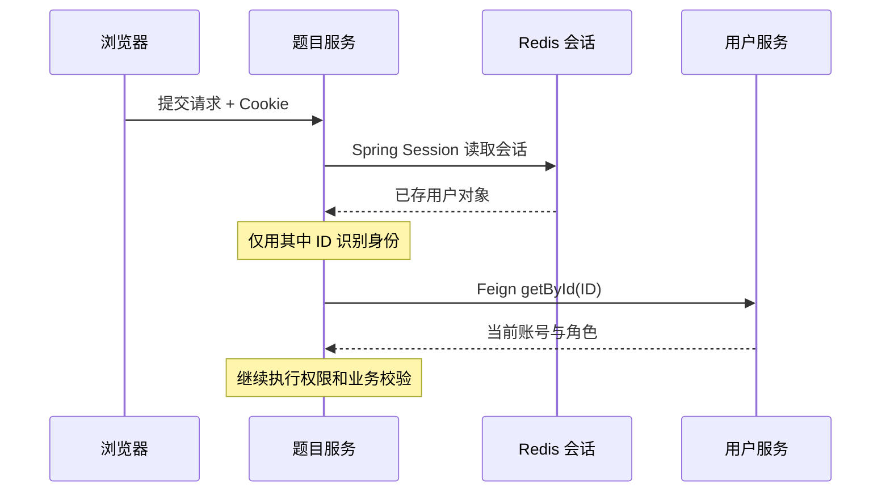

# 公共层与用户服务：一次登录怎样支撑整个项目

判题主链开始前，后端首先要回答“谁在提交”。本篇沿登录、跨服务识别用户、权限校验展开。读完应能解释 Session、Feign、AOP 和内部密钥的不同作用。

## 1. 先理解项目中的几种对象

| 对象 | 作用 | 在项目里的例子 |
| --- | --- | --- |
| Request DTO | 接收用户允许填写的参数 | 登录账号密码、提交语言和代码 |
| Entity | 表示数据库记录 | `User`、`Question`、`QuestionSubmit` |
| VO | 按页面需要输出且做脱敏 | `LoginUserVO`、`QuestionVO`、`QuestionSubmitVO` |
| 内部协议 | 表示服务间业务命令与响应 | `JudgeDispatch`、`JudgeLease`、`ExecutionCommand` |

不要把实体原样作为所有接口的响应。用户密码、隐藏测试用例、内部执行身份各有自己的访问边界。

[common](../../../codeoj-backend/codeoj-backend-common/src/main/java/com/codeoj/codeojbackendcommon) 提供 `BaseResponse`、`ResultUtils`、`ErrorCode`、`BusinessException` 和权限注解；[model](../../../codeoj-backend/codeoj-backend-model/src/main/java/com/codeoj/codeojbackendmodel/model) 提供上述共享类型；[service-client](../../../codeoj-backend/codeoj-backend-service-client/src/main/java/com/codeoj/codeojbackendserviceclient) 提供调用接口和共享鉴权逻辑。这三个是依赖库。

## 2. 第一次登录：密码怎样变成会话

阅读顺序：[UserController](../../../codeoj-backend/codeoj-backend-user-service/src/main/java/com/codeoj/codeojbackenduserservice/controller/UserController.java) 的 `userRegister/userLogin` → [UserServiceImpl](../../../codeoj-backend/codeoj-backend-user-service/src/main/java/com/codeoj/codeojbackenduserservice/service/impl/UserServiceImpl.java) 的同名方法。

注册时先做参数检查，检查账号是否可用，把密码用 BCrypt 编码后保存。登录时按账号查用户，再验证输入密码；BCrypt 不能按“重新加密后的字符串相等”直接查询密码。

登录成功后的关键代码是：

```java
// UserServiceImpl.userLogin 中的实际语句
request.getSession().setAttribute(USER_LOGIN_STATE, user);
return this.getLoginUserVO(user);
```

Session 保存登录态；返回的 VO 给页面展示。Spring Session Redis 将会话保存在 Redis，浏览器通过 Cookie 携带会话标识。Cookie 里不需要装管理员角色，页面 store 也不是后端授权依据。

当前还兼容历史 `md5(SALT + password)` 格式。旧密码验证通过后尝试升级 BCrypt，不能据此声称所有旧用户都已经迁移。

配置见[用户服务 application.yml](../../../codeoj-backend/codeoj-backend-user-service/src/main/resources/application.yml)：会话使用 Redis，Cookie path 为 `/api`。多服务要共享相容的会话配置与存储位置；Redis 编号不同会导致同一 Cookie 到其他服务时查不到会话。

## 3. 登录后提交代码：题目服务怎样认识用户



源码从 [UserFeignClient.getLoginUser](../../../codeoj-backend/codeoj-backend-service-client/src/main/java/com/codeoj/codeojbackendserviceclient/service/UserFeignClient.java) 跟到 [SessionUserResolver.requireLogin/permitNull](../../../codeoj-backend/codeoj-backend-service-client/src/main/java/com/codeoj/codeojbackendserviceclient/auth/SessionUserResolver.java)。

解析器先读取 `request.getSession(false)`，没有会话就不创建一个空会话冒充登录。随后取 Session 中用户的 ID，通过传入的 lookup 查询当前账号，检查 ID、逻辑删除与封禁，再返回当前用户。

**容易误读的地方：** Session 里实际保存了 User 对象，但代码不会信任它的旧角色。这里“Session 只提供身份”的含义是只用其 ID 去刷新账号，不是说 Redis 只存了一个 long。

## 4. default 方法为什么仍可能发生远程调用

`UserFeignClient` 中可以看到：

```java
// 实际实现
default User getLoginUser(HttpServletRequest request) {
    return SessionUserResolver.requireLogin(request, this::getById);
}
```

这段 default 方法在调用方本地执行。`getById` 则带有 `@GetMapping`，由 Feign 发 HTTP 请求。因此完整过程是“本地解析会话 → 远程查询当前账号”，不能把整段说成没有网络调用。

用户服务自己调用 `UserServiceImpl.getLoginUser` 时，lookup 是本地 `this::getById`，直接查本服务数据库。相同解析规则可以接不同查询实现。

## 5. 认证、业务权限、内部接口鉴权分别管什么

| 层次 | 问题 | 当前代码 |
| --- | --- | --- |
| 登录身份 | 当前是哪位用户？ | `SessionUserResolver` |
| 业务权限 | 是否管理员、是否本人、是否有参赛资格？ | `AuthInterceptor`、Controller 和事务中的显式检查 |
| 内部调用 | 调用者是否持有服务凭据？ | `GlobalAuthFilter`、`InnerApiAuthFilter` |
| 沙箱访问 | 是否允许请求执行代码？ | 沙箱 Controller 中的 `checkAuth` |

### AOP 与显式校验

[AuthInterceptor.doInterceptor](../../../codeoj-backend/codeoj-backend-service-client/src/main/java/com/codeoj/codeojbackendserviceclient/aop/AuthInterceptor.java) 拦截 `@AuthCheck` 方法，查询当前用户，再检查注解要求的角色。题目删除等场景还会显式判断是否本人或管理员。

关键写事务中，[ExecutionRepository.requireAccount](../../../codeoj-backend/codeoj-backend-question-service/src/main/java/com/codeoj/codeojbackendquestionservice/submission/ExecutionRepository.java) 再读当前数据库账号，某些路径加锁。入口鉴权与事务检查是不同位置，不能概括为“网关统一鉴权后其他地方不用检查”。

权限切面和事务都需要注意代理边界。默认代理模式下，同类内部直接调用不会因为被调用方法加了注解就触发新的拦截；已有外层事务仍可覆盖内部代码。Spring 的[事务代理说明](https://docs.spring.io/spring-framework/docs/5.2.x/spring-framework-reference/data-access.html#transaction-declarative-annotations)可用于理解这一点。

### 内部调用为什么还需要服务自己的过滤器

[FeignInnerAuthConfig](../../../codeoj-backend/codeoj-backend-service-client/src/main/java/com/codeoj/codeojbackendserviceclient/config/FeignInnerAuthConfig.java) 为内部请求附加 `X-Inner-Secret`。[GlobalAuthFilter](../../../codeoj-backend/codeoj-backend-gateway/src/main/java/com/codeoj/codeojbackendgateway/filter/GlobalAuthFilter.java) 在网关检查内部路径，[InnerApiAuthFilter](../../../codeoj-backend/codeoj-backend-service-client/src/main/java/com/codeoj/codeojbackendserviceclient/filter/InnerApiAuthFilter.java) 在业务服务再次检查，覆盖绕过网关直连端口的情况。

内部密钥证明持有服务凭据，不代表可以跳过比赛资格、当前账号、token 等业务检查。当前网关源码中的 JWT 注释是待办，不能据此介绍为已使用 JWT 登录。

## 6. 当前角色变了，旧 Cookie 应该怎样表现

管理员 U7 登录时 Session 中角色是 admin。之后数据库把 U7 改成 user。U7 再请求管理操作时：

1. Cookie 仍可能解析出原会话和用户 ID；
2. lookup 查询出当前 user 角色；
3. AOP 或事务权限检查拒绝管理操作。

这说明“会话仍有效”和“仍有管理员权限”不是同一件事。如果查询当前账号失败，解析器传播错误，不退回 Session 里的旧 admin。

会话 Redis 故障也不应显示为普通未登录。[SessionAvailabilityFilter](../../../codeoj-backend/codeoj-backend-service-client/src/main/java/com/codeoj/codeojbackendserviceclient/filter/SessionAvailabilityFilter.java) 在响应尚未提交等条件下，捕获 Redis 相关异常并返回 503 / `SESSION_STORE_UNAVAILABLE`。不能把这个特定保护说成所有故障均可恢复。

## 7. 响应与隐私再核对一次

`BaseResponse.code=0` 表示该业务响应成功；HTTP 202 是已受理，HTTP 409 常用于状态或幂等冲突，503 表示服务暂不可用。内部 Feign 方法可能直接返回对象或 boolean，是否包装要看实际签名。

题目 VO 不暴露隐藏用例。提交代码仅按本人/管理员等权限输出；单提交状态接口也先检查可见性。题目详情、提交列表和单次状态接口有各自规则，不应一概说“所有接口只允许本人访问”。

## 8. 自测与核对

1. **同一 Cookie 下管理员降权，哪一步拦住？** 当前账号查询刷新角色，业务权限检查拒绝；不是等 Cookie 自然过期。
2. **为什么服务调用失败不能返回 Session 中的用户？** 可能放行已降权、删除、封禁账号；当前查询失败不能当作权限未变。
3. **有内部密钥能否直接提交比赛代码？** 仍需业务资格、状态、时间、发布版本等检查。
4. **数据模型共用是否表示共用所有业务逻辑？** model 共享类型，Feign 共享契约，事实变更仍由相应业务服务负责。

通过标准：画出登录与后续跨服务请求两段流程，并定位一处角色检查、一处内部密钥检查和一处源码脱敏。测试对照：[CurrentAccountAuthorizationTest](../../../codeoj-backend/codeoj-backend-service-client/src/test/java/com/codeoj/codeojbackendserviceclient/auth/CurrentAccountAuthorizationTest.java)。继续读[题目与受理](03-网关与题目服务.md)。
