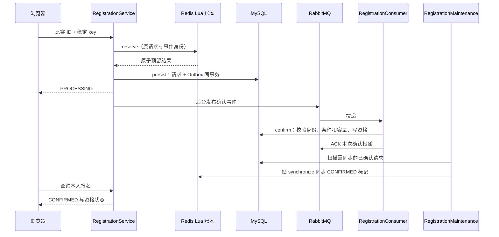

# 赛事与报名：从熟悉的秒杀理解当前实现

你已了解秒杀的大体模型，本篇不从 Redis 基础讲起。先把比赛的业务前提补齐，再对照“Lua 预扣 → MQ → 数据库确认”，解释当前增加的请求账本、修复、对账与版本检查。

读完应能画出报名与比赛提交两条链，并解释预留成功后为什么还需要恢复。

## 1. 比赛不是给普通题目加一个 contestId

比赛要固定题目、时间、名额和计分规则。源码入口是 [ContestController](../../../codeoj-backend/codeoj-backend-question-service/src/main/java/com/codeoj/codeojbackendquestionservice/contest/ContestController.java) → [ContestService](../../../codeoj-backend/codeoj-backend-question-service/src/main/java/com/codeoj/codeojbackendquestionservice/contest/ContestService.java) / [ContestTransactions](../../../codeoj-backend/codeoj-backend-question-service/src/main/java/com/codeoj/codeojbackendquestionservice/contest/ContestTransactions.java)。

| 业务对象 | 保存什么 | 不能和什么混淆 |
| --- | --- | --- |
| `contest` | 时间、容量、状态、发布版本、报名模式 | 当前页面推算出来的 phase |
| `contest_problem_snapshot` | 发布时固定的题目内容与 judgeSpecHash | 后来被修改的题库 question |
| `contest_registration_request` | 谁以什么 key 发起报名、当前处理和回收状态 | 最终资格 |
| `contest_registration` | 已确认资格 | Redis 在途预留 |
| 比赛提交上下文 | 比赛、快照、发布版本、acceptedAt | 普通练习的题目关联 |

定义见 [V002](../../../codeoj-backend/mysql-init/migrations/V002__contest_core.sql)、[V003](../../../codeoj-backend/mysql-init/migrations/V003__async_registration.sql)、[V005](../../../codeoj-backend/mysql-init/migrations/V005__registration_recovery_fence.sql)。

### 发布快照怎样产生

读 `ContestTransactions.create/update/publish`。管理员先编辑草稿，发布时校验版本和当前角色，读取题目来源，调用 `freezeSpec`，保存题目快照并改变比赛状态。

当前支持两种类型：PUBLIC_TRAINING 草稿只选公共题库 ID，发布时复制题目内容与判题设置；PRIVATE 直接在草稿提供私有题干、限制与用例，不关联公共源题。比赛提交引用 snapshotId 和 publishedVersion，即使源题后来修改，也不会换掉本场发布依据。

这里有三种不同版本：contest.version 控制管理操作，publishedVersion 表示发布内容版本，报名 epoch 表示账本代次。不要都称为“版本号”却说不清各自保护什么。

## 2. 报名有两种模式，先确认自己读哪条

[RegistrationService.register](../../../codeoj-backend/codeoj-backend-question-service/src/main/java/com/codeoj/codeojbackendquestionservice/contest/RegistrationService.java) 按单场模式分流。

| 模式 | 核心过程 | 适合怎样理解 |
| --- | --- | --- |
| DB_SYNC | 一个数据库事务创建请求并确认资格 | 先建立业务正确性的基线 |
| REDIS_READY 等 Redis 模式 | Redis 预留，DB 保存请求与事件，异步确认 | 当前秒杀链与故障恢复 |
| REDIS_PAUSED / REDIS_RECONCILING | 暂停或对账中 | 已有身份可恢复，新准入受限 |

全局 `ASYNC_REGISTRATION_ENABLED` 不会自动把所有比赛都切到 Redis 模式。prepare/reconcile 在管理员、版本和安全前提下完成单场切换，不能让旧 DB 分配器和新 Redis 分配器同时分配同一场容量。

## 3. 正常报名逐步跟读



### 3.1 Java 协调层做什么

`RegistrationService.register` 校验 key 与当前账号，先查数据库是否已有本人的原请求；有则要求原 key 并回读。进入 Redis 路径后，读取 `RegistrationSettings`，repair/check 账本，查用户映射，必要时调用 reserve，再以原身份 persist。

它没有把 Redis 和 DB 包进一个可回滚事务。数据库调用由独立 `RegistrationTransactions` 负责；跨系统空窗要靠记录和恢复处理。

### 3.2 Lua 除了扣库存还保存什么

读 [RedisRegistrationLedger.reserve/keys](../../../codeoj-backend/codeoj-backend-question-service/src/main/java/com/codeoj/codeojbackendquestionservice/contest/RedisRegistrationLedger.java) → [contest-registration.lua](../../../codeoj-backend/codeoj-backend-question-service/src/main/resources/lua/contest-registration.lua) 的 reserve 分支。

| Redis 结构 | 内容 |
| --- | --- |
| meta（Hash） | 发布/账本版本、闸门、时间、计数、mutation 意图 |
| stock（String） | 当前可预留库存 |
| users（Hash） | 用户 ID → 原 eventId |
| ledger（Hash） | eventId → 完整预留身份与状态 |
| pending（ZSet） | 待检查或同步的事件 |

五个 key 使用同一 hash tag。脚本检查类型、完整性、版本、时间、库存和用户身份，生成含 requestId、eventId、key、hash、epoch、sequence、原预留时间的记录。保存这些内容，是为了之后恢复同一次请求，而不是只知道“库存减了 1”。

第一遍先看 reserve、user、finish，再读 apply/repair；最后才看 init、gate、upgrade 与完整一致性检查。

### 3.3 数据库什么时候真正确认资格

[RegistrationTransactions.persist](../../../codeoj-backend/codeoj-backend-question-service/src/main/java/com/codeoj/codeojbackendquestionservice/contest/RegistrationTransactions.java) 正常写 PROCESSING 请求及 REGISTRATION_CONFIRM Outbox，同事务提交。按原预留时间设置有限恢复期限，补建时不能重新获得一整段自动恢复时间。

[RegistrationMessaging](../../../codeoj-backend/codeoj-backend-question-service/src/main/java/com/codeoj/codeojbackendquestionservice/contest/RegistrationMessaging.java) 负责消息传输，[RegistrationConsumer.receive](../../../codeoj-backend/codeoj-backend-question-service/src/main/java/com/codeoj/codeojbackendquestionservice/contest/RegistrationConsumer.java) 调 confirm。

confirm 核验原事件、发布上下文、账号、状态和期限，再进入 `ContestTransactions.confirmRegistration`。关键数据库约束包括比赛行锁、请求状态检查、唯一资格以及：

```sql
-- confirmRegistration 中的条件扣减，参数表示本场比赛
UPDATE contest SET remainingCapacity=remainingCapacity-1
WHERE id=? AND remainingCapacity>0;
```

正常事务还会插入确认资格并更新请求状态。重复确认已经处理的请求不能再次扣容量。Consumer 确认数据库处理后 ACK；Redis 的确认标记由维护器等恢复/协调路径调用 synchronize 同步，失败保留待同步状态继续恢复，不要求 Consumer 直接调用 Redis。

## 4. 与常见秒杀模型相比，当前多了什么

| 熟悉的思路 | 在本项目还要补的条件 | 保护的具体问题 |
| --- | --- | --- |
| Lua 原子扣减 | 同时保存原身份与 mutation 意图 | 中途报错后知道恢复哪个请求、目标库存是多少 |
| 预扣后异步落库 | 请求与 Outbox 同事务 | DB 已接纳后不会只剩一条无事件请求 |
| 唯一用户防重复 | 原 key、hash、event、发布版本一致 | 不把不同身份混成同一次报名 |
| 失败补库存 | 先落 DB 可回收终态，再幂等释放 | 未知执行误退款、重复退款、确认后退款 |
| 对账库存数字 | 核验每条身份、序号、状态和容量关系 | 数量一致但具体用户丢失 |
| 管理员重试 | 原 epoch/revision、原因、有限预算 | 旧管理结果覆盖新状态、无限自动重试 |

不要将这些机制解释成分布式事务。系统允许中间状态存在，通过可追溯身份、有限恢复和人工核查收敛。

## 5. 用名额例子读懂两套库存

总容量 2，A 预留成功未落库，B 已确认。此时：

| 指标 | 数值 | 含义 |
| --- | --- | --- |
| Redis stock | 0 | 已被 A、B 占用，不能再预留 |
| MySQL remainingCapacity | 1 | 还有一份容量尚未变为确认资格 |
| 页面已确认人数 | 1 / 2 | 只统计已确认资格 |

所以 C 不能拿 MySQL 的 1 再抢一次。A 恢复后补建原请求，确认时 DB 再扣至 0，最终两位资格成立。

如果 A 被明确终止，则先写 FAILED/RELEASE_PENDING，再由 finish 幂等释放。未知超时只说明没拿到结果，不能假设 A 没有预留并直接加库存。

## 6. 为什么 Lua 报错后需要 repair

脚本执行不被其他命令穿插，不代表运行时报错会撤销之前的写入。当前 apply 可能已经更新 stock，还没有完成用户映射和账本写入。

脚本在复合变更之前先写 mutation，保存原身份、原 stock/计数和目标状态。repair 校验观察值是允许的变更前或变更后值，再写确定目标。

例如原 stock=2，预留目标为 1。第一次已写为 1 后中断，repair 再写 1，而不是再 DECR。释放也写确定的目标，避免重复 INCR。

如果观测值与 mutation 证据矛盾，就保留暂停/人工核查，不能为了恢复服务直接重置库存。

## 7. 谁来发现并恢复中间状态

阅读 [RegistrationMaintenance.maintain](../../../codeoj-backend/codeoj-backend-question-service/src/main/java/com/codeoj/codeojbackendquestionservice/contest/RegistrationMaintenance.java)、`RegistrationService.recoverUnknown/synchronize`、`RegistrationTransactions.recover`。

| 故障点 | 恢复方向 |
| --- | --- |
| Lua 响应丢失 | repair + 原用户映射回查，找到原身份再 persist |
| 预留成功，DB 未落库 | pending 扫描补建原请求与 Outbox |
| Outbox 已 Confirm，仍无业务确认 | 按原事件、有限预算重开发布/确认 |
| DB 已确认，Redis 标记失败 | 重放 CONFIRMED 标记，不退款 |
| DB 已失败/取消，释放失败 | 重放原身份 RELEASED，不能重复退 |
| 自动预算耗尽 | MANUAL_REVIEW，保留预留，管理员明确 CONTINUE 或 FAIL |

请求状态与回收状态是两条轴。例如 CONFIRMED/COMPLETE 表示资格确认且同步完成；FAILED/RELEASE_PENDING 表示已决定失败但名额尚未释放。只看 status 不足以判断能否结算。

## 8. 旧快照和迟到对账为什么更难

### 8.1 数量相等，不代表身份完整

假设数据库已记录 A、B，Redis 回滚后丢了 B，又出现 C。两侧数量同为 2，但 B 的原身份已经缺失。对账必须按 request/event/user/版本/序号逐条比较，不能只对 COUNT。

settings 读取已落库 sequence 高水位，Lua 检查账本没有退回更早计数。V005 的 `(contestId, reservationEpoch, reservationSequence)` 唯一约束，进一步阻止旧快照重新把已使用序号绑定给其他身份。

无法验证的 Redis 丢失不能静默按 DB 余量初始化，因为还可能存在未落库预留。旧格式账本先关闸，核对完整身份和容量，提交稳定序号，再升级。

### 8.2 旧操作不能借用新版本

`reconcile` 先在 DB 建立本次 revision，操作 Redis、补建和同步，再在同一个原 revision 上完成核验。成功后进入新 revision。

若旧操作 R10 的外部调用很晚才报错，而 R11 已恢复成功，旧失败不得暂停 R11。`issueIfCurrent` 要求 epoch 与原 revision 仍匹配才修改状态。失败路径也必须带自己观察的版本，不能重新读取最新 revision 后去暂停最新状态。

对账不是一条跨 Redis/DB 大事务，而是一段带版本条件的协调过程。完整操作说明见[报名恢复](../../contest/registration-recovery.md)。

### 8.3 为什么限制累计账本

当前新建容量和累计预留身份均限制为 10000。释放身份仍留在账本和幂等映射中，不能删除记录来继续无限准入；这些记录关系到去重、序号及完整性核验。这是实现的明确容量边界，不是压测得出的吞吐结论。

## 9. 报名以后怎样接回判题主链

`ContestTransactions.submit` 接收 problemSnapshotId、publishedVersion、language、code 和 key。它先做幂等回读，再锁比赛、检查当前账号与确认资格，并校验状态、ready、发布版本、快照归属和 `[startAt,endAt)` 窗口。

通过后复用 `SubmissionAcceptance.write`，将 contestId、snapshotId、publishedVersion 写入执行上下文。后续 MQ、worker、沙箱与普通可靠判题相同；完成事件再进入[榜单篇](08-榜单与结算.md)。

比赛结束后，合法受理但尚未完成的提交仍需处理，不能因为结果晚到就丢弃。计分依据受理时间，结算等待其收敛。

## 10. 自测与核对

1. **为什么 Redis 成功后页面还可能 PROCESSING？** 预留不是资格，DB 异步确认尚未完成。
2. **为什么未知超时不退款？** 扣减可能已生效，需原身份恢复，明确终态后才能释放。
3. **库存数字对上就能开闸吗？** 还需逐条身份、发布/账本版本、序号、状态及容量关系核验。
4. **旧对账失败怎样避免影响新恢复？** 带原 epoch/revision，`issueIfCurrent` 条件不匹配则不修改。
5. **已确认资格能否管理员直接 FAIL 退库？** 当前 review 拒绝普通终止已确认/终态请求，不能把资格随意退成可售库存。

通过标准：手算 2 个名额，画出预留/持久请求/最终资格/标记同步，定位 repair 和版本条件。测试对照：[RegistrationRedisIntegrationTest](../../../codeoj-backend/codeoj-backend-question-service/src/test/java/com/codeoj/codeojbackendquestionservice/contest/RegistrationRedisIntegrationTest.java)，优先读 `reservedBeforeDatabaseCrashIsRebuiltWithOriginalIdentity`、`reservationRecoversEveryPartialWriteAndTheOriginalIdentity`、`lateGateFailureCannotPauseANewerSuccessfulReconciliation`；赛事快照和提交条件读 [ContestCoreTest](../../../codeoj-backend/codeoj-backend-question-service/src/test/java/com/codeoj/codeojbackendquestionservice/contest/ContestCoreTest.java)。
