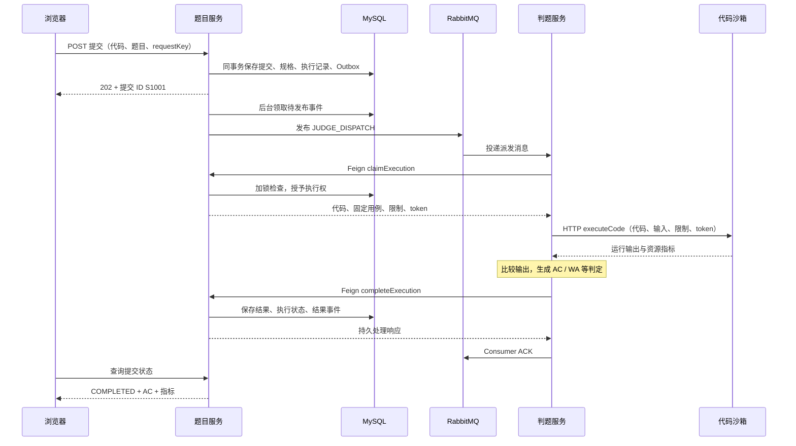

# 03 完整链路：跟着一次提交读懂项目

本篇是第一轮阅读的主线。假设你已经会看 Spring Boot 分层代码，现在跟随一份程序，从用户点击提交一直读到结果显示。先读第 1、2 节的正常流程，再进入故障、报名、榜单和权限。

每个源码入口都给出了方法名。打开文件后先定位该方法，只读当前步骤需要的分支；详细 SQL 和机制在对应模块篇展开。下面的用户、ID、事件名与时间均为教学示例，不是运行收据。

## 1. 一次提交如何受理

这一节会走完“受理 → 派发 → 执行 → 写回 → 查询”，让你先建立完整图景。

### 1.1 准备一个能贯穿全流程的例子

用户 U7 登录，打开题目 Q42。题目要求从标准输入读取两个整数并输出和，隐藏用例之一是输入 `1 2`、期望输出 `3`。用户提交 Java 程序，后端为它分配提交 ID S1001。

先区分四份内容：题干给用户看；用户代码需要执行；测试输入交给沙箱；期望输出留在判题端比较。沙箱不需要知道标准答案。



图中省略了 Gateway 路由与周期续租。MQ 派发和浏览器收到响应没有固定先后：事务提交后，两者都可以继续。页面不会保持原提交请求一直等到沙箱完成。

### 1.2 第一步：从提交按钮找到请求

打开 [ViewQuestionView.vue](../../codeoj-frontend/src/views/question/ViewQuestionView.vue)，搜索 `doSubmit`。页面从 `form` 取语言和代码，加上题目 ID，生成内容指纹和请求 key，再调用生成客户端 `doQuestionSubmitUsingPost`。

普通练习实际入口为 `POST /api/question/question_submit/do`。页面发送的是一份“执行这段代码”的请求，不是执行后的答案。请求 key 用于识别网络重试，后面再解释。

继续打开 [QuestionController.doQuestionSubmit](../../codeoj-backend/codeoj-backend-question-service/src/main/java/com/codeoj/codeojbackendquestionservice/controller/QuestionController.java)：它处理请求头与请求体的 key，一致性检查后获取当前用户，调用提交 Service。开启可靠判题后，HTTP 响应为 202，响应体 `data` 是提交 ID。

**此时记下：** 谁提交、交了哪道题的什么代码、用哪个 key 标识本次请求。还没有 AC/WA。

### 1.3 第二步：选中新版受理分支

打开 [QuestionSubmitServiceImpl.doQuestionSubmit](../../codeoj-backend/codeoj-backend-question-service/src/main/java/com/codeoj/codeojbackendquestionservice/service/impl/QuestionSubmitServiceImpl.java)。第一处关键分支是 `reliableEnabled`。本篇沿 `ReliableSubmissionService.accept` 阅读，暂时跳过下面的旧 MQ 分支。

[ReliableSubmissionService.accept](../../codeoj-backend/codeoj-backend-question-service/src/main/java/com/codeoj/codeojbackendquestionservice/submission/ReliableSubmissionService.java) 检查用户、语言、代码长度和 key 格式，然后调用独立 Spring Bean 的事务方法。外层负责有限次数据库瞬态异常重试，内层负责一次完整受理事务。

这里需要分两层，是为了在一次事务完全回滚后重试整个业务，而不是在已经失败的事务中继续补一条 SQL。

### 1.4 第三步：把一次提交变成可继续处理的数据库事实

打开 [SubmissionAcceptance.accept → freezeSpec → write](../../codeoj-backend/codeoj-backend-question-service/src/main/java/com/codeoj/codeojbackendquestionservice/submission/SubmissionAcceptance.java)。正常首次受理按下列顺序进行：

1. 根据题目、语言、代码生成 `requestHash`，按用户与 key 查是否已经受理。
2. 核验当前账号，读取题目的用例和限制。
3. `freezeSpec` 把用例、限制和比较规则版本存为固定规格，得到 `judgeSpecHash`。
4. `write` 保存用户代码，创建 `QUEUED` 执行记录，再插入待派发事件。
5. 普通练习更新题目提交数，整个事务提交，返回提交 ID。

用示例观察事务提交后的数据库：

| 数据 | 示例内容 | 它以后供谁使用 |
| --- | --- | --- |
| `question_submit` | S1001、U7、Q42、Java 代码、兼容 status=0 | 查询展示、领取时代码来源 |
| `judge_spec` | 规格 H1：输入/答案、时间/内存、TEXT_V1 | 判题端领取固定依据 |
| `submission_execution` | S1001、QUEUED、H1、代次 1、事件 E1 | 领取与恢复的权威状态 |
| `reliable_outbox` | E1、JUDGE_DISPATCH、PENDING、消息体 | 后台发布器派发任务 |

此时**没有创建 `judge_attempt`**；只有真正领取执行权后才产生一次执行尝试。相同规格可以复用已有 `judge_spec` 记录，不要求每次新插一行。

这些写入同事务：如果插入 Outbox 失败，提交和执行记录也回滚。事务中没有调用 MQ 或沙箱，所以受理不会等待代码运行。

### 1.5 第四步：后台怎样知道有任务

打开 [OutboxRelay.tick](../../codeoj-backend/codeoj-backend-question-service/src/main/java/com/codeoj/codeojbackendquestionservice/submission/outbox/OutboxRelay.java)。它定时查到待发布事件，再调用 [OutboxStore.claim](../../codeoj-backend/codeoj-backend-question-service/src/main/java/com/codeoj/codeojbackendquestionservice/submission/outbox/OutboxStore.java) 领取发布权，由 [OutboxDelivery.publish](../../codeoj-backend/codeoj-backend-question-service/src/main/java/com/codeoj/codeojbackendquestionservice/submission/outbox/OutboxDelivery.java) 在事务外发送 MQ。

消息 E1 只携带提交 ID、事件 ID、派发代次、协议版本等身份。用户代码和隐藏用例不放在派发消息里。这个事件表达“请尝试处理 S1001”，不能直接授予执行权。

### 1.6 第五步：判题服务领取代码和执行权

打开 [ReliableJudgeConsumer.receive](../../codeoj-backend/codeoj-backend-judge-service/src/main/java/com/codeoj/codeojbackendjudgeservice/rabbitmq/ReliableJudgeConsumer.java)。它校验消息格式，再调用 [ReliableJudgeWorker.process](../../codeoj-backend/codeoj-backend-judge-service/src/main/java/com/codeoj/codeojbackendjudgeservice/judge/ReliableJudgeWorker.java)。

worker 先占本实例并发名额，再通过 [QuestionFeignClient.claimExecution](../../codeoj-backend/codeoj-backend-service-client/src/main/java/com/codeoj/codeojbackendserviceclient/service/QuestionFeignClient.java) 调回题目服务。沿 [QuestionInnerController.claimExecution](../../codeoj-backend/codeoj-backend-question-service/src/main/java/com/codeoj/codeojbackendquestionservice/controller/inner/QuestionInnerController.java) 找到 [ExecutionCommands.claim](../../codeoj-backend/codeoj-backend-question-service/src/main/java/com/codeoj/codeojbackendquestionservice/submission/ExecutionCommands.java)。

`claim` 在事务中锁定 S1001，确认状态、代次和事件都正确，随后：

- 把状态从 QUEUED 改为 RUNNING；
- 产生第 1 次尝试及 token T1，设置租约和绝对期限；
- 插入 `judge_attempt`；
- 返回 `JudgeLease`，包含代码、H1 中的用例与限制，以及执行身份。

**此时记下：** 只有领取成功，worker 才拥有本次执行权并取得执行材料。重复消息可以进 Consumer，但不一定能领取成功。

### 1.7 第六步：执行程序，然后比较答案

回到 `ReliableJudgeWorker.process`，找到 `ExecuteCodeRequest.builder()`。worker 把代码、各用例输入、限制、token 和期限交给远程沙箱；期望输出保留在 `lease.getCases()` 中。

沿 [RemoteCodeSandbox.executeCode](../../codeoj-backend/codeoj-backend-judge-service/src/main/java/com/codeoj/codeojbackendjudgeservice/judge/codesandbox/impl/RemoteCodeSandbox.java) → [ExecuteCodeController.executeCode](../../codeoj-backend/codeoj-backend-codesandbox/src/main/java/com/codeoj/codeojbackendcodesandbox/controller/ExecuteCodeController.java) → [JavaIsolatedCodeSandbox.executeCode](../../codeoj-backend/codeoj-backend-codesandbox/src/main/java/com/codeoj/codeojbackendcodesandbox/service/impl/JavaIsolatedCodeSandbox.java) 阅读。

沙箱编译代码，并以各用例输入运行程序。示例返回输出 `3` 和运行指标，`outcome=EXECUTED`。它说明正常执行，还没有断言答案正确。

回到判题服务：[SandboxResultMapper.userVerdict](../../codeoj-backend/codeoj-backend-judge-service/src/main/java/com/codeoj/codeojbackendjudgeservice/judge/SandboxResultMapper.java) 先校验协议。EXECUTED 进入 [JudgeManager.doJudge](../../codeoj-backend/codeoj-backend-judge-service/src/main/java/com/codeoj/codeojbackendjudgeservice/judge/JudgeManager.java)，选择 [JavaLanguageJudgeStrategy.doJudge](../../codeoj-backend/codeoj-backend-judge-service/src/main/java/com/codeoj/codeojbackendjudgeservice/judge/strategy/JavaLanguageJudgeStrategy.java)，检查资源、输出数量并逐个比较答案，最终生成 AC。

如果代码编译失败，沙箱返回 CE，映射器直接生成编译错误判定；不需要继续比较答案。

### 1.8 第七步：结果怎样保存并显示

worker 调用 `QuestionFeignClient.completeExecution`，进入 `ExecutionCommands.complete`。题目服务再次检查 token 和期限，再把结果和状态写入数据库，同时生成 `JUDGE_RESULT` 事件。Consumer 在 worker 正常返回后 ACK 本次 MQ 投递。

| 阶段 | `submission_execution` | `judge_attempt` | 页面能查到什么 |
| --- | --- | --- | --- |
| 受理后 | QUEUED、attempt=0 | 尚无记录 | 等待判题 |
| 领取后 | RUNNING、attempt=1、T1 | 第 1 次 RUNNING | 判题中 |
| 完成后 | COMPLETED、resultVersion=1 | 第 1 次 COMPLETED | AC 与时间/内存 |

查询走 [SubmissionStatusController.get](../../codeoj-backend/codeoj-backend-question-service/src/main/java/com/codeoj/codeojbackendquestionservice/submission/SubmissionStatusController.java) 与 `QuestionSubmitServiceImpl.getQuestionSubmitVO`，把完整执行状态补入 VO。普通练习成功后跳转提交列表；比赛详情页会轮询 `/api/submissions/{id}`。两种页面交互见[前端篇](02-模块/01-前端.md)。

**第一轮练习：** 关闭文档，画出上述时序，并在图中标注受理事务、MQ 边界、答案比较、最终查询。

**核对：** 代码持久化在 MQ 前；领取通过内部 HTTP 回题目服务；沙箱只执行，判题策略比较；最终状态通过另一请求查询。漏掉其中一项，回对应步骤重读。

## 2. 完成判题为什么不等于 AC

理解本节后，你应能从“页面显示失败”反推到底是用户代码错误，还是平台需要恢复。

### 三层状态分别在回答什么

| 层次 | 示例 | 含义 |
| --- | --- | --- |
| 执行状态 `executionStatus` | QUEUED、RUNNING、COMPLETED、RETRY_WAIT、NEEDS_ATTENTION | 平台工作流进行到哪一步 |
| 沙箱结果 `outcome` | EXECUTED、CE、RE、TLE、MLE、OUTPUT_LIMIT、PLATFORM_ERROR | 编译/运行发生了什么 |
| 用户判定 `judgeInfo.verdict` | AC、WA、CE、RE、TLE、MLE、OUTPUT_LIMIT | 用户这份程序最终判成什么 |

例如输出 `4` 的求和程序正常退出，沙箱返回 EXECUTED；策略发现与 `3` 不同，结果是 WA；题目服务成功保存判定后，执行状态是 COMPLETED。**COMPLETED 表示判题工作完成，可以对应 WA。**

若远程沙箱连接超时，我们不知道程序实际运行情况。它走平台失败与有限恢复，不能直接判用户 TLE。TLE 需要执行层提供相应的超时结论。

### 输出比较不是随意去空格

打开 [TextOutputComparator.normalize/matches](../../codeoj-backend/codeoj-backend-model/src/main/java/com/codeoj/codeojbackendmodel/model/codesandbox/TextOutputComparator.java)。当前 TEXT_V1 先把 CRLF 转 LF，再只去掉末尾一个换行，其他空白保留。

| 标准答案 / 实际输出 | 当前规则 |
| --- | --- |
| `3` / `3\n` | 相同 |
| `3\r\n` / `3\n` | 相同 |
| `3` / `3 ` | 不同 |
| `3\n` / `3\n\n` | 不同 |

Java 策略还先校验时间、内存、输出数量。答案看似正确但缺少必要指标时进入平台失败，不能补零判 AC。

**练习：** 对输出错误、语法错误、真实用例超时、HTTP 读取超时、资源指标缺失五种情况分类。

**核对：** 前三者分别得到 WA、CE、TLE，属于可完成的用户判定；后两者属于平台失败，可能 RETRY_WAIT 或 NEEDS_ATTENTION。读 [SandboxResultMapperTest](../../codeoj-backend/codeoj-backend-judge-service/src/test/java/com/codeoj/codeojbackendjudgeservice/judge/SandboxResultMapperTest.java) 对照协议断言。

## 3. 消息重复或进程崩溃后如何恢复

现在回到 S1001，逐个给正常流程加入故障。要回答“已经持久保存了什么、谁会发现、如何继续、旧请求如何被阻止”。

### 3.1 受理事务刚提交，API 进程就退出

S1001、H1、执行状态和 E1 已全部落库，`OutboxRelay` 恢复后能继续扫描 E1。用户若没收到响应，用原 key、原代码重试，受理服务回读同一个提交 ID。唯一约束保护并发同 key 请求，内容 hash 防止同 key 偷换代码。

只做“写提交后直接发 MQ”会留下数据库已提交、消息未发送的空窗；Outbox 让待派发意图也成为数据库事实。

### 3.2 Broker 接收消息，但发布确认丢了

发布方只能记录 UNKNOWN，不能推断 Broker 没收到。之后可能重发 E1，所以消费者必须能处理重复。Confirm、Return 和消费 ACK 分别在不同环节，详见[判题与 MQ](02-模块/04-判题服务与消息队列.md)。

### 3.3 两个消费者都收到 E1

二者都调用 `claim`，但同一执行行的数据库锁把领取检查排成顺序。第一个把 QUEUED 改成 RUNNING 后，第二个看到已有状态，领取失败，不执行代码。`ExecutionRepository.save` 还有 `stateVersion` 条件更新。不能只说“用了 Java 锁”，也不能只说“消息 ID 去重”。

### 3.4 worker 被杀，旧沙箱请求还活着

```text
T=0     第一次领取：generation=1，attempt=1，token=T1
T=5     worker 失联，不再续租
T=租约后  ExecutionRecovery 发现过期，recover 建立 generation=2、事件 E2
稍后     新 worker 领取：attempt=2，token=T2
更晚     旧 worker 携 T1 写回：owned 检查失败，拒绝覆盖
```

[ExecutionRecovery.tick](../../codeoj-backend/codeoj-backend-question-service/src/main/java/com/codeoj/codeojbackendquestionservice/submission/ExecutionRecovery.java) 扫描可恢复记录，`ExecutionCommands.recover` 加锁后再次检查状态、时间和预算。扫描候选不等于直接授予恢复权。

`owned` 检查 RUNNING、attempt/token、租约、尝试期限、总恢复期限。数据库时间在加锁后读取，避免等锁期间时间已经过期却仍被当成有效。

| 身份 | 保护哪个动作 | 例子 |
| --- | --- | --- |
| `requestKey` + `requestHash` | 同一次用户请求不要重复受理 | 响应丢失重试仍返回 S1001 |
| `dispatchGeneration` + `eventId` | 只领取当前派发 | E1 晚到时不能领取第 2 代任务 |
| `attemptNo` + `executionToken` | 只有当前尝试能续租和写回 | T1 不能覆盖 T2 |
| `stateVersion` | 数据库更新与管理操作不使用旧版本 | 旧管理页面重试需冲突 |

### 3.5 已经写回结果，还没 ACK 就退出

数据库中的 COMPLETED 不随 Consumer 崩溃消失。RabbitMQ 重投后，`claim` 无法再次领取；Consumer 可以结束这次重复投递。重复完成请求也会比较结果摘要，同 token 异内容不能覆盖已完成结果。

### 3.6 恢复不是无限重试

受理时固定尝试次数、派发次数和恢复期限；预算耗尽进入 NEEDS_ATTENTION。管理员须带期望版本、原因和明确的有限扩展再重试。不断重发同一消息不能代替业务恢复状态机。

**练习：** 对照上述五个故障窗口，分别写出一张恢复依赖表和拒绝旧请求的方法。

**核对：** 必须指出 `SubmissionAcceptance.replay`、Outbox 发布记录、`claim/currentMessage`、`owned`、COMPLETED 重投分支。阅读 [ReliableExecutionTest](../../codeoj-backend/codeoj-backend-question-service/src/test/java/com/codeoj/codeojbackendquestionservice/submission/ReliableExecutionTest.java) 与 [OutboxRelayTest](../../codeoj-backend/codeoj-backend-question-service/src/test/java/com/codeoj/codeojbackendquestionservice/submission/outbox/OutboxRelayTest.java) 的故障断言。不能承诺网络下只投递一次或只物理执行一次。

## 4. 数据库租约失效后，谁停止用户代码

第 3 节的 token 只控制数据库认可哪份结果。旧 worker 不能写回，并不意味着它启动的容器已经消失。沙箱需要另一套物理执行管理。

沿 [JavaIsolatedCodeSandbox](../../codeoj-backend/codeoj-backend-codesandbox/src/main/java/com/codeoj/codeojbackendcodesandbox/service/impl/JavaIsolatedCodeSandbox.java) → [DurableExecutionRegistry](../../codeoj-backend/codeoj-backend-codesandbox/src/main/java/com/codeoj/codeojbackendcodesandbox/service/impl/DurableExecutionRegistry.java) → [DockerIsolationEngine](../../codeoj-backend/codeoj-backend-codesandbox/src/main/java/com/codeoj/codeojbackendcodesandbox/service/impl/DockerIsolationEngine.java) → [supervisor.py](../../codeoj-backend/codeoj-backend-codesandbox/isolation/supervisor.py) 阅读，细节见[沙箱篇](02-模块/05-代码沙箱.md)。

一次执行先持久登记 token、内容摘要、slot 和期限，再编译，随后每个用例使用新容器运行。容器内监督器独立执行期限；即使 HTTP 断开或管理器被杀，它仍能停止用户程序和后代。

slot 是沙箱允许并发运行的名额。只有确认容器、卷等物理对象清理完成才释放；清理失败保留 REAP_PENDING。后继管理器读取持久登记并取得文件锁后重试回收。共享容量的范围是同一 Docker daemon、同一持久本地目录。

**练习：** 沙箱允许 2 个并发，其中 1 个任务结果已经算出，但容器删除失败。此时可用名额是多少？

**核对：** 如果另一个名额未占用，可用只有 1 个；不能因为结果算出就释放清理失败的名额。读 [DurableExecutionRegistryTest.cleanupFailureKeepsSlotReservedUntilActualRemovalSucceeds](../../codeoj-backend/codeoj-backend-codesandbox/src/test/java/com/codeoj/codeojbackendcodesandbox/service/impl/DurableExecutionRegistryTest.java)。

## 5. 秒杀报名如何从预留变成资格

你已学过常见“Redis Lua 扣库存 → MQ → 数据库落单”。当前报名保留这个基本方向，但增加了跨系统未知状态的恢复。先看正常流程，再看差异，完整讲解见[赛事与报名](02-模块/07-赛事与报名.md)。

```text
前端用稳定 key 报名
 → RegistrationService.register 读取单场模式与当前账号
 → Redis Lua 原子预留（保存原请求身份）
 → RegistrationTransactions.persist 同事务写请求 + Outbox
 → 返回 PROCESSING
 → RegistrationConsumer 消费
 → RegistrationTransactions.confirm 在 DB 确认资格
 → 维护器等协调路径经 synchronize 把确认标记同步到 Redis
 → 查询显示 CONFIRMED
```

源码主入口：[RegistrationService](../../codeoj-backend/codeoj-backend-question-service/src/main/java/com/codeoj/codeojbackendquestionservice/contest/RegistrationService.java)、[RegistrationTransactions](../../codeoj-backend/codeoj-backend-question-service/src/main/java/com/codeoj/codeojbackendquestionservice/contest/RegistrationTransactions.java)、[contest-registration.lua](../../codeoj-backend/codeoj-backend-question-service/src/main/resources/lua/contest-registration.lua)。

### 用两个名额手算

总容量 2。A 在 Redis 预留成功，还未落 DB；B 已预留并确认资格。此时 Redis 可预留库存为 0，MySQL 剩余未确认容量为 1，页面已确认人数为 1。C 不能因为 DB 还有 1 就再抢一次。

A 的恢复必须沿原 request/event/key 补建请求，不能重新分配身份。确认时数据库条件扣容量和唯一约束仍是最终防线。

### 当前更需要理解的故障

- Redis 执行结果未知：回查、repair；不能因接口超时就退款。
- 预留成功、DB 未落库：维护器按 Redis 原身份补建请求和事件。
- Lua 中途报错：原子执行不等于运行时回滚；按提前记录的 mutation 意图修复到确定目标值。
- 明确失败或取消：先写可回收的数据库终态，再幂等释放；已确认资格不能走普通退款。
- 旧快照或迟到对账：用身份、持久序号和 epoch/revision 核验，避免旧操作破坏新恢复。

**练习：** 页面显示“已确认 1 / 2”，新用户却抢不到；解释这个现象，再说一次 Redis 超时为什么不能直接补库存。

**核对：** 区分已确认人数、在途预留、Redis 库存；未知操作可能已经扣减，必须恢复原身份和结果。对照 [RegistrationRedisIntegrationTest](../../codeoj-backend/codeoj-backend-question-service/src/test/java/com/codeoj/codeojbackendquestionservice/contest/RegistrationRedisIntegrationTest.java) 中预留未落库、重复退款、迟到对账测试。

## 6. 乱序结果如何计分，榜单如何重建

比赛提交复用可靠判题，但引用比赛发布快照，并校验资格、时间和发布版本。结果保存后产生 JUDGE_RESULT，由榜单消费端处理。

沿 `ExecutionCommands.complete` → [ScoreboardConsumer.receive](../../codeoj-backend/codeoj-backend-question-service/src/main/java/com/codeoj/codeojbackendquestionservice/scoreboard/ScoreboardConsumer.java) → [ScoreboardTransactions.project](../../codeoj-backend/codeoj-backend-question-service/src/main/java/com/codeoj/codeojbackendquestionservice/scoreboard/ScoreboardTransactions.java) → [ScoreboardService.page](../../codeoj-backend/codeoj-backend-question-service/src/main/java/com/codeoj/codeojbackendquestionservice/scoreboard/ScoreboardService.java) 阅读。详细规则与 SQL 见[榜单篇](02-模块/08-榜单与结算.md)。

当前 FIRST_AC_V1：每题取最早 AC 的**提交受理时间**；解题数多者优先，同题数时达到该题数更早者优先。不是消费顺序，也不是所有 AC 时间求和。

| 选手 | A 首次 AC 受理时间 | B 首次 AC 受理时间 | 解题数 / 达成时间 |
| --- | --- | --- | --- |
| U1 | 第 10 分钟 | 第 20 分钟 | 2 / 第 20 分钟 |
| U2 | 第 15 分钟 | 第 20 分钟 | 2 / 第 20 分钟 |

最初两人并列。随后 U1 一次第 12 分钟受理的 B 提交才返回 AC，U1 的达成时间变为第 12 分钟，超过 U2。同题重复 AC 不再增加解题数。

`project` 在一个事务中保存业务回执和投影变化。Redis 只缓存页面 entries；key 包含投影版本、revision 和 cacheEpoch。最终结算从原始完成事实重建并核对，不能因为 MQ 发布已确认就认为成绩已经完整。

**练习：** 一个比赛已有 2 位确认选手，但只有 1 位提交过代码。另一位是否入榜？比赛结束时还有 NEEDS_ATTENTION，能否 FINISHED？

**核对：** 确认选手以零分入榜；未决提交阻止结算，不能偷偷当 WA。对照 [ScoreboardTest](../../codeoj-backend/codeoj-backend-question-service/src/test/java/com/codeoj/codeojbackendquestionservice/scoreboard/ScoreboardTest.java)。

## 7. 旧 Cookie 为什么不能保留旧权限

最后补齐前面所有请求依赖的登录身份。完整登录流程见[用户与鉴权篇](02-模块/02-公共层与用户服务.md)。

```text
用户登录 → Session 保存用户对象，Spring Session 写 Redis
后续请求带 Cookie → 共享 Session 取用户 ID
 → SessionUserResolver 查询当前账号
 → Controller / AOP / 事务层执行对应权限检查
```

沿 [UserFeignClient.getLoginUser](../../codeoj-backend/codeoj-backend-service-client/src/main/java/com/codeoj/codeojbackendserviceclient/service/UserFeignClient.java) → [SessionUserResolver.permitNull/requireLogin](../../codeoj-backend/codeoj-backend-service-client/src/main/java/com/codeoj/codeojbackendserviceclient/auth/SessionUserResolver.java) → [AuthInterceptor.doInterceptor](../../codeoj-backend/codeoj-backend-service-client/src/main/java/com/codeoj/codeojbackendserviceclient/aop/AuthInterceptor.java) 阅读。

Session 的实际存储对象包含用户信息，但业务使用时只取其中 ID 作为身份线索，再查询当前角色、删除与封禁状态。`getLoginUser` 是 Feign 接口中的本地 default 方法；它委托的 `getById` 才是远程请求。

管理员被降权后，原 Cookie 仍可能存在，但当前角色已改变，管理操作必须拒绝。内部 `X-Inner-Secret` 是另一层服务凭据，不能代表用户具有管理员或参赛资格。前端隐藏按钮也不能代替后端检查。

**练习：** 同一 Cookie 下管理员被降权，指出哪个查询刷新账号、哪个位置拒绝操作；再说明 Redis 会话不可用与普通未登录的区别。

**核对：** 跟到账号查询和角色判断，而非只说 Cookie 失效。会话基础设施失败应按可用性错误处理，不能伪装为用户未登录。对照 [CurrentAccountAuthorizationTest](../../codeoj-backend/codeoj-backend-service-client/src/test/java/com/codeoj/codeojbackendserviceclient/auth/CurrentAccountAuthorizationTest.java)。

## 8. 阅读成果检查

| 检查 | 要实际产出的内容 | 不通过时回哪里 |
| --- | --- | --- |
| 全貌 | 一张提交到结果的时序图 | 第 1 节 |
| 数据 | 受理、领取、完成三个时间点的记录变化 | 题目服务篇 |
| 判题 | 五种用户错误/平台失败分类 | 第 2 节、判题篇 |
| 可靠性 | 五个故障窗口的恢复者与检查条件 | 第 3 节 |
| 沙箱 | 一次编译、逐用例运行、物理清理过程 | 第 4 节、沙箱篇 |
| 赛事 | 2 个名额的库存手算与比赛提交条件 | 第 5 节、赛事篇 |
| 榜单 | 乱序 AC 的手算结果与结算条件 | 第 6 节、榜单篇 |
| 权限 | 登录后跨服务查询与降权请求过程 | 第 7 节 |

这些检查通过，再进入[面试篇](04-面试.md)。不需要背完全部实现细节，但每个主要结论都应能回到一个方法或一条 SQL。
