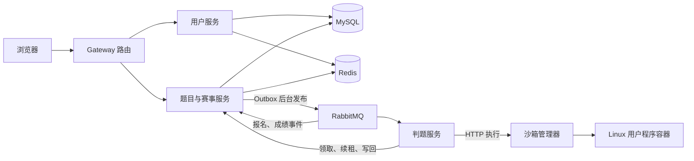

# CodeOJ 源码阅读指南

本指南面向已有 Spring Boot CRUD 基础、尚未串起项目的读者。目标是结合文档与当前源码，理解关键业务过程，能够画流程、解释设计、回答面试追问。

正文围绕五条业务链展开。每条链先给全局位置和正常流程，再按文件、方法、阅读范围带读，最后分析异常。文档解释代码，但不复制源码；请同时打开 IDE，沿指定范围阅读。

## 1. 先认识整个项目

CodeOJ 是在线判题与赛事平台。用户登录后，可以浏览题目、提交 Java 程序、查询判定；比赛增加了发布试题、限额报名、资格检查、计分和结算。

一次在线判题需要真正编译运行用户程序，所以耗时和风险都比普通 CRUD 大。题目服务先保存提交并返回 ID，后台再执行；沙箱负责运行程序，判题策略负责比较标准答案，页面另发查询请求取得结果。

图中浏览器提交与后台执行是不同时间段。判题服务收到消息后还要回题目服务领取执行权；沙箱也不会直接替用户更新数据库成绩。

| 组件 | 在全局中负责什么 |
| --- | --- |
| 前端 | 页面导航、编辑代码、发送请求、保留重试身份、查询结果 |
| Gateway | 将公开路径转发到相应服务，保护内部请求边界 |
| 用户服务 | 注册、登录、当前账号查询 |
| 题目服务 | 题库、可靠受理、执行状态与结果、赛事、资格、成绩 |
| 判题服务 | 消费任务、领取/续租、调用沙箱、比较答案、写回 |
| 沙箱服务 | 编译运行、资源与文件边界、期限、执行对象清理 |
| common/model/service-client | 共享响应与异常、DTO/实体/VO/协议、Feign 与鉴权；这些是依赖库 |

公共类型按需查看：[common 响应与异常](../../codeoj-backend/codeoj-backend-common/src/main/java/com/codeoj/codeojbackendcommon)、[model 数据与协议](../../codeoj-backend/codeoj-backend-model/src/main/java/com/codeoj/codeojbackendmodel/model)、[service-client 调用契约](../../codeoj-backend/codeoj-backend-service-client/src/main/java/com/codeoj/codeojbackendserviceclient)。

先在链路里遇到具体对象，再打开对应类型，不需要预先读完整个目录。

工程入口与版本见[后端父 POM](../../codeoj-backend/pom.xml)：Java 8、Spring Boot 2.6.13、Spring Cloud。前端为 Vue 3、TypeScript、Arco Design 与 Monaco。

### 三种中间件不能只背用途

MySQL 保存提交、执行权、资格和成绩事实；RabbitMQ 传递待处理事件；Redis 分别承载共享会话、报名预留账本与榜单缓存。报名账本需要保护未落库身份，不能因榜单缓存可丢失就把全部 Redis 数据随意删除。

基础版提供用户/题目管理、异步判题、远程沙箱与判题策略；当前扩展包括固定规格、Outbox、租约恢复、隔离回收、赛事快照、异步报名和可重建榜单。个人贡献需按实际参与情况表达。

### 1.1 同一个 Java 名字，不等于同一个运行对象

| 名称/关系 | 编译时看到什么 | 运行时实际发生什么 |
| --- | --- | --- |
| 依赖 service-client JAR | 多个服务都能引用相同接口 | 每个进程各自加载类型和创建 Bean |
| Feign Client | 一份远程方法声明 | 调用方代理构造 HTTP，提供方 Controller 接收 |
| Controller implements Client | Java 方法签名对齐 | 不会让两个进程变成一次普通对象调用 |
| ServiceImpl 继承通用 Service | 某些 CRUD 方法没写在当前类 | 由 MyBatis-Plus 继承实现执行本地数据访问 |
| 同名 getLoginUser | 各处都有获取用户的方法 | 需要按调用对象区分页面 API、本地解析和远程查询 |

这也是阅读顺序里先讲登录链的原因：先用具体请求理解“本地对象、客户端代理、远端提供者”，后面的执行命令就容易接起来。

### 1.2 全项目反复出现的四种边界

| 边界 | 过界时发生什么 | 读源码先确认什么 |
| --- | --- | --- |
| HTTP | 参数/对象序列化为请求，远端重新解析 | Client/Controller 两端、地址、路径、请求头、返回类型 |
| MQ | 先持久投递，再由消费者线程处理 | 事件身份、交换机/路由/队列、ACK 与业务状态 |
| 数据库事务 | 多条本地写入一起提交或回滚 | 代理入口、锁/条件、外部调用是否在事务外 |
| 用户进程 | 后端启动受限执行对象 | stdin/stdout、期限、资源、可信收据与物理清理 |

**全局图的箭头只是起点。** 每读一个箭头，都应知道谁发起、传什么、谁接收，以及收到响应到底证明了什么。

## 2. 五条链路如何连接

| 顺序 | 链路 | 起点 → 终点 | 与其他链路的交接 |
| --- | --- | --- | --- |
| 1 | [登录与权限](01-登录与权限链路.md) | 登录 → 后续业务请求获得当前账号并检查权限 | 为提交、报名和管理提供身份 |
| 2 | [提交与判题](02-提交与判题链路.md) | 打开题目、提交 → 持久结果与页面查询 | 中途调用链路 3，比赛结果进入链路 5 |
| 3 | [沙箱执行与回收](03-沙箱执行与回收链路.md) | 执行请求 → 编译/运行结果与物理回收 | 将输出及资源结果交回链路 2 |
| 4 | [赛事报名与参赛](04-赛事报名与参赛链路.md) | 发布快照、报名 → 确认资格并受理比赛提交 | 比赛提交复用链路 2，最终成绩进入链路 5 |
| 5 | [成绩榜单与结算](05-成绩榜单与结算链路.md) | 判题完成事件 → 排名、重建与最终版本 | 等待判题与报名事实收敛后结束比赛 |

先按 1→2 阅读正常流程。链路 2 调用沙箱时，第一遍可先了解其输入输出，把整个提交读完，再进入链路 3。你已学过秒杀，链路 4 重点比较当前预留、资格、未知恢复和版本条件。

每条链开头给全局图；流程跨 HTTP、MQ、事务或进程时再交代当前进度。阅读辅助方法后会明确回到哪个调用者，避免钻进一个类后失去主线。

## 3. 正文怎样配合源码阅读

每步先看“方法职责与输入输出”，知道它为什么存在；再按阅读范围打开源码，最后核对业务和数据变化。普通赋值与重复校验简述，关键判断、SQL 条件和事务边界展开。第一遍跳过已标明的故障分支，第二遍回到同一流程推演异常。

| 看到的对象 | 先回答的问题 |
| --- | --- |
| Controller / 前端请求 | 请求从哪来、谁提供身份、响应表示什么？ |
| Service / 内部命令 | 调用者是谁、同步还是异步、事务何时开始结束？ |
| SQL / Redis 操作 | 操作哪个业务对象、条件保护什么、完成后状态怎样变？ |
| 消息 / HTTP 协议 | 携带数据还是引用、接收成功是否代表业务完成？ |
| catch / 恢复任务 | 哪些事实已落地、谁继续处理、如何拒绝旧操作？ |

不要求先逐目录读完，也不把全部 DTO、Mapper 字段当成重点。题目准备、登录、提交、判题、隔离、报名和榜单都在对应业务链中覆盖；样式和重复 CRUD 可略读。

### 3.1 读一个方法需要得到的五项信息

| 信息 | 文档应提供的解释 |
| --- | --- |
| 职责 | 这个方法负责哪件业务，为什么在这一层 |
| 输入 | 参数来自浏览器、数据库、消息还是上游返回 |
| 输出 | 返回值、异常、数据库变更或外部副作用 |
| 机制 | 相关代理、事务、监听器、脚本、进程等怎样起作用 |
| 衔接 | 调用谁、回到谁、接下来走哪一段链路 |

先走正常分支建立调用图，再在第二遍推演失败。方法表负责快速定位，正文解释原因，流程图负责把局部重新放回全局。

## 4. 阅读前明确当前实现

普通提交的分叉在 [QuestionSubmitServiceImpl.doQuestionSubmit](../../codeoj-backend/codeoj-backend-question-service/src/main/java/com/codeoj/codeojbackendquestionservice/service/impl/QuestionSubmitServiceImpl.java)。

主文沿可靠判题，旧 MyMessageProducer/MyMessageConsumer 仅作局部对照，旧图见[历史流程](../history/legacy-judge-walkthrough.md)。

| 配置/条件 | 阅读含义 |
| --- | --- |
| RELIABLE_JUDGE_ENABLED=true | 新受理、Outbox、执行命令和可靠 worker |
| ASYNC_REGISTRATION_ENABLED=true，单场 Redis 模式 | Lua 预留、异步确认与恢复；DB_SYNC 仍是另一条报名模式 |
| SCOREBOARD_ENABLED=true | 成绩投影、缓存和结算 |
| 判题端 type=remote | 使用 HTTP 调用沙箱 |
| 沙箱端 mode=isolated | Linux 容器执行，默认模式；native 是显式可信样例模式 |

三个业务开关默认关闭，后两项依赖可靠判题；完整启动显式配置。

迁移按[基础表](../../codeoj-backend/mysql-init/create_table.sql)、[V001—V005](../../codeoj-backend/mysql-init/migrations)顺序准备。

remote 与 isolated 可以同时成立，它们配置在不同一端。

## 5. 运行与证据放在什么位置

| 目的 | 继续读 |
| --- | --- |
| 保持页面，一边操作一边学 | [完整本机启动](../contest/local-startup.md)，选择 local-stack.sh serve |
| 自动启动、smoke、退出清理 | 同入口的 verify；退出后不能继续访问临时地址 |
| 可信 Java 或 H2 赛事演示 | [脚本索引](../../scripts/README.md)，明确与真实依赖的区别 |
| 当前验证范围 | [项目状态](../status.md)，区分历史全栈基线与后续修复回归 |
| 复验和配置细节 | [运行交接](../contest/handoff.md)；操作和历史证据保留原路径 |

完整本机链使用 Mac 业务管理器、私有 MySQL/Redis/MQ、临时 Linux Docker/cgroup 环境和静态发现。先核对页面代理、Cookie、Redis 编号、Feign 地址/内部密钥、沙箱 URL/auth、镜像和持久目录。

入口实现为 [local-stack.sh](../../scripts/local-stack.sh) → [start-stack.py](../../scripts/local/start-stack.py)。端口监听不等于真实业务就绪。

本次重构是源码导读，不重跑业务测试。测试链接用于阅读断言；H2、MQ/引擎替身、真实 Redis、完整跨进程链各能证明什么，要分别判断。真实 Nacos、目标部署、压测、长期稳定性等以状态页的未验收范围表达，不提供未经测量的 QPS。

## 6. 学完以后怎样检查

| 链路 | 你应该能脱稿说明 |
| --- | --- |
| 登录 | 同 Cookie 跨服务识别、账号降权后在哪被拒绝 |
| 提交 | 从请求到结果的全流程，受理/领取/完成三次数据变化 |
| 沙箱 | 编译与逐用例运行，运行期限与物理清理的区别 |
| 报名 | 预留与资格，两个名额手算，未知结果为什么不能直接退款 |
| 榜单 | 迟到更早 AC 的排名变化，何时才能最终结算 |

每条链末尾有对应自测与测试入口。最后读[面试复盘](06-面试复盘.md)，将理解转成项目介绍与追问回答。能背类名但解释不了条件与数据变化时，回该步骤继续读源码。
