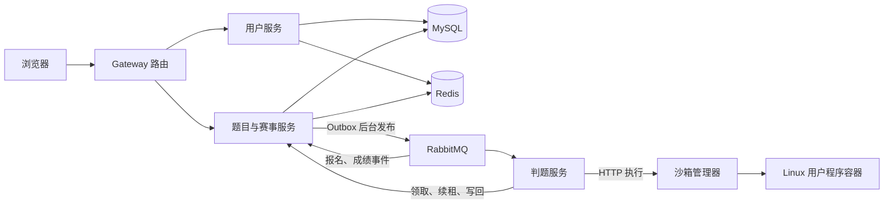

# CodeOJ 源码阅读指南

本指南面向已有 Spring Boot CRUD 基础、尚未串起项目的读者。目标是结合文档与当前源码，理解关键业务过程，能够画流程、解释设计、回答面试追问。

正文围绕五条业务链展开。每条链先给全局位置和正常流程，再按文件、方法、阅读范围带读，最后分析异常。文档解释代码，但不复制源码；请同时打开 IDE，沿指定范围阅读。

**开始方式：** 先读下面的求和主例，再按第 2 节一次完成一条链、一张纸。源码中没看懂的字段先标问号，回到该链的设计解释补齐；第一次不用从头读完所有表格、故障分支和测试。

## 第一次打开项目：先认识一道题和两份提交

CodeOJ 中，用户提交的是一段完整程序。平台把测试输入交给程序运行，再把实际输出与期望输出比较，并检查运行时间、内存等限制。网页上的“提交成功”只表示服务器收到了程序，答案是否正确需要后台判题。

后面五条链共用下面的教学主例，数值和身份是阅读用的符号，不是预置账号、真实请求或运行收据。

| 对象 | 本指南约定 | 读者先理解什么 |
| --- | --- | --- |
| 用户 | 用户 7 | 登录后发起练习提交，之后报名比赛 |
| 题目 | 公共题库 42：求两个整数的和 | 题干给用户看；完整测试用例留在判题端 |
| 程序 | 求和程序 P | 每次运行读取一组输入，向标准输出写答案；正文不给程序源码 |
| 两个用例 | 输入 1 2，期望输出 3；输入 2 5，期望输出 7 | 实际输出与期望输出是两份数据，不由用户自称正确 |
| 普通练习 | 新提交记为 S1 | 先受理并返回 ID，后台再判题，页面另查结果 |
| 比赛 | 管理员发布比赛 99，其中题 A 是题目 42 的发布快照 | 报名形成资格后，用户在比赛窗口提交 |
| 比赛提交 | 另一次新提交记为 S2 | 有比赛、快照和发布版本上下文；S1 不会自动成为比赛成绩 |

首先只记住这条正常业务线：**登录 → 打开题目 → 交程序 → 等待判题 → 查看结果**。理解以后，再增加比赛的发布、报名、资格和计分。

### 先认识页面会显示的结果

| 名称 | 在这个求和例子里表示什么 |
| --- | --- |
| 测试用例 | 一组输入及对应期望输出；通常一题有多组 |
| 受理成功 | S1 已保存并返回提交 ID，后台尚未必完成 |
| AC / WA | 所有用例合格、资源符合限制 / 运行后答案不符合比较规则 |
| CE / RE | 编译失败 / 用户程序运行出错 |
| TLE / MLE / OUTPUT_LIMIT | 有明确依据的时间、内存或输出超限 |
| 平台失败 | 网络、执行协议或必要指标等存在问题；不能直接当成用户答案错误 |

判定类型对应 [JudgeVerdict](../../codeoj-backend/codeoj-backend-model/src/main/java/com/codeoj/codeojbackendmodel/model/enums/JudgeVerdict.java)，比较和资源规则在 [JavaLanguageJudgeStrategy.doJudge](../../codeoj-backend/codeoj-backend-judge-service/src/main/java/com/codeoj/codeojbackendjudgeservice/judge/strategy/JavaLanguageJudgeStrategy.java)。现在先认识业务含义，读链路二、三时再进入这两个类。

第一次阅读可以全程静态跟源码，不要求先搭好环境。需要操作页面时，使用文末“运行与证据”的启动入口；不要把教学身份 7、42、99 当成启动后一定存在的数据。

## 1. 先认识整个项目

CodeOJ 是在线判题与赛事平台。用户登录后，可以浏览题目、提交 Java 程序、查询判定；比赛增加了发布试题、限额报名、资格检查、计分和结算。

一次在线判题需要真正编译运行用户程序，所以耗时和风险都比普通 CRUD 大。题目服务先保存提交并返回 ID，后台再执行；沙箱负责运行程序，判题策略负责比较标准答案，页面另发查询请求取得结果。

图中浏览器提交与后台执行是不同时间段。判题服务收到消息后还要回题目服务领取执行权；沙箱也不会直接替用户更新数据库成绩。

| 组件 | 在全局中负责什么 |
| --- | --- |
| 前端 | 页面导航、编辑代码、发送请求、保留重试身份、查询结果 |
| Gateway | 将公开路径转发到相应服务，保护内部请求边界 |
| 用户服务 | 注册、登录、当前账号查询 |
| 题目服务 | 题库、可靠受理、执行状态与结果、赛事、资格、成绩 |
| 判题服务 | 消费任务、领取/续租、调用沙箱、比较答案、写回 |
| 沙箱服务 | 编译运行、资源与文件边界、期限、执行对象清理 |
| common/model/service-client | 共享响应与异常、DTO/实体/VO/协议、Feign 与鉴权；这些是依赖库 |

公共类型按需查看：[common 响应与异常](../../codeoj-backend/codeoj-backend-common/src/main/java/com/codeoj/codeojbackendcommon)、[model 数据与协议](../../codeoj-backend/codeoj-backend-model/src/main/java/com/codeoj/codeojbackendmodel/model)、[service-client 调用契约](../../codeoj-backend/codeoj-backend-service-client/src/main/java/com/codeoj/codeojbackendserviceclient)。

先在链路里遇到具体对象，再打开对应类型，不需要预先读完整个目录。

工程入口与版本见[后端父 POM](../../codeoj-backend/pom.xml)：Java 8、Spring Boot 2.6.13、Spring Cloud。前端为 Vue 3、TypeScript、Arco Design 与 Monaco。

### 三种中间件不能只背用途

MySQL 保存提交、执行权、资格和成绩事实；RabbitMQ 传递待处理事件；Redis 分别承载共享会话、报名预留账本与榜单缓存。报名账本需要保护未落库身份，不能因榜单缓存可丢失就把全部 Redis 数据随意删除。

基础版提供用户/题目管理、异步判题、远程沙箱与判题策略；当前扩展包括固定规格、Outbox、租约恢复、隔离回收、赛事快照、异步报名和可重建榜单。个人贡献需按实际参与情况表达。

### 1.1 同一个 Java 名字，不等于同一个运行对象

| 名称/关系 | 编译时看到什么 | 运行时实际发生什么 |
| --- | --- | --- |
| 依赖 service-client JAR | 多个服务都能引用相同接口 | 每个进程各自加载类型和创建 Bean |
| Feign Client | 一份远程方法声明 | 调用方代理构造 HTTP，提供方 Controller 接收 |
| Controller implements Client | Java 方法签名对齐 | 不会让两个进程变成一次普通对象调用 |
| ServiceImpl 继承通用 Service | 某些 CRUD 方法没写在当前类 | 由 MyBatis-Plus 继承实现执行本地数据访问 |
| 同名 getLoginUser | 各处都有获取用户的方法 | 需要按调用对象区分页面 API、本地解析和远程查询 |

登录链先跟一次登录，再在题目服务需要查询账号时展开客户端代理；后面的执行命令沿用相同的跨进程阅读方法。

### 1.2 全项目反复出现的四种边界

| 边界 | 过界时发生什么 | 读源码先确认什么 |
| --- | --- | --- |
| HTTP | 参数/对象序列化为请求，远端重新解析 | Client/Controller 两端、地址、路径、请求头、返回类型 |
| MQ | 先持久投递，再由消费者线程处理 | 事件身份、交换机/路由/队列、ACK 与业务状态 |
| 数据库事务 | 多条本地写入一起提交或回滚 | 代理入口、锁/条件、外部调用是否在事务外 |
| 用户进程 | 后端启动受限执行对象 | stdin/stdout、期限、资源、可信收据与物理清理 |

**全局图的箭头只是起点。** 每读一个箭头，都应知道谁发起、传什么、谁接收，以及收到响应到底证明了什么。

## 2. 五条链路如何连接

按顺序完成五个静态阅读任务。点击“起点”开始读，能写出本行的一张纸，再进入下一条链；回查机制时使用第 3.3 节设计索引。

| 学习任务 | 本轮起点与停点 | 留在纸上的成果 |
| --- | --- | --- |
| 1. 认出用户 7 | [登录与会话](01-登录与权限链路.md#2-正常流程从登录到下一次业务请求) → 账号解析后回题目请求 | 登录与下一次请求的两条线；标明本地解析、HTTP 查询和权限检查 |
| 2. 交程序并查看 S1 | [六个停靠点](02-提交与判题链路.md#首次跟读用六个停靠点走完-s1) → 普通提交列表显示判定 | 受理、后台、查询三段线；标出断开的请求线程和 DB 写入 |
| 3. 展开“程序运行” | [两组输入的运行](03-沙箱执行与回收链路.md#首次场景程序-p-怎样得到两个输出) → 清理后把输出交回判题端 | 输入/实际输出/期望输出分三栏；区分管理器、监督器和用户 JVM |
| 4. 从报名走到 S2 | [用户 7 参赛](04-赛事报名与参赛链路.md#首次场景用户-7-怎样成为参赛者) → 资格成立后受理新的 S2 | 预留、请求、资格、同步四个时点；记录谁接力，而非只写“报名成功” |
| 5. 从 AC 走到最终成绩 | [S2 计入一道题](05-成绩榜单与结算链路.md#首次场景s2-的-ac-怎样成为一道解题成绩) → 到期推进、重建与最终结束 | 一份 AC 的计分变化；自动定时动作与管理员命令分两列 |

链路二将沙箱暂看成输入/输出边界，链路三再展开；链路四形成新的比赛提交 S2 后，执行仍复用二、三，结果才进入五。S1 的普通练习结果不会自动转为比赛成绩。

第一次每条链只走正常路径；第二次选一个故障窗口推演，沿该篇的恢复入口回查。能画清一次故障后再增加下一种，无须同时背完全部恢复分支。

## 3. 正文怎样配合源码阅读

每次只跟一段调用，纸上记四列：**当前进程/方法｜手中数据｜已持久变化｜下一步触发者或返回位置**。读不出时先留问号，再用该方法的阅读范围和正文解释补齐。

跨 HTTP 要分别打开调用契约与远端入口；跨 MQ、Scheduled 或 Listener 时另起一条线。不要一直沿“查找调用者”猜后台入口，也不要把接口的 Java“跳到实现”误当成本地对象调用。

正文提供正常流程、设计理由和故障条件；你先预测状态/数据，再看已有快照和练习核对。首次只读主线指定分支，DTO/Mapper 的重复字段和通用工具按需回查。

### 源码里不同对象怎样接上本次请求

| 名称 | 在当前项目里先这样理解 |
| --- | --- |
| DTO / Request | 入口接收的请求数据，如题目、语言、代码；身份与权限由后端核验 |
| Entity | 对应持久业务记录的对象，如题目或用户 |
| VO | 供页面展示并按权限脱敏的数据结构 |
| 内部协议对象 | 服务间的任务引用、执行凭证、运行材料或结果，如 JudgeDispatch、JudgeLease |

### 3.1 读一个方法需要得到的五项信息

职责、输入、输出、机制、衔接。把职责写在“当前方法”旁，把返回值与副作用分开记录，最后补出“为什么这里需要代理、事务、脚本或进程”。不必把方法体逐行改写成中文。

### 3.2 三遍阅读各完成一件事

1. **先走正常链。** 完成第 2 节的一张纸，能从用户动作讲到可观察结果。
2. **再解释设计与一种故障。** 找出已经落地的事实、失效的操作和接手的组件，补入原图。
3. **最后闭卷核对。** 遮住正文的数据快照先推演，再与方法条件、现有测试断言比较；不用先运行测试才能学习。

### 3.3 第二遍怎样读“为什么这样设计”

设计说明仍放在各链对应位置。用下面入口回查“问题、当前机制、设计理由、代价”。

| 设计主题 | 回查重点 |
| --- | --- |
| [调用与入口](01-登录与权限链路.md#331-设计推演两套入口分开的到底是什么) | Client、内外接口、共享契约与网络依赖 |
| [身份与权限](01-登录与权限链路.md#351-设计推演共享-session-后为什么仍要查账号) | 共享会话、当前账号、写事务前置条件 |
| [异步与可靠状态](02-提交与判题链路.md#设计取舍先受理再执行为何还要多张记录) | 受理、持久事件、领取命令与兼容记录 |
| [真实执行](03-沙箱执行与回收链路.md#设计推演回调为什么交给-registry而不是先运行再登记) | 执行回调、登记、清理与可信结果通道 |
| [赛事与报名](04-赛事报名与参赛链路.md#设计取舍既然-mysql-还要确认为何引入-redis-预留) | 快照、预留、资格、双状态与模式切换 |
| [成绩与结算](05-成绩榜单与结算链路.md#设计推演为什么成绩表是投影redis-只是页缓存) | 事实、投影、回执、缓存与最终版本 |

当前[用户服务配置](../../codeoj-backend/codeoj-backend-user-service/src/main/resources/application.yml)与[题目服务配置](../../codeoj-backend/codeoj-backend-question-service/src/main/resources/application.yml)默认连接同一个 codeoj 数据库，关键事务还会检查 user 表。Client 跨进程调用与共用数据库同时存在；服务拆分带来网络、配置与一致性维护，不能只凭模块名判断完全解耦。

## 4. 阅读前明确当前实现

普通提交的分叉在 [QuestionSubmitServiceImpl.doQuestionSubmit](../../codeoj-backend/codeoj-backend-question-service/src/main/java/com/codeoj/codeojbackendquestionservice/service/impl/QuestionSubmitServiceImpl.java)。

主文沿可靠判题，旧 MyMessageProducer/MyMessageConsumer 仅作局部对照，旧图见[历史流程](../history/legacy-judge-walkthrough.md)。

| 配置/条件 | 阅读含义 |
| --- | --- |
| RELIABLE_JUDGE_ENABLED=true | 新受理、Outbox、执行命令和可靠 worker |
| ASYNC_REGISTRATION_ENABLED=true，单场 Redis 模式 | Lua 预留、异步确认与恢复；DB_SYNC 仍是另一条报名模式 |
| SCOREBOARD_ENABLED=true | 成绩投影、缓存和结算 |
| 判题端 type=remote | 使用 HTTP 调用沙箱 |
| 沙箱端 mode=isolated | Linux 容器执行，默认模式；native 是显式可信样例模式 |

这些是本指南选择的阅读场景，静态阅读时应主动跟 reliableEnabled 分支及相应条件组件；不是说直接按默认配置启动就会进入新链。三个业务开关默认关闭，后两项依赖可靠判题；完整启动要显式配置。

迁移按[基础表](../../codeoj-backend/mysql-init/create_table.sql)、[V001—V005](../../codeoj-backend/mysql-init/migrations)顺序准备。

remote 与 isolated 可以同时成立，它们配置在不同一端。

## 5. 运行与证据放在什么位置

| 目的 | 继续读 |
| --- | --- |
| 保持页面，一边操作一边学 | [完整本机启动](../contest/local-startup.md)，选择 local-stack.sh serve |
| 自动启动、smoke、退出清理 | 同入口的 verify；退出后不能继续访问临时地址 |
| 可信 Java 或 H2 赛事演示 | [脚本索引](../../scripts/README.md)，明确与真实依赖的区别 |
| 当前验证范围 | [项目状态](../status.md)，区分历史全栈基线与后续修复回归 |
| 复验和配置细节 | [运行交接](../contest/handoff.md)；操作和历史证据保留原路径 |

完整本机链使用 Mac 业务管理器、私有 MySQL/Redis/MQ、临时 Linux Docker/cgroup 环境和静态发现。先核对页面代理、Cookie、Redis 编号、Feign 地址/内部密钥、沙箱 URL/auth、镜像和持久目录。

入口实现为 [local-stack.sh](../../scripts/local-stack.sh) → [start-stack.py](../../scripts/local/start-stack.py)。端口监听不等于真实业务就绪。

测试链接用于阅读夹具与断言；H2、MQ/引擎替身、真实 Redis、完整跨进程链各能证明什么，要分别判断。真实 Nacos、目标部署、压测、长期稳定性等以状态页的未验收范围表达，不提供未经测量的 QPS。

## 6. 学完以后怎样检查

收起正文，把五张纸串成“用户 7 登录 → S1 判题 → 沙箱运行 → 报名后提交 S2 → 比赛成绩”的完整故事。每处交接都应能指出发起者、输入、已经保存的事实和失败后的接手者。

说不清某一格，回该链的正常步骤或纸上推演核对；能解释后再进入[面试复盘](06-面试复盘.md)的五道纸上题。个人贡献和运行能力仍按实际参与与证据表达，读懂实现不等于亲自开发或完成部署验证。
